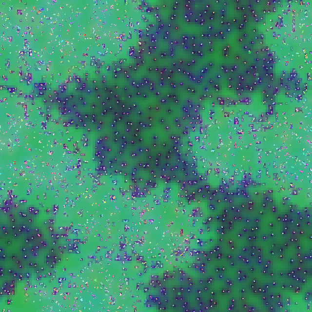
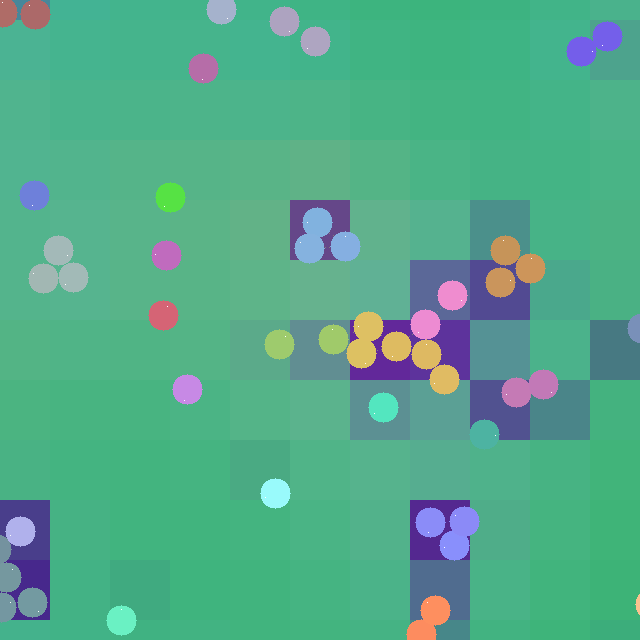

# alife

A neural artificial-life engine in Python on [Apple MLX](https://github.com/ml-explore/mlx).

Agents ("dots") live on a periodic 2-D torus. Each one has its own mutable recurrent neural controller. Agents
sense, signal, move, bond into bodies, split, exert forces, harvest a regenerating resource field, share energy,
fight, reproduce with mutation, and die when their energy runs out. There is no backpropagation and no fitness
function: selection is ecological only. Energy is tracked in exact integer quanta, and a ledger closes bit-exactly
every step.

The whole simulation step is a pure, compiled MLX function on fixed shapes. It targets one Apple-silicon Mac
(Metal GPU, 64k agents at ≥ 30 steps/s), and CI runs on Linux with CPU-only MLX.

The single source of truth for the design (state schema, step pipeline, numeric defaults, RNG streams, tests and
work packages) is [`docs/DESIGN.md`](docs/DESIGN.md).




Frames from `alife render` of a `dev` run at step 600 (CPU, seed 0, float32 weights). Agents are coloured by tag, so
kin share colours. The green resource field is grazed down and tinted by the agents' chemical signals where they
gather (the dark cells). The zoomed frame shows small bonded bodies of kin.

## Quickstart (macOS, Apple silicon)

Requires Python 3.12–3.14 (mlx 0.32 ships no wheels for newer versions) and [uv](https://docs.astral.sh/uv/).
The repository pins 3.12 in `.python-version`, so `uv sync` picks (or downloads) a supported interpreter.

```bash
git clone <this repo> artificial-life && cd artificial-life
uv sync                                   # creates .venv with mlx (Metal) and numpy
uv sync --extra viewer --extra video      # optional: pygame-ce live viewer, bundled ffmpeg for videos
                                          # (a later plain `uv sync` removes the extras again)

uv run alife run --preset tiny --steps 500 --out runs/first
uv run alife resume runs/first --steps 500   # continue bitwise-identically from the latest checkpoint
uv run alife inspect runs/first --check
uv run alife render runs/first --steps 200 --every 2 --out runs/first/media/movie.mp4
uv run alife view --preset dev            # live viewer (needs the `viewer` extra)
```

## CLI overview

| command | what it does |
|---|---|
| `alife run` | create a run directory and simulate (`--preset tiny\|dev\|64k\|256k`, `--overlay fast`, `--set section.key=value`, `--init-from` to fork) |
| `alife resume RUN` | continue a run bitwise-identically from its latest (or a chosen) checkpoint |
| `alife render RUN` | re-simulate from a checkpoint and write a PNG, a video, or a PNG sequence |
| `alife inspect RUN` | config summary, carrying capacity, checkpoints, ledger status, bodies and clades; `--check` runs the full invariant check |
| `alife view` | interactive pygame-ce viewer (pan, zoom, layers, agent picking, snapshots) |
| `alife bench` | throughput, donation health, determinism and brain-variant benchmarks |

Run directories (`runs/<name>/`) hold the resolved `config.json`, `meta.json`, `metrics.jsonl`, safetensors
checkpoints, and birth/death event logs (DESIGN §18).

## Presets

| preset | agents (`n_max`) | world side | use |
|---|---|---|---|
| `tiny` | 1 024 | 128 | tests and CI |
| `dev` | 16 384 | 512 | development |
| `64k` (defaults) | 65 536 | 1 024 | the target configuration |
| `256k` | 262 144 | 2 048 | large runs |

The `fast` overlay (`K = 6`, `C = 12`, `H = 24`) combines with any preset.

## Development and testing on Linux (CPU)

On Linux the `mlx[cpu]` wheel is installed automatically, so the full test suite runs without a GPU:

```bash
uv sync                                   # includes the dev group (pytest, ruff)
uv run ruff check && uv run ruff format --check
uv run pytest -m "not slow"               # the fast suite (< 3 min)
uv run pytest -m slow                     # nightly: long invariant runs and the ecology test
```

Trajectories are deterministic per backend (CPU and Metal differ), but every invariant, including exact ledger
closure, holds on both.

## Layout

```text
src/alife/      config, state, rng, ops (the only scatters), spatial, fields, sensing, brain, actions,
                bonds, physics, energy, lifecycle, step, invariants, metrics, runio, runner, render,
                viewer, bench, cli
src/alife/presets/   tiny, dev, 64k, 256k and the fast overlay (TOML)
tests/          pytest suite (DESIGN §22)
docs/DESIGN.md  the design document
```
