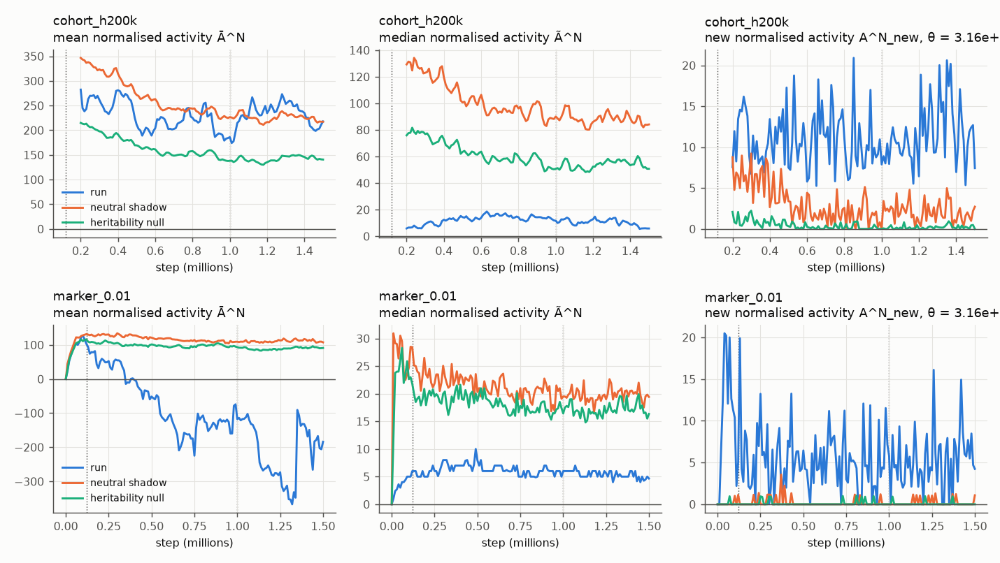
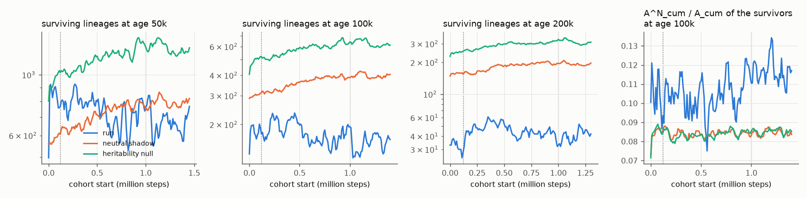
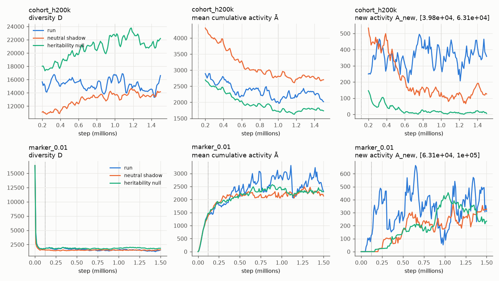
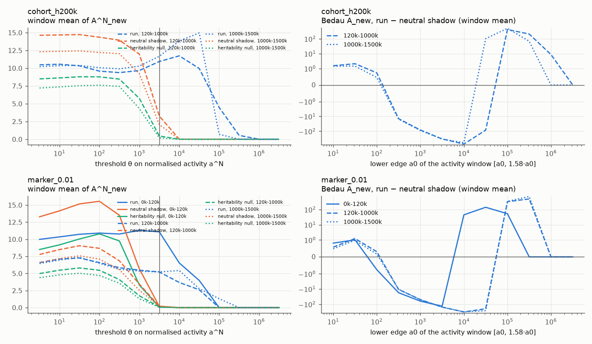
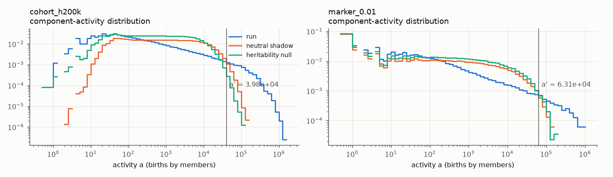

# Evolutionary activity of `runs/64k_s0`

Lineage-based Bedau–Packard statistics for the 64k run (seed 0, 1.504M steps), computed offline from its event
logs with `alife activity` (`src/alife/analysis/`). Written 2026-10-11. This is analysis only: the engine, the
step, the config and the golden digest are unchanged.

## Answer

**The run shows bounded adaptive activity, in every window: 0–120k, 120k–1M and 1M–1.5M.** This is class 2 of
Bedau, Snyder & Packard 1998.

- New lineages with heritable excess reproduction keep appearing at a steady rate.
- Cumulative normalised activity does not grow: lineages are replaced, not accumulated.
- There is no transition at 1M. The rate of new adaptive activity is the same before and after 1M.
- Lineage sorting, measured against a heritability null, is if anything stronger after 1M.

The "stall" in `HANDOVER.md` is therefore a bounded steady state of lineage turnover, not a decline of
selection.

The verdict rests on Channon's component-normalised statistics, which correct a known flaw of Bedau's original
normalisation. It is the same for every component definition, cohort horizon, marker rate, grid spacing, shadow
seed and informative threshold tried. The original Bedau normalisation (subtracting the shadow's population-level
statistics) gives *none*, *bounded* or *unbounded* depending on the activity window. Its "unbounded" verdicts come
from the neutral shadow's own mean activity drifting down, not from the run's mean activity growing. That is
Channon's critique, seen directly; details are in §4.3.

| definition | 0–120k | 120k–1M | 1M–1.5M | whole run |
|---|---|---|---|---|
| cohort subtrees, horizon 100k / 200k / 500k | n/a (pool filling) | bounded | bounded | bounded |
| marker components, rate 0.003 / 0.01 / 0.03 / 0.1 | bounded | bounded | bounded | bounded |
| Bedau's original normalisation, any definition | mixed (see §5) | mixed | mixed | mixed |

The classes are those of the Channon procedure with the primary settings of §3.5. The full table, with the
count of sweep settings giving each class, is in [`activity/classification.txt`](activity/classification.txt).

## 1. Data and coverage

| item | value |
|---|---|
| agents | 43,578,602: 16,384 founders and 43,562,218 logged births |
| deaths logged | 43,544,763; alive at the end 33,839 |
| immigrants | 0 (`immigration_floor = 0`, periodic immigration off) |
| `deaths_unlogged` (metrics counter) | **0**: every death of the run is in the event log |
| event chunks | 151 births and 151 deaths chunks; they tile `[0, 1,504,009)` without gaps |
| cross-checks | births and deaths match the `metrics.jsonl` totals exactly; the alive uids at the final checkpoint are exactly the agents without a death record |
| parent–child gap | ≥ 21 steps; every parent outlives its child's birth step |
| analysed span | `[0, 1,500,000)`; the trailing 4,009 steps (0.27%) are dropped so that every window is 10k steps |

Founders are uids 0–16,383. They are not in the births log; every logged birth has a parent. The loader keeps
three int32 arrays (0.5 GB) and streams the 302 chunks.

**Gap: tags.** A tag-based component definition is not possible from this run's records. Tags are not in the
event log, and only four checkpoints survive (0, 1.49M, 1.50M, 1.504M; `keep_checkpoints = 3`). The verified
re-simulated states of the signal-information session (`analysis_cache/64k_s0/`, 120k to 1M) could support a
snapshot comparison, but not a birth-resolved activity measure. Both definitions here are lineage-based.

## 2. Components

Founder clades are too coarse: 4 remain at the end. Two finer, heritable definitions are used.

1. **Cohort subtrees** (the preferred definition). Every 10k steps (`τ_k`), each agent alive at `τ_k` roots one
   component that holds all its later descendants. Every later birth belongs to exactly one component per
   earlier cohort, like alleles at one locus per cohort. "Alive at `τ_k`" rather than "born in a window"
   guarantees that every later birth has exactly one root.
   - Statistics are kept per cohort, aligned on cohort age (§4.2).
   - For the Bedau statistics, cohorts are pooled over a sliding horizon `H` (100k, 200k, 500k): at time `t` the
     pool holds the cohorts aged `0 < t − τ_k ≤ H`.
   - Pooling all cohorts instead would make `D` and the totals grow with the number of cohorts by construction,
     because each cohort keeps at least one surviving lineage.
   - A pool is classified only from `t ≥ H`, after it has filled. For that reason the cohort pools have no
     0–120k verdict.
2. **Marker components** (paraphyletic, genotype-like). Each birth founds a new component with probability
   `μ`, else joins its parent's. The founding events are a fixed hash of the uid, so every shadow has the same
   ones.
   - This is the genealogy seen through a neutral infinite-alleles marker, the closest analogue of Bedau's
     genotypes, whose components are created continuously.
   - `μ = 0.003, 0.01, 0.03, 0.1` gives about 470, 1,500, 4,000 and 10,000 components present at a time.
     `1/μ` generations sets their lifetime.

Activity `a_i(t)` is the cumulative number of births by members of component `i`, as the task specifies. It is
reset to 0 when `i` goes extinct. Bedau 1998 uses a presence increment instead (`a_i` = the component's age).
That version is computed as a sensitivity check (§5).

## 3. Method

### 3.1 Statistics

These follow Bedau, Snyder & Packard 1998, checked against the paper (eqs. 1–8 and the appendix):

- `D(t)`: the components present at `t`.
- `A_cum = Σ a_i` over the present components; `Ā = A_cum / D`.
- `A_new(t) = (1/D) Σ_{a0 ≤ a_i ≤ a1} a_i` (eq. 7). It is a sum normalised by `D`, over a window `[a0, a1]`.
  - Eq. 8 of the same paper reads it as a count. The count is available (`activity.a_new(count=True)`), but the
    sum is used here.
- Each component's activity is evaluated on a 10k-step grid. The histograms use 10 log bins per decade, so the
  `A_new` window edges snap to those bins.

### 3.2 Shadows

Both shadows are built on the same agents, the same birth steps and the same per-step birth and death counts.
Two replicates of each are used.

- **Neutral shadow** (Bedau 1998). In each step, the logged number of deaths removes uniformly random agents.
  Then each birth picks a uniformly random eligible parent (alive, age ≥ 21). Selection is random by
  construction.
- **Heritability null** (new here). The children born in a step are reassigned at random among that step's
  real parents.
  - Every agent keeps its life span, its offspring count and its reproduction times, so the life history and
    the individual variance in fecundity are exactly the run's.
  - Only the correlation of reproductive success along lineages is destroyed.
  - The neutral shadow also randomises life histories. This matters: at age 20k a cohort keeps about 3,000
    lineages in the run and in this null, but only about 1,700 in the neutral shadow (§4.2).

### 3.3 Normalisations

1. **Bedau 1998:** subtract the shadow's population-level statistic (`A_new`, `Ā`) from the run's.
2. **Channon 2002/2003, component-normalised.** `aN_i = a_i − e_i`, where `e_i` is the expected number of births
   of `i` under the neutral shadow reset to the real state at every grid time.
   - A neutral share is a martingale, so a component expects `B_j · n_i(g_j) / N(g_j)` of window `j`'s births.
     The expectation is computed exactly instead of sampled.
   - Statistics:
     - `A^N_cum = Σ aN_i`;
     - the median `Ã^N`;
     - `A^N_new(θ) = (1/D) Σ aN_i` over the components that first reach `aN ≥ θ` at that grid time (Channon's
       "new").
   - `Σ_i aN_i = 0` over all components, extinct ones included.
   - Channon's critique: Bedau's population-level shadow drifts away from the run, so normalising each component
     against a regularly reset shadow is the corrected test. Channon 2024 states the test as: *unbounded* iff
     `A^N_cum` and `Ã^N` are unbounded and `A^N_new` is persistently positive. This summary of Channon 2024 is
     secondary, from de Pinho & Sinapayen 2026; the paper was not accessible.
   - **The reset interval is a choice.** With a reset every step (`aF`, computed as a diagnostic), only
     fecundity counts and survival does not. With the 10k-step grid, both count within a window. §5 covers the
     grid sensitivity (5k, 10k, 20k).

### 3.4 Thresholds

- **Bedau.**
  - The 1998 rule takes `a'` where the time-collapsed run and shadow distributions cross, and sets
    `[a0, a1] = a' ± 0.05 (a_max − a')`.
  - Here `a_max / a' ≈ 40` (against about 5 in Bedau's example), so the literal window's lower edge falls to 0
    and `A_new` collapses into `Ā`.
  - The primary window is therefore `[a', 1.58 a']`, the same 0.2-decade width as the swept windows. The literal
    window is part of the sweep.
  - Swept: `a0 = 10 … 10^6.5` in half decades, the two crossing windows, both shadows, both increments.
- **Channon.**
  - His `−min(aN)` rule assumes symmetric neutral noise, which holds for presence increments but not for births:
    here it gives θ = 8.6e4 to 3.5e5.
  - Instead, θ is placed so that at most `q` of the neutral shadow's positive normalised activity lies above it
    (the analogue of Channon 2001's window above about 97% of shadow activity). The primary is `q = 5%`, which
    gives θ = 3,162 for both primary spaces. Also swept: `q = 1%, 20%` and every θ from 3 to 3e6.
  - The *informative* sweep keeps the θ where the run has crossings and the shadow's `A^N_new` is at most 20% of
    the run's.

### 3.5 Classification

The 1998 appendix defines its terms asymptotically: `f` is unbounded iff `limsup max f / t > 0`, and positive
iff its time average stays above 0. On a finite window these become trends. Primary values are given here, with
the sweeps in brackets.

- **Positive new activity:**
  - Bedau: the window mean of `A_new` (run − shadow) is above 0.
  - Channon: `A^N_new` is positive in at least 50% (75%) of the window's 50k-step blocks, and its mean is above
    the neutral shadow's.
- **Unbounded:**
  - Bedau, `Ā`: `ρ = slope(Ā_run − Ā_shadow) · D̄ / B̄ > 0.01` (0.003, 0.03), i.e. more than 1% of each step's
    new activity is kept in the mean.
  - Bedau, `D`: fitted growth across the window above 50% (25%, 100%).
  - Channon: `slope(A^N_cum) / B̄ > 0.01` **and** `slope(Ã^N) · D̄ / B̄ > 0.01`, with the same sweep.
- **Classes:** *none* without positive new activity; else *unbounded* if any growth criterion holds (Channon's
  3a/3b/3c split; 3a is the 1998 class 3); else *bounded*.

## 4. Results

### 4.1 Component-normalised activity



Rows: cohort pool `H = 200k` (top) and marker `μ = 0.01` (bottom). Shadows are replicate means.

- **New activity is persistently positive.** Above θ = 3,162:
  - the run adds 10.9–11.7 (cohort pool) and 5.2–11 (marker) units of new normalised activity per component per
    10k steps, positive in every 50k block of every window;
  - the neutral shadow adds 2–3 (cohort) and 0.2 (marker);
  - the heritability null adds 0.2–0.5 and 0.06–0.1.
  - The rate is flat across 120k–1M and 1M–1.5M (cohort 10.9 → 11.7, marker 5.2 → 5.2).
- **Cumulative and median normalised activity do not grow.** In 120k–1M and 1M–1.5M the slopes are, in units of
  the birth rate:
  - `A^N_cum`: −0.04 and −0.02 (cohort), −0.015 and −0.002 (marker);
  - `Ã^N`: at most 0.005 in magnitude.
  - The verdict is therefore **bounded**.
- **Marker `Ā^N` is negative for the run, while both shadows are positive.** The persisting marker components
  have fewer births than their share. In a births-based measure this is the signature of lineages that persist by
  surviving (lower turnover) rather than by out-reproducing. The heritability null, with the same individual life
  spans scattered across lineages, does not show it, so longevity is heritable. Births-based activity
  under-rewards that strategy, which is a caveat on the measure (§6).

### 4.2 Cohort lineage sorting



Surviving lineages per cohort (mean over the cohorts started in each window):

| cohort start | age 50k: run / neutral / null | age 100k | age 200k | run ÷ null at 100k |
|---|---|---|---|---|
| 0–120k | 819 / 580 / 945 | 180 / 300 / 486 | 33 / 157 / 246 | 0.37 |
| 120k–1M | 743 / 715 / 1146 | 180 / 361 / 578 | 46 / 183 / 292 | 0.31 |
| 1M–1.5M | 672 / 790 / 1253 | 155 / 398 / 629 | 41 / 193 / 313 | 0.25 |

- The run keeps 2.7 to 4 times fewer lineages than the heritability null at age 100k, and 6 to 8 times fewer at
  200k.
- Both nulls keep more lineages in later cohorts, because births per step fall from 35 to 27, so fewer
  generations fit in 100k steps. The run's count does not rise with them.
- The share of the survivors' births that is excess over the reset shadow (`A^N_cum / A_cum` at age 100k) is
  0.104–0.117 in the run against 0.084–0.085 in both nulls, and is highest for the cohorts after 1M.
- Selection among lineages did not weaken after 1M.

### 4.3 Bedau's original normalisation





- **The sign of `A_new` (run − shadow) depends on the window** (right column of the threshold figure). The run's
  activity distribution has fewer mid-size components and a much longer tail than either shadow (see the
  distribution figure).
  - Below about 100, run − shadow is positive.
  - From about 300 to 10^4.5, it is negative.
  - From 10^5 to 10^6, it is positive.
  - With the literal 1998 window, the primary class is *none* nearly everywhere. With `[a', 1.58 a']` it is mostly
    *unbounded (3b)*.
- **The "unbounded" verdicts come from the shadow.** For cohort pools in 120k–1M, `ρ = 0.56` splits into
  `ρ_run = −0.43` and `ρ_shadow = −0.99`: the neutral shadow's `Ā` falls faster than the run's.
  - In 1M–1.5M the run's own `Ā` trend is small (cohort `ρ_run = 0.12`; marker 0.01: −0.005; marker 0.03:
    0.016).
  - For markers in 0–120k, both run and shadow `Ā` rise from 0 as the first components accumulate (`ρ_run ≈
    ρ_shadow ≈ 0.8`). That is a start-up transient.
- **The sweep counts show the instability** (none / bounded / unbounded over all swept settings):
  - cohort pool 200k, 1M–1.5M: 126 / 66 / 114;
  - marker 0.01, 120k–1M: 225 / 99 / 108.
- With presence increments, the Bedau classes are mostly none or bounded (for example, cohort pool 200k over the
  whole run: 18 / 27 / 0 for each shadow).



## 5. Sensitivity

| varied | values | Channon class | Bedau class |
|---|---|---|---|
| component definition | cohort pools (H = 100k, 200k, 500k); marker (μ = 0.003, 0.01, 0.03, 0.1) | bounded in every valid cell | mixed |
| grid / reset interval | 5k, 10k, 20k steps | bounded in every cell; `A^N_new` grows with the interval, and the neutral shadow's stays below it | mixed |
| shadow seed | 0, 7 (two replicates each) | identical classes | identical classes |
| Channon θ | informative sweep: the θ where the run crosses and the shadow mostly does not | bounded or none (none where crossings become rare at large θ), never unbounded | n/a |
| Channon θ | full sweep, 3 to 3e6 | none at small θ (the shadow crosses as often as the run) and at very large θ (no crossings); bounded between; never unbounded | n/a |
| ρ0, persistence | 0.003–0.03; 50%, 75% | never unbounded: the two growth criteria never hold together, and the `Ã^N` slope is below 0.006 in every cell after 120k | ρ0 moves cells between bounded and unbounded |
| Bedau window, shadow, increment | 14 windows × 2 shadows × 2 increments | n/a | all three classes in every window |

Two threshold artefacts in the sense of Schaeffer et al. (NeurIPS 2023) appear only with Bedau's normalisation:

- the literal versus the narrow crossing window flips *none* to *unbounded*;
- the `A_new` sign changes twice along `a0`.

The component-normalised verdict does not move under any swept setting.

## 6. Caveats

- **Finite windows.** "Bounded" means no detectable growth of `A^N_cum` or `Ã^N` within a window of 0.5–0.9M
  steps, about 450–800 generations. A very slow growth below ρ = 0.003 cannot be excluded.
- **Births as activity** reward fecundity and within-window survival, but not long-run longevity (§4.1). A
  presence-increment version of the normalised test (Channon's original) needs a sampled reset shadow and is not
  implemented.
- **The heritability null counts all inherited success as heritable, ecological inheritance included.** Children
  are born next to their parent and may inherit a good patch. Genetic and spatial inheritance cannot be separated
  without genome or position data per birth.
- **The neutral shadow** ignores the run's age structure (`max_age`, starvation of the young); it enforces only
  the minimum parent age. That is why the heritability null is the better reference for cohort survival.
- **Forks** are read since the director evaluation (`docs/EVALUATION.md`, DESIGN Review-log I40): the founders
  are the agents alive in the fork's first checkpoint, and `--start STEP` does the same from any step of a run
  from step 0. The results above, from step 0, are unchanged by it.
- **The 0–120k window** is affected by the start-up boom (1,024 births per step at first) and by the founders.
  The cohort pools are not yet filled; the marker verdict for it is bounded.

## 7. Reproduce

```bash
uv sync --extra analysis
```

```bash
uv run alife activity runs/64k_s0
```

```bash
uv run alife activity runs/64k_s0 --grid 20000 --out /tmp/act20k --no-plots
```

- The default writes `runs/64k_s0/activity/`: `activity.npz` (all series, about 7 MB), `summary.json`,
  `classification.txt` and the figures.
- `--reuse` recomputes only the summary and the figures.
- The run's files are not modified.
- One full run (the run, two neutral shadows, two heritability nulls) takes about 3 minutes on the M5 Pro and
  peaks at 8 GB RSS.
- Tests: `tests/test_analysis_activity.py`, with a hand-built tree with known answers, a neutral population that
  matches its shadow, a selective population that does not, and a loader test on a synthetic run directory.

## References

- Bedau, Snyder & Packard 1998, *A classification of long-term evolutionary dynamics*, ALife VI: definitions,
  neutral shadow, crossing threshold, classes. Primary text read.
- Rechtsteiner & Bedau 1999, GECCO: excess normalisation. Primary text read.
- Channon 2001, ECAL; Channon 2002/2003, ALife VIII: component normalisation and the reset shadow. Primary texts
  read.
- Channon, Bedau, Packard & Taylor 2024, *Artificial Life* 30(3) editorial. Channon 2024's procedure is known
  only through de Pinho & Sinapayen 2026 (arXiv 2603.01701).
- Schaeffer, Miranda & Koyejo 2023, NeurIPS: threshold artefacts.
