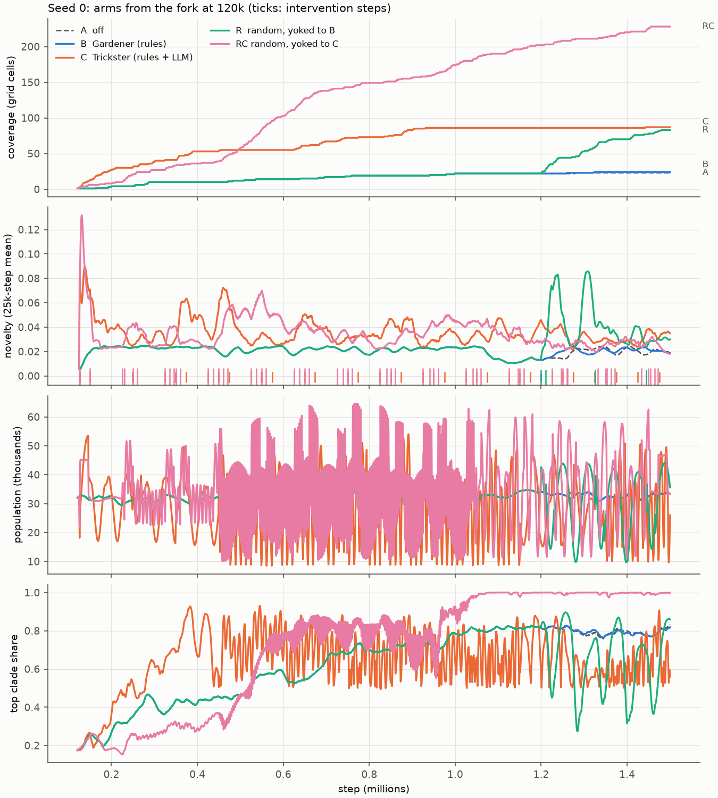
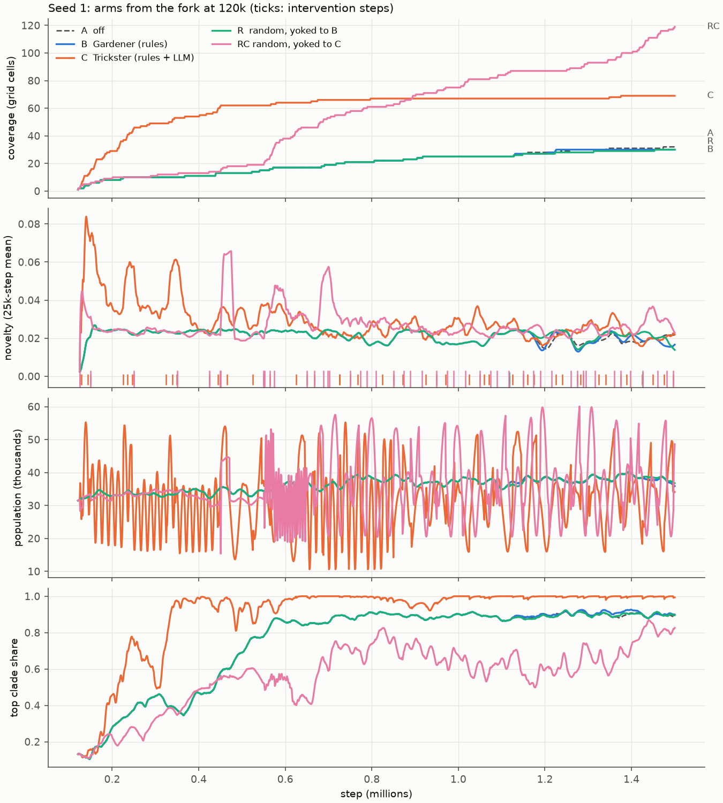
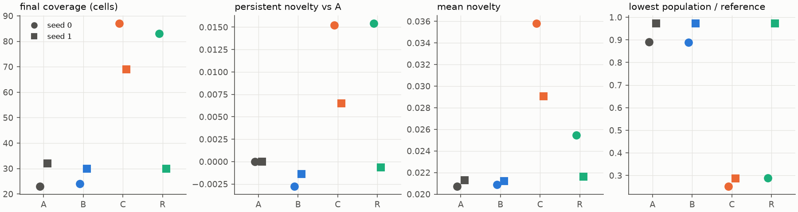

# Director evaluation (`DIRECTOR.md` §9)

Status: **draft** (2026-10-15). Arms A, B, C and R are finished and analysed on both seeds, RC on seed 0; s1_RC is
running (resumed from step 460,730, §1.4), and the legibility ratings are with the owner. Sections that wait for them say so.

## Answer

- **Criterion 1 fails.** On neither seed does the rule-tier Gardener (B) beat the control (A) or the yoked random
  director (R) on both coverage and persistent novelty. The Gardener acted once (seed 0) and twice (seed 1) in 1.38M
  steps, so B is almost A. There was no population collapse.
- **Criterion 2 passes as specified.** The LLM Trickster (C) beats B on coverage and persistent novelty on both seeds:
  87 and 69 cells against 24 and 30, and its novelty stays above A's 100k steps after its interventions. The
  legibility rating was therefore not needed for the verdict.
- **The coverage and novelty metrics mostly measure forced population oscillation, not heritable novelty.** On seed
  0, R's single random move (permanent seasons at step 1,199,000) took coverage from 22 to 83 cells in 300k steps and
  matched C's persistent novelty. C's own gains come mostly from the permanent seasons the model set. Read on
  Bedau–Packard evolutionary activity, every arm on both seeds is **bounded**, director or not. C has 2.4–5 times the
  rate of new adaptive activity in the cohort space, and neither the neutral shadow nor the heritability null comes
  close.
- **Random moves at C's steps and budget (RC) do at least as well as the LLM on the §9 metrics** (seed 0; seed 1
  pending): 228 cells against C's 87, and the same persistent novelty (+0.0157 against +0.0152). The LLM's choices
  show only in the evolutionary activity and the clades: C keeps a high rate of new adaptive activity to the end
  (27.6 against RC's 10.5 in 1M–1.5M) and three clades, while RC ends in one lineage at 100%.
- **C pays in viability.** Its population fell to 25% and 29% of the reference, was "at risk" in about 60% of rule
  windows, and needed 34 and 38 extinction rescues. The rescue rule cannot tell a seasonal trough from a crash. The
  rescues used up the budget, so the model answered "none" in 36 and 37 of its 56 calls.

## 1. Setup

Every arm forks the same 120,000-step state of its seed and runs to step 1,500,000 (1.38M steps), so within a seed
the director is the only difference. The arms ran one at a time on the M5 Pro (Metal), from the queue in
`runs/eval_queue/` (its README holds the controls).

| arm | director | seed 0 run | seed 1 run |
|---|---|---|---|
| A | off | `runs/64k_s0`, steps 120k–1.5M (not re-run, §1.1) | `runs/eval_s1_A` |
| B | rule tier, Gardener | `runs/eval_s0_B` | `runs/eval_s1_B` |
| C | rule tier + LLM every 25k, Trickster | `runs/eval_s0_C` | `runs/eval_s1_C` |
| R | `random`, yoked to B | `runs/eval_s0_R` | `runs/eval_s1_R` |
| RC | `random`, yoked to C, with C's pacing and budget (PR #14) | `runs/eval_s0_RC` | `runs/eval_s1_RC` |
| D | not run (§1.5) | | |

### 1.1 Fork sources

- **Seed 0:** `runs/eval_bases/s0_step_0000120000.safetensors`, byte-identical to
  `analysis_cache/64k_s0/step_0000120000.safetensors` (sha256 `8dd42c57c868ba45…`), the re-simulated state of
  `runs/64k_s0` at 120,000 verified against all 1,200 metrics rows (`docs/SIGNALS.md` §3).
- **Seed 1:** `runs/eval_s1_base`, a fresh `alife run --preset 64k --seed 1 --steps 120000`, forked at its checkpoint
  `runs/eval_s1_base:120000`.
- **Arm A of seed 0 is `runs/64k_s0` itself.** A fork with the director off would repeat it: arm B's metrics rows
  equal `64k_s0`'s on every one of the 10,790 rows before B's first action (1,199,000), wall-clock fields aside, with
  one exception, `diag`: `64k_s0` carries the sticky warning bit `CELL_OVERFLOW_WARN` (65536) from before 120k,
  which the fork cleared. Every arm is analysed up to step 1,500,000; `64k_s0` itself ran on to 1,504,009.

### 1.2 Commands and code

Common flags: `--steps 1380000 --set run.checkpoint_every=50000 --set run.keep_checkpoints=40`. `S0` is the seed-0
fork file above, `S1` is `runs/eval_s1_base:120000`.

| arm | command (after `alife run --init-from S0|S1 ... --out runs/eval_s<seed>_<arm>`) | code |
|---|---|---|
| A (seed 1) | (no director flags) | a154d45 |
| B | `--director live --persona gardener` | a154d45 |
| C | `--director live --persona trickster --llm` (model `gemma-4-26b-a4b-it-mlx@8bit`, LM Studio, loaded with `lms load ... -c 8192 --gpu max`, checked with `alife llm-check` before each C arm) | a154d45 |
| R | `--director live --persona random --yoke-log runs/eval_s<seed>_B/director.jsonl` | 0071863 (PR #11) |
| RC | `--director live --persona random --yoke-log runs/eval_s<seed>_C/director.jsonl` | b849ba9 (PR #14; `src/` and `tests/` identical to its merge afe52f5) |

- The checkouts share the engine. The R checkout's engine was reported digest-identical to a154d45 when the queue was
  set up, and PR #14 changes only how R picks its pacing parameters (its tests show a Gardener-yoked R is
  byte-identical). Arm A of seed 0 is the earlier run `runs/64k_s0` (created at `f09b32a`, resumed at 120k with the
fertility change of DESIGN Review-log I26 and later commits, before the director existed); §1.1 shows its
director-off trajectory equals the fork's.
- `rule_every` is the default 1,000 in every arm, and `budget_per_100k` the persona's default (Gardener 2, Trickster
  6). R takes the Gardener's pacing; RC takes the Trickster's and budget 6 from C's log header.
- Each arm ended with `alife inspect RUN --check` (the full invariant and ledger check), which passed. The energy
  ledger was checked every step.

Wall time of the simulated steps (the rows' `wall_s`, excluding start-up and checkpoint writes), in hours:

| arm | seed 0 | seed 1 |
|---|---|---|
| A | 6.14 | 6.41 |
| B | 6.24 | 6.69 |
| C | 6.59 | 6.80 |
| R | 6.66 | 6.53 |
| RC | 6.67 | pending |

### 1.3 Smoke runs

The queue was started on 2026-10-12, before this evaluation was specified with smoke runs, so A, B and C ran without a
2,000-step smoke run; each ran with the ledger checked every step and passed `inspect --check` at the end. For R, a
2,000-step smoke run from the seed-0 fork with the R code and flags was made before the R arms started (2026-10-13):
the ledger closed (`full_check: OK`), `director.jsonl` was written with the yoke path and sha256 in its header, the
yoke parser read one yoked move at step 1,199,000 from `runs/eval_s0_B/director.jsonl` (B's single discretionary
entry), and its 20 metrics rows equal B's.

### 1.4 Interruptions

At the owner's request the queue was paused twice, each time with one SIGINT and a `STOP` file, and resumed from the
checkpoint with `alife resume`:
- s0_R at step 792,173 (2026-10-14 01:02, resumed 22:41). Its only yoked move is at 1,199,000, after the resume.
- s0_RC at step 1,255,491 (2026-10-15 14:20, resumed 16:52).
- s1_RC at step 460,730 (2026-10-15 19:42, resumed 20:12).

Known effects of a live resume:
- a resume that splits a 1,000-step rule window may decide the safety rules differently from an uninterrupted run
  (`HANDOVER.md`, director caveats); `director.jsonl` is the record either way. R's yoked draws depend only on the
  seed, the step and the log's budget and cooldowns, not on the vital signs;
- `Director._blocked` is not persisted, so a rule still blocked across the resume is journalled again in
  `journal.jsonl` (found by the 3D session; a fix is deferred). The evaluation reads no rule-tier journal of R or RC.

### 1.5 Arm D

Not run. The 3D session found that no part of the 3D plan depends on it, that 2D bodies do not transfer to 3D (gravity,
bond sag), and that the goal "bodies ≥ 100" is within noise of the undirected baseline (largest body about 90 at 64k),
so even a positive result would be hard to read. A goal-directed bodies experiment is planned in 3D after its PR 6.
Owner decision (2026-10-13): deferred, to keep the GPU free. It may still be run later, with a goal measurably
above the baseline (for example largest body ≥ 200).

## 2. Metrics

All metrics are computed by `python -m alife.analysis.evaluation` (`src/alife/analysis/evaluation.py`, tests in
`tests/test_analysis_evaluation.py`) from each arm's `metrics.jsonl`, `director.jsonl`, `journal.jsonl` and event logs.
The full output is in [`evaluation/`](evaluation/): `evaluation.json` (every number below and more), `table.md`,
`series.npz` (the per-boundary series) and the figures.

- **The director's own vital signs are recomputed for every arm**, the control included, with the director's code
  (`Tracker`, default `RuleParams`, a 1,000-step rule window), each arm's archive starting empty at the fork. The
  recomputation equals the vital signs the live directors logged with every one of their entries (novelty, coverage,
  `fall` and `b_shift`: 1, 2, 108, 109, 10 and 3 entries checked for B, C and R on seeds 0 and 1; no mismatch).
- **Coverage:** grid cells (10 × 10 × 10 over the fraction of emitters, the fraction in bodies ≥ 4, and the predation
  ratio) ever visited, and the cells the control never visited.
- **Novelty:** the director's novelty, the mean RMS distance of the window's ten-component behaviour descriptor to its
  5 nearest archive members, averaged over the arm. **Excursion:** the same distance to every descriptor of the
  seed's control arm, which does not depend on the arm's own archive.
- **Persistent novelty** (§9: novelty still above the baseline 100k steps after an intervention). For each
  intervention step `s` (any applied entry but a revert) whose window ends by 1.5M:
  - *vs A* (primary): the arm's mean novelty over `(s + 100k, s + 150k]` minus the control's over the same steps.
    It is 0 for A by construction;
  - *vs before*: the same window minus the arm's own mean over `(s − 50k, s]`.
- **Turnover:** `b_shift`, the RMS distance between the descriptor now and 100k steps earlier, and archive
  additions per 100k steps.
- **Viability:** the lowest population, its ratio to a fixed per-seed reference (the base run's mean population over
  steps 70k–120k: 33,071 for seed 0, 32,164 for seed 1), **collapse** = a minimum below 20% of the reference, the share
  of rule windows "at risk" (the director's `fall` above 0.3, a fall of more than 30% within 50k steps), and the
  extinction rescues (events; each is a regen pulse plus an immigration pulse).
- **Clades:** `clades_alive`, `top_clade_share` (all immigrants share one clade id, so immigration adds at most one
  clade). **Lineages** (event logs): the fork founders' lineages still alive at 1.5M, the immigrant-descended share of
  the population, and the generations gained since the fork (mean generation of founder-descended births in the last
  50k steps minus the first 10k).
- **Interventions:** counts by action, source and rule, distinct actions, the entropy of the discretionary action
  mix, and the budget cost per 100k steps.
- **LLM:** JSON validity (replies that parsed and passed the schema, over the replies that arrived), the clamp rate
  (clamped parameters per accepted proposal), rejections, fallbacks and latency.
- **Evolutionary activity:** `alife activity RUN --start 120000` (the fork step; for a fork it is the default) with
  the windows 120k–1M and 1M–1.5M, written to `analysis_cache/eval/s<seed>_<arm>/`. `alife activity` now reads forks:
  the founders are the agents alive at the fork step. On `runs/64k_s0` from step 0 the change reproduces
  `docs/ACTIVITY.md` exactly (all 820 arrays). Classes and the primary settings are Channon's, as in
  `docs/ACTIVITY.md`; the rates are `A^N_new` above θ = 3,162 (new normalised activity per component per 10k steps).

## 3. Results







### 3.1 The §9 criteria metrics

| arm | seed | coverage | cells not in A | PN vs A | PN anchors | PN vs before | novelty (mean) | pop min / ref | collapse |
|---|---|---|---|---|---|---|---|---|---|
| A | 0 | 23 | 0 | +0.0000 | 0 | – | 0.0207 | 0.89 | False |
| A | 1 | 32 | 0 | +0.0000 | 0 | – | 0.0213 | 0.97 | False |
| B | 0 | 24 | 1 | -0.0028 | 1 | +0.0065 | 0.0209 | 0.89 | False |
| B | 1 | 30 | 0 | -0.0014 | 1 | -0.0035 | 0.0212 | 0.97 | False |
| R | 0 | 83 | 60 | +0.0154 | 3 | +0.0053 | 0.0255 | 0.29 | False |
| R | 1 | 30 | 0 | -0.0007 | 1 | -0.0028 | 0.0216 | 0.97 | False |
| C | 0 | 87 | 83 | +0.0152 | 41 | -0.0002 | 0.0358 | 0.25 | False |
| C | 1 | 69 | 62 | +0.0065 | 47 | -0.0030 | 0.0291 | 0.29 | False |
| RC | 0 | 228 | 212 | +0.0157 | 52 | +0.0021 | 0.0343 | 0.29 | False |
| RC | 1 | pending | | | | | | | |

- **B is almost A.** The Gardener's only rule that fired was the stagnation response, with an immigration pulse:
  646 agents at 1,199,000 (seed 0), 700 at 1,118,000 and 728 at 1,426,000 (seed 1). Its trajectory is A's until then.
  Its second seed-1 move is too late to be scored (its window would end after 1.5M). After its moves, B ends 1 cell
  above A on seed 0 and 2 cells below on seed 1, and its novelty 100k steps later is below A's on both.
- **R decides the B comparison by its draws.** R makes B's moves at B's steps with uniformly random actions. On seed
  0 its one draw was `set_seasons` with period 58,876 and amplitude 0.87, which is permanent; coverage then went
  22 → 44 within 51k steps and 83 by 1.5M (A: 23). On seed 1 its two draws (patch 1 off for 37k steps, a patch move)
  changed almost nothing.
- **C** is above A in novelty 100k steps after all 41 (seed 0) and 42 of 47 (seed 1) of its interventions, and
  reaches 83 and 62 cells A never visits. Measured against its own level before each intervention, the effect is
  about zero (−0.0002 and −0.0030): C keeps the world in a permanently perturbed state rather than lifting novelty
  step by step. Its novelty falls over the run (0.042 → 0.033 on seed 0, 0.040 → 0.024 on seed 1, by block) and is
  close to A's on seed 1 after about 600k.

**Why coverage moves with seasons.** The grid's three axes are population-level fractions (emitters, bodies ≥ 4,
predation ratio), and all three swing with the boom and bust of a seasonal population. A strong permanent season
therefore sweeps the descriptor through many cells within a few periods. That is what R's one move did on seed 0,
and it is most of what C did. C set seasons in its first call on both seeds (period 45k or 15k, amplitude 0.6) and
changed them three more times on each seed, alternating long and short periods (12k–15k at amplitude 0.8–0.85).
Coverage and novelty are the director's own definitions (`DIRECTOR.md` §4); they reward any forced oscillation of
the population, whether or not anything heritable changes.

### 3.2 Evolutionary activity (Bedau–Packard, Channon's normalisation)

Rate of new normalised activity, `A^N_new` per component per 10k steps:

| arm | seed | cohort 120k–1M | cohort 1M–1.5M | marker 120k–1M | marker 1M–1.5M |
|---|---|---|---|---|---|
| A | 0 | 10.8 | 11.7 | 4.4 | 4.6 |
| A | 1 | 6.8 | 4.6 | 3.0 | 1.9 |
| B | 0 | 10.8 | 11.0 | 4.4 | 4.3 |
| B | 1 | 6.8 | 3.7 | 3.0 | 1.6 |
| R | 0 | 10.8 | 13.7 | 4.4 | 5.0 |
| R | 1 | 7.2 | 6.2 | 3.0 | 2.0 |
| C | 0 | 27.2 | 27.6 | 9.7 | 13.7 |
| C | 1 | 27.7 | 15.8 | 8.2 | 4.5 |
| RC | 0 | 20.9 | 10.5 | 6.2 | 4.5 |
| RC | 1 | pending | | | |

Against the two nulls (whole span, 120k–1.5M):

| arm | seed | cohort run | cohort neutral shadow | cohort heritability null | marker run | marker neutral shadow | marker heritability null |
|---|---|---|---|---|---|---|---|
| A | 0 | 11.15 | 2.15 | 0.25 | 4.49 | 0.18 | 0.03 |
| A | 1 | 5.86 | 0.05 | 0.00 | 2.59 | 0.25 | 0.00 |
| B | 0 | 10.88 | 2.21 | 0.29 | 4.39 | 0.19 | 0.07 |
| B | 1 | 5.48 | 0.03 | 0.00 | 2.48 | 0.20 | 0.01 |
| R | 0 | 12.02 | 2.13 | 0.30 | 4.63 | 0.23 | 0.06 |
| R | 1 | 6.75 | 3.90 | 0.32 | 2.63 | 0.23 | 0.00 |
| C | 0 | 27.39 | 0.17 | 0.00 | 11.12 | 0.44 | 0.35 |
| C | 1 | 22.63 | 0.03 | 0.00 | 6.89 | 0.32 | 0.13 |
| RC | 0 | 16.46 | 0.21 | 0.01 | 5.61 | 0.50 | 0.19 |

- **Every arm is bounded** over the whole span, in every component space (cohort pools with horizons 100k, 200k and
  500k; marker components at rates 0.003 to 0.1), on both seeds. New adaptive lineages keep arising and nothing
  accumulates, as in `docs/ACTIVITY.md`.
- **One exception, not robust: RC on seed 0, 120k–1M**, is classified unbounded in the cohort pools with horizons
  100k and 200k (12 of 24 informative settings in each), and bounded with horizon 500k and in all four marker spaces.
  It is the only window of the 189 analysed (9 arms × 7 spaces × 3 windows) where any setting gives unbounded. It
  coincides with a selective sweep: RC's top clade rose from 0.27 to 0.99 over 500k–1M, while one cohort lineage's
  normalised activity grew with it. In 1M–1.5M its cumulative normalised activity falls the most steeply of any arm
  (ρ = −0.16, cohort 200k). A sweep to monoculture is growth that ends; `docs/ACTIVITY.md` counts a class only when
  it holds across the component definitions.
- **C sorts lineages faster.** Its rate is 2.4 to 5 times A's in the cohort space, the neutral shadow and the
  heritability null are near zero, and cohort components cannot contain immigrant lineages, so the excess is not
  immigration or drift. The likely cause is selection through the repeated bottlenecks (the crashes). R on seed 0,
  with one season, shows a much smaller rise in 1M–1.5M (13.7 against A's 11.7). Whether random perturbation at C's
  pace and budget does the same as C is the RC question (pending).
- On seed 1, C's rate halves in 1M–1.5M (27.7 → 15.8), as its top clade reaches 99% (§3.4).

### 3.3 Viability

| arm | seed | pop mean | pop min | at step | windows at risk | rescues | immigrants |
|---|---|---|---|---|---|---|---|
| A | 0 | 32,519 | 29,459 | 222,000 | 0% | 0 | 0 |
| A | 1 | 36,202 | 31,276 | 121,000 | 0% | 0 | 0 |
| B | 0 | 32,501 | 29,404 | 222,000 | 0% | 0 | 646 |
| B | 1 | 36,179 | 31,276 | 121,000 | 0% | 0 | 1,428 |
| R | 0 | 32,054 | 9,576 | 1,399,000 | 9% | 3 | 3,072 |
| R | 1 | 36,200 | 31,276 | 121,000 | 0% | 0 | 0 |
| C | 0 | 28,954 | 8,329 | 562,000 | 65% | 34 | 39,470 |
| C | 1 | 31,573 | 9,201 | 747,000 | 59% | 38 | 44,778 |
| RC | 0 | 34,653 | 9,632 | 458,000 | 74% | 47 | 45,232 |

- No arm collapsed (minimum below 20% of the reference) or went extinct. C's and R's (seed 0) lowest points are 25–29%
  of the reference.
- **The extinction rescue fires on seasonal troughs.** Its risk flag is a fall of more than 30% within 50k steps, and
  a season of amplitude 0.6–0.87 produces such a fall every period. C needed a rescue (regen ×1.5 for 20k steps plus
  up to 1,024 immigrants) about every 40k steps; R on seed 0 needed three after its one season. The rescue boosts the
  next boom, and its budget charge crowds out the model (§3.6). This is a defect of the rule tier, not of the
  persona: the flag is not season-aware.

### 3.4 Clades and lineages

| arm | seed | clades at 1.5M | top clade share | fork lineages alive | immigrant-descended | generations gained |
|---|---|---|---|---|---|---|
| A | 0 | 4 | 0.83 | 4 | 0.00000 | 896 |
| A | 1 | 3 | 0.89 | 3 | 0.00000 | 1419 |
| B | 0 | 4 | 0.82 | 4 | 0.00000 | 922 |
| B | 1 | 3 | 0.90 | 3 | 0.00000 | 1409 |
| R | 0 | 4 | 0.86 | 4 | 0.00000 | 947 |
| R | 1 | 3 | 0.90 | 3 | 0.00000 | 1384 |
| C | 0 | 3 | 0.56 | 2 | 0.00004 | 882 |
| C | 1 | 2 | 0.99 | 1 | 0.00654 | 940 |
| RC | 0 | 2 | 1.00 | 1 | 0.00108 | 746 |

- Every arm coalesces: of about 31,500 lineages alive at the fork, 1 to 4 have descendants at 1.5M.
- C does not prevent monoculture. On seed 0 its top clade ends at 0.56 (A 0.83), but on seed 1 it passes 0.95 by
  about 600k and ends at 0.99, with one fork lineage left (A 0.89, three lineages).
- **Immigrants rarely establish.** On seed 0, 25,310 of C's 39,470 immigrants had at least one child and 60,252
  immigrant descendants were born, yet 1 agent of 26,349 descends from an immigrant at 1.5M; on seed 1, 0.65%. Random
  founders lose to the resident, adapted lineages, so an immigration pulse injects no lasting genetic novelty.
- Generations gained since the fork are similar across arms of a seed; C's crashes do not speed up generations.

### 3.5 Turnover and interventions

| arm | seed | excursion from A | b shift | archive adds / 100k | novelty 120k–500k | 500k–1M | 1M–1.5M |
|---|---|---|---|---|---|---|---|
| A | 0 | – | 0.037 | 10.7 | 0.0225 | 0.0218 | 0.0183 |
| A | 1 | – | 0.042 | 11.6 | 0.0234 | 0.0212 | 0.0199 |
| B | 0 | 0.005 | 0.039 | 11.0 | 0.0225 | 0.0218 | 0.0187 |
| B | 1 | 0.004 | 0.042 | 11.7 | 0.0234 | 0.0212 | 0.0196 |
| R | 0 | 0.028 | 0.075 | 26.3 | 0.0225 | 0.0218 | 0.0313 |
| R | 1 | 0.004 | 0.042 | 11.7 | 0.0234 | 0.0212 | 0.0207 |
| C | 0 | 0.161 | 0.189 | 76.3 | 0.0423 | 0.0341 | 0.0326 |
| C | 1 | 0.135 | 0.142 | 52.8 | 0.0397 | 0.0266 | 0.0236 |
| RC | 0 | 0.121 | 0.167 | 65.4 | 0.0346 | 0.0387 | 0.0296 |

| arm | seed | applied | discretionary | safety | distinct (disc.) | entropy (bits) | cost / 100k |
|---|---|---|---|---|---|---|---|
| A | 0 | 0 | 0 | 0 | 0 | 0.00 | 0.00 |
| A | 1 | 0 | 0 | 0 | 0 | 0.00 | 0.00 |
| B | 0 | 1 | 1 | 0 | 1 | 0.00 | 0.07 |
| B | 1 | 2 | 2 | 0 | 1 | 0.00 | 0.14 |
| R | 0 | 7 | 1 | 6 | 1 | 0.00 | 0.51 |
| R | 1 | 2 | 2 | 0 | 2 | 1.00 | 0.22 |
| C | 0 | 83 | 27 | 56 | 6 | 2.30 | 6.16 |
| C | 1 | 82 | 22 | 60 | 5 | 1.93 | 6.16 |
| RC | 0 | 84 | 15 | 69 | 6 | 2.28 | 6.16 |

"Applied" counts log entries other than reverts; a rescue is two entries. C's discretionary moves: seed 0, drift ×9,
immigration ×7, fertility gain ×4, seasons ×4, habitat loss ×2, regen ×1; seed 1, immigration ×11, seasons ×4, drift
×3, habitat loss ×3, fertility gain ×1. The model alternates between two settings of a lever (drift ×4 and ×0.5–0.6;
season periods of 45k and 12k–15k) rather than exploring the menu. It never chose a catastrophe.

### 3.6 The LLM tier (arm C)

| | seed 0 | seed 1 |
|---|---|---|
| calls (one per 25k steps) | 56 | 56 |
| replies that arrived | 56 | 55 (one connection refused at 475k: the server was unreachable; the rule tier took that boundary) |
| JSON validity (of replies) | 100% | 100% |
| outcome ok / none | 20 / 36 | 18 / 37 |
| proposals accepted / rejected | 27 / 1 | 22 / 6 (all rejections: budget used up) |
| clamped parameters | 0 | 0 |
| latency median / p90 / max (s) | 3.6 / 5.5 / 6.0 | 4.4 / 7.2 / 18.1 (the call after the outage: a cold model load) |
| prompt tokens (median) | 2,482 | 2,469 |

The model chose "none" in about two thirds of its calls, and its journal usually gives the reason: the budget was used
up, mostly by the rescues (§3.3). The C arms are therefore less "LLM-directed" than their call count suggests: 27 and
22 accepted moves in 1.38M steps.

### 3.7 C against RC (random moves at C's steps, with C's pacing and budget)

RC (`DIRECTOR.md` §15, PR #14) makes, at each step where C's log has discretionary entries, as many uniformly random
eligible moves, under the Trickster's budget (6), cooldowns and safety rules. It isolates the quality of C's choices
from the amount and timing of perturbation. Seed 1 is pending.

| seed 0 | C (LLM) | RC (random) |
|---|---|---|
| coverage (cells not in A) | 87 (83) | 228 (212) |
| persistent novelty vs A (anchors, share above A) | +0.0152 (41, 100%) | +0.0157 (52, 100%) |
| mean novelty | 0.0358 | 0.0343 |
| discretionary moves made | 27 | 15 |
| extinction rescues; windows at risk | 34; 65% | 47; 74% |
| lowest population / reference | 0.25 | 0.29 |
| top clade at 1.5M; fork lineages alive | 0.56; 2 | 1.00; 1 |
| new activity, cohort 120k–1M / 1M–1.5M | 27.2 / 27.6 | 20.9 / 10.5 |
| new activity, marker 120k–1M / 1M–1.5M | 9.7 / 13.7 | 6.2 / 4.5 |

- **On the §9 metrics, random choice does as well as the model, or better.** RC made fewer moves (its budget went
  to rescues even faster), yet covered 2.6 times as many cells. One of its draws was a season of period 3,056 and
  amplitude 0.83 (from step 450k), whose fast cycles sweep the descriptor through the grid. Persistent novelty is the
  same.
- **The model's choices show in the evolutionary activity and the clades.** C sustains a high rate of new adaptive
  activity to the end, where RC's falls by half after 1M, and C keeps two fork lineages and a top clade of 0.56 where
  RC ends with one lineage at 100%. On seed 1, though, C itself ends at 0.99 (§3.4), so this difference needs seed 1's
  RC before it counts.

### 3.8 Journal legibility (owner ratings)

The sheet is [`evaluation/legibility_sheet.md`](evaluation/legibility_sheet.md): 10 LLM journal entries of arm C, 5 per
seed, drawn uniformly without replacement (`journal_sample`, seed 0), each with the population and novelty the
director saw, and B's rule-tier lines for comparison. Rated by the owner, 1 (opaque or wrong) to 5 (clear and accurate).

| entry | 1 | 2 | 3 | 4 | 5 | 6 | 7 | 8 | 9 | 10 | mean |
|---|---|---|---|---|---|---|---|---|---|---|---|
| rating | pending | pending | pending | pending | pending | pending | pending | pending | pending | pending | – |

The numbers the model quotes can be checked against the sheet's context columns (for example, entry 1 quotes the
population 21,135 that the director saw at step 475,000).

## 4. Verdict

**Criterion 1: "B beats both A and R on coverage and persistent novelty, on every seed, with no population
collapse." Fails.**

| seed | coverage B vs A, R | persistent novelty B vs A, R | collapse |
|---|---|---|---|
| 0 | 24 vs 23, 83: beats A, loses to R | −0.0028 vs 0, +0.0154: loses to both | no |
| 1 | 30 vs 32, 30: loses to A, ties R | −0.0014 vs 0, −0.0007: loses to both | no |

The Gardener under rules version 1 almost never acts (1 and 2 interventions), so it is close to the undirected world.

**Criterion 2: "C beats B on those metrics, or matches B with better journal legibility." Passes as specified, on
both seeds.** Coverage 87 vs 24 and 69 vs 30; persistent novelty vs A +0.0152 vs −0.0028 and +0.0065 vs −0.0014.
Legibility was not needed. Caveats, which change what the pass means:
- the metrics reward forced oscillation: one random seasons move (R, seed 0) matched C's persistent novelty and came
  within 4 cells of its coverage;
- evolutionary activity is bounded in C as in every arm; C raises the rate of new adaptive lineages, not their
  accumulation;
- C buys its novelty with repeated crashes to a quarter of the reference population, and with 34–38 rescues;
- against random moves at its own steps and budget (RC, seed 0), C does not win on coverage (87 against 228) and ties on
  persistent novelty; it leads only on evolutionary activity and clade diversity (§3.7). Seed 1's RC is pending.

## 5. What this says about the director

1. **The Gardener is too passive.** Its stagnation rule needs mean novelty below 0.02 and no new grid cell for 200k
   steps; that held once on seed 0 and twice on seed 1. Its monoculture breaker needs a top clade above 0.9 for 100k
   steps and never fired, although seed 1's top clade hovered around 0.9. A Gardener that is to beat A needs lower
   thresholds or a different trigger.
2. **The extinction-risk flag must be season-aware.** A fall of 30% in 50k steps is normal under the seasons the menu
   allows. A follow-up PR (after this evaluation) will detrend the fall over the season period or exempt falls within
   the forced amplitude, together with the `Director._blocked` journal fix.
3. **Coverage over population-level fractions is not a novelty measure of heritable behaviour.** Bedau–Packard activity,
   or a descriptor of genotypes or of per-lineage behaviour, should lead any future criterion.
4. **Immigration does not inject lasting novelty**: random founders do not establish. An archive of past genomes
   (`DIRECTOR.md` §5, deferred) might, since its immigrants were once adapted.
5. **The LLM is reliable but repetitive.** Every reply was valid and in bounds, at a few seconds per call. It
   alternated between two settings of the same levers, and spent most calls waiting for budget.

## 6. Caveats

- Two seeds. The spread between seeds is large for every directed arm (C's seed-1 rate halves late; R's seeds differ by
  one draw), so the effect sizes are indicative only.
- The R and RC arms each have one random draw sequence per seed; R's seed-0 result rests on a single draw.
- s0_R, s0_RC and s1_RC were each resumed once (§1.4).
- Coverage, novelty and persistent novelty use the director's own definitions and archive, recomputed per arm; the
  archive is path-dependent, so novelty compares how each arm moves relative to its own past.
- Persistent novelty pools anchors that overlap in time in C (a move every 25k steps against a 100k lag).
- The activity rates are births-based (`docs/ACTIVITY.md` §6): repeated booms after crashes may favour fecundity,
  which this measure rewards.

## 7. Reproduce

```bash
uv run alife activity runs/64k_s0 --start 120000 --out analysis_cache/eval/s0_A --windows 120000:1000000,1000000:end
```

```bash
uv run alife activity runs/eval_s0_B --out analysis_cache/eval/s0_B --windows 120000:1000000,1000000:end
```

(The same for every other arm, `--out analysis_cache/eval/s<seed>_<arm>`.)

```bash
uv run python -m alife.analysis.evaluation --arm 0:A:runs/64k_s0:120000 --arm 0:B:runs/eval_s0_B --arm 0:C:runs/eval_s0_C --arm 0:R:runs/eval_s0_R --arm 1:A:runs/eval_s1_A --arm 1:B:runs/eval_s1_B --arm 1:C:runs/eval_s1_C --arm 1:R:runs/eval_s1_R --base 0:runs/64k_s0 --base 1:runs/eval_s1_base --activity-root analysis_cache/eval --out docs/evaluation --lineages --plots --journal-sample 0:C:5 --journal-sample 1:C:5 --legibility-compare B
```

Each `alife activity` call takes about 3.5 minutes and 7 GB; the evaluation takes about one minute with `--lineages`.
