# The first long 3D run: `runs/64k3d_s0`

The first long run of the 3D world (`docs/3D.md`, `DESIGN.md` §27): preset `64k3d`, seed 0, 500,000 steps, director
off. Written 2026-10-16. This is analysis only: the engine, the step, the config and the golden digests are unchanged.
The 2D reference is `runs/64k_s0` (preset `64k`, seed 0). The comparisons that use the `metrics.jsonl` rows (population,
lineages, predation, energy, the size of the largest body) cover the same steps, 0 to 500,000. The 2D bodies'
structure and contact graphs come from the only 2D checkpoints that survive, at steps 1.49M to 1.504M (§5.3, §9).

## Answer

> **Update, 2026-10-18.** A second seed, a half-food control and a run with the director live are analysed in
> `docs/RESULTS_3D_RUNS.md`. Several single-seed results below do not replicate on seed 1: the population's
> stationarity, the turnover, the buoyancy cap's trajectory and which clade keeps a high cap, and the size of the
> bodies (its §3).

- **The 3D world runs at 64k scale.** 500,000 steps took 9.5 h (14.6 steps/s, peak 3.32 GB). The energy ledger was
  exact on all 5,000 metrics rows. No hash cell overflowed: the maximum occupancy was 37 (step 4,500) and at most 18
  after step 50,000, against `C` = 48. There were no velocity clips and no error flags.
- **The population settles near 42,000, a quarter above the sizing aim.** First come a founder boom and crash (25,719
  at step 100, 11,585 at step 1,200) and an overshoot (42,730 at step 13,100, then 25,111 at step 36,600). From step
  100,000 to 500,000 it fluctuates around a mean of 41,923. The sd of the 100-step means is 1,582 (3.8%), and there
  is no detectable trend (slope 1.9 per 1,000 steps, 95% CI −2.8 to 6.4). That is 1.25× the 33,600 that
  `regen_max` 1,700 was sized for, and 1.32× the 2D run over steps 250k to 500k.
- **The capacity estimates hold; the sizing's assumption does not.**
  - From step 100,000 the population is 0.63 to 0.68 of the occupancy-weighted `K_est` (60,500 to 66,500). It is
    2.2 to 2.4× the floor layer's `K_floor` (17,100 to 18,800).
  - Only 19 to 21% of the agents live in the floor layer (`z` < 4), not the 70% that the sizing assumed. 53% live in
    the bottom quarter of the column and 35% in the top quarter.
  - The director's extinction-risk ratio `n/K_floor` is lowest at the founder crash, about 0.62. That is 3.1× above
    `risk_k_frac` (0.2), and the ratio stays above 1.05 after step 5,000.
- **Vertical niches form: two depth zones, each shared by two clades.**
  - From step 177,100 the population is four founder clades. At step 500,000 their heights fall in a floor zone and
    a top zone, with two clades in each. The two clades of a zone have offset medians and overlap by 0.56 (floor
    pair) and 0.60 (top pair) in height, against 0.002 to 0.11 between zones.

    | zone | clade | share of agents | height, median (quartiles) |
    |---|---|---|---|
    | floor | 5165 | 40% | 5.8 (1.5 to 10.9) |
    | floor | 8695 | 20% | 17.0 (7.7 to 27.3) |
    | top | 4616 | 11% | 68.0 (60.4 to 74.9) |
    | top | 13526 | 28% | 74.4 (69.7 to 77.9) |

  - At step 500,000 the clade label carries 0.60 of the entropy of an agent's height band: a mutual information of
    0.63 nats, against a shuffle baseline of 0.0001. Most of it separates the two zones: a two-valued zone label alone
    carries 0.515 nats, and the clades within a zone add 0.111.
  - Within the same xy column the clade label carries 0.73 of that entropy (baseline 0.010 nats), and every column
    holds at least two of the clades. The two clades that share a zone are also partly separated in xy: their xy
    overlap is 0.53 (floor pair) and 0.55 (top pair), and in 41% of floor-zone columns and 52% of top-zone columns
    one clade holds at least 90% of the pair. Clades of different zones overlap in xy by 0.50 to 0.91. Whether the
    horizontal split inside a zone is territory or kin clustering was not separated.
  - A layer's share of the agents follows its share of the food: the log correlation is 0.994 to 0.996 at every
    checkpoint from step 100,000. This is a correlation; food as the cause was not tested.
- **The heritable buoyancy cap evolves downward.**
  - The median cap falls from the founders' 0.50 to 0.19 over the last 50,000 steps (q10 0.024).
    `HEAT_BUOYANCY` falls from 1.75% of all heat in the first 50,000 steps to 0.62% in the last.
  - The clades differ. The surface clade keeps a cap of 0.44. The upper-water clade has 0.08 and holds its height by
    pitching up.
  - The shifts are far larger than neutral drift unless the effective population is below about 100. Selection on the
    cap itself cannot be separated from hitchhiking.
- **Bonded bodies are about 35 times larger than in 2D, but they are not organisms.**
  - Over steps 100k to 500k, the largest body is 2,582 agents at the median, against 74 in 2D.
  - The bodies are thin single-clade sheets pressed against the surface or the floor. The largest at step 500,000
    has 2,423 agents and is 157 × 110 units wide, with an sd in z of 3.0.
  - None wraps the torus, and members do not move together (velocity coherence 0.04 to 0.10). Energy sharing has all
    but vanished: sharers are 1.1% of agents.
  - They are adhesion clusters. After every bond is cut, the bodies re-form within about 10 steps. Agents have 1.25
    to 1.59 contacts within 3 units against 0.81 to 0.89 in 2D, and the largest contact cluster has 2,681 agents (2D:
    94). The 3D crowd is 12 to 13 times denser per unit of floor area, summed over the 80-unit column, but 1.7 to 4.7
    times denser in the slabs where the sheets sit.
  - Crowding and bonding are not separated. Bonds also hold the contacts together: erasing them at every step
    dissolves the contact clusters (the largest falls from 2,681 to 295 in 100 steps) and kills about 15% of the
    population within 100 steps. Over 40 steps, attacks rise 5.0× and kills 3.6×. This fits bonds acting as a
    ceasefire (`attack_bonded = false`). A lower-density control (§10, item 4) would separate the two. The 2D side of
    the contact comparison is from steps 1.49M to 1.504M (§5.3, §9).
- **Evolutionary activity is bounded, as in 2D.**
  - Channon's component-normalised test gives "bounded" in all 22 valid cells. The result holds for every horizon,
    grid and shadow seed tried.
  - Lineage sorting differs from 2D: it is much stronger early and weakens over the run. It reaches the 2D ratio at
    cohort age 100k for cohorts started after about 290k, and at age 200k after about 240k, but not at age 50k. The
    ratio is still trending up at every age.
  - The survivors' excess share of births does not exceed the heritability null. At age 100k it is −0.003 ± 0.002,
    against +0.021 ± 0.001 in 2D.
- **Other differences from 2D.** These compare preset against preset, not dimension in a controlled way.
  - Lineages collapse 1.8 to 4.4 times faster, depending on the threshold. For example, 1,000 clades are reached at
    step 15,200 against 31,200 in 2D, and at most 10 clades remain from step 99,500 against 392,800.
  - Predation stays high: the kill share of deaths is 0.50, against 0.13 (steps 400k to 500k).
  - Emission stays common: emitters are 0.88, against 0.53. Whether the emissions carry information in 3D is
    untested.
- **Caveats.** This is one seed and 500,000 steps, with the director off. The 2D and 3D presets differ in more than
  dimension. The body and activity results rest on checkpoints 50,000 steps apart and on short CPU continuations. The 2D
  reference for the bodies' structure is from steps 1.49M to 1.504M (§9).

**For the open items of `DESIGN.md` §27.13:**

- The population has settled (above).
- The floor-layer share and the `n/K_floor` series are measured (§3.4).
- `max_occupancy` never exceeds 37, a margin of 11 against 48.
- Nothing here forces `regen_max` or `n_init` to move. The sign-off of `n_init` remains the owner's.
- `risk_k_frac` 0.2 is confirmed for a run with the director off (§3.4).

## 1. Data and coverage

| item | value |
|---|---|
| run | `runs/64k3d_s0`: `alife run --preset 64k3d --seed 0 --steps 500000 --set run.checkpoint_every=50000 --set run.keep_checkpoints=12 --out runs/64k3d_s0`; `meta.json` status `done`, config hash `df54434f…` |
| code | 358de29, a pinned worktree whose tree equals `main` 99098f4 (after PR #20); Metal GPU on the M5 Pro |
| director | off |
| metrics | 5,000 rows (every 100 steps); heavy keys (`bodies_*`, `body_z_extent_*`, `weight_diversity`) every 1,000 |
| checkpoints | 11, every 50,000 steps from 0 to 500,000 (686 MB each) |
| event logs | births and deaths, 10 chunks each, tiling `[0, 500,000)` without gaps |
| agents | 22,511,509: 16,384 founders and 22,495,125 logged births; 22,471,096 deaths; 40,413 alive at the end; no immigrants |
| cross-checks | `deaths_unlogged` is 0. Births and deaths equal the `metrics.jsonl` totals. The alive set at step 500,000 is exactly the set of agents without a death record. `n_init` + Σ(births − deaths) equals the alive count at all 11 checkpoints. The band fractions, the cap quantiles and every `bodies_*` and `body_z_extent_*` key recomputed from the checkpoints equal the metrics rows. `bodies_converged` is true on all 500 heavy rows |
| wall time | 9.49 h; 14.65 steps/s without the compile interval (2D: 61.5, over steps 100 to 500,000); peak memory 3.32 GB |
| 2D reference | `runs/64k_s0` (created at f09b32a, 1,504,009 steps), read from its metrics rows up to step 500,000. Its activity, recomputed on the windows used here, reproduces the stored `activity.npz` bit for bit |

## 2. Method

- **Rows.** Every number for a step range comes from the `metrics.jsonl` rows. `n_alive` in a row is the mean over
  its 100 steps. Interval keys cover the 100 steps that end at the row, and the snapshot keys are taken at the row's
  step. Windowed values are means over rows.
- **Checkpoints.** All 11 checkpoints were read on the CPU, with `alife.runio.load_checkpoint` or a numpy safetensors
  reader. `metrics.carrying_capacity` and `metrics.floor_carrying_capacity` were evaluated on each state and
  re-derived independently in numpy (agreement 1e-6). The layer assignment equals `floor(z/4)` for every agent.
- **Approximate `K` between checkpoints.** `K` is exact only at the 11 checkpoints. Between them, `K_floor` is
  interpolated linearly. `K_est` is approximated from each row's height quartiles, band fractions and grounded and
  surface shares, using the layer regeneration profile. The approximation is within 1.2% at 50k and 0.5% from 100k,
  and within about 4% before 50k.
- **Clades and depth.** A "large" clade holds at least 1% of the alive agents.
  - The mutual information (MI) of clade and height band is the plug-in value over the four 20-unit bands.
  - Its baselines are 200 shuffles of the band labels: either across all agents, or within 10 × 10 xy columns of
    32 units.
  - `I(clade; band | xy column)` asks whether clades differ in depth at the same place.
  - Confidence intervals come from a block bootstrap over 8 × 8 xy blocks of 40 units. This covers spatial dependence,
    not kin dependence.
- **Bodies.** A body is a connected component of the mutual-bond graph, found by union-find. It is the definition
  of `metrics.components`.
  - Shape: positions unwrapped by minimum-image breadth-first search, with torus winding checked on the non-tree
    edges, and a PCA of the unwrapped positions.
  - Structure: degree histogram, cycle rank, 2-core, bridges (Tarjan), hop diameter (exact for the largest body at
    100k, 300k and 500k, else a lower bound), and lineage.
  - Contact graphs (pairs closer than 3 or 4 units) and a degree-preserving null model.
- **Continuations.** Forward continuations on the CPU ran 300 steps from the checkpoints at 350,000 and 500,000,
  in three arms:
  - normal;
  - every bond reset at step 0;
  - every bond erased after every step.

  They follow the same dynamics as the run but not its GPU trajectory, because floating-point results differ between
  the devices.
- **Activity.** `alife activity`, unchanged, at 99098f4 on the CPU: grid 10k, 2 neutral shadows and 2 heritability
  nulls, seed 0. The windows are 0–100k, 100k–300k and 300k–500k, plus the whole run. The 2D run was recomputed on
  the same windows. The method is `docs/ACTIVITY.md`'s.
- **Scripts.** The scripts and their full outputs are kept, git-ignored and local to the Mac, in
  `analysis_cache/64k3d_s0/results3d/`. They are grouped by topic: `population/`, `vertical/`, `bodies/`,
  `activity/`, `compare2d/` and `writeup/`; `writeup/` holds the derived numbers of this note. The cached checkpoint
  extracts and the `alife activity` outputs are next to them, in `analysis_cache/64k3d_s0/`. `review/` holds the
  checks made after the first review of this note (the two depth zones, the contacts, the 2D reference's age, the
  rounding of table values).

## 3. Population and carrying capacity

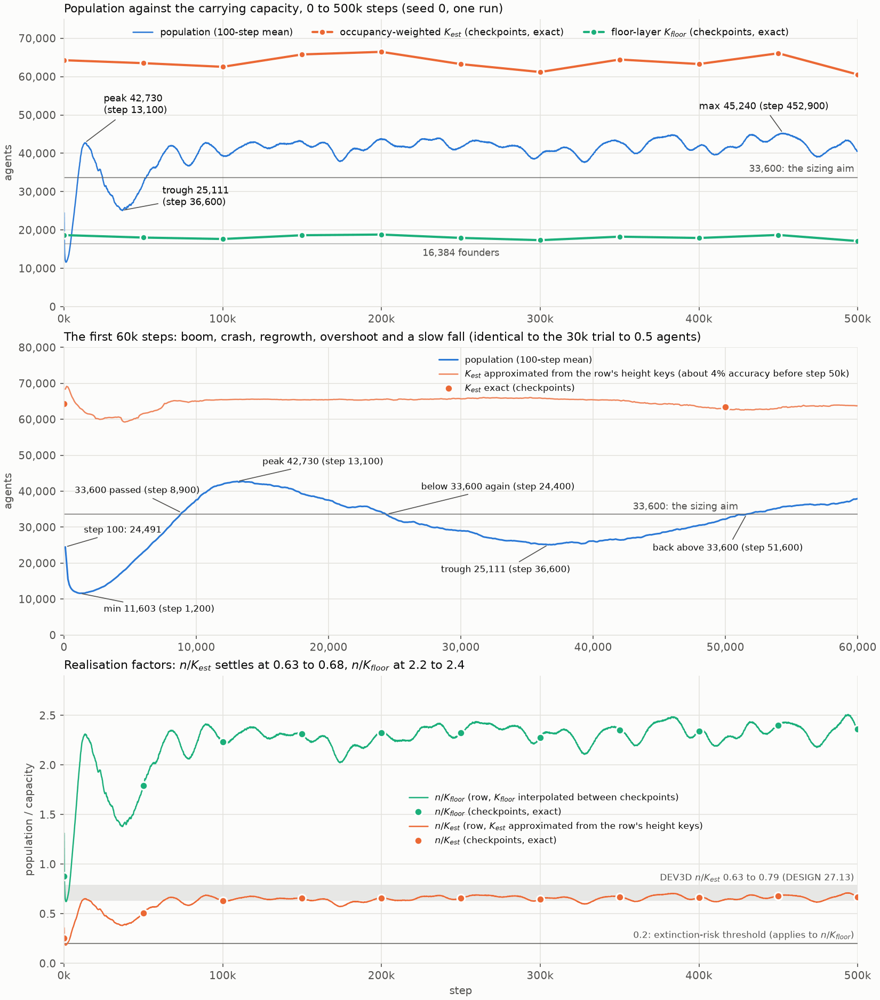

### 3.1 Trajectory

| step | population | note |
|---|---|---|
| 0 | 16,384 | founders, uniform in the volume |
| 100 | 25,719 (100-step mean 24,491) | the founders' first generation; 30,382 births blocked in these 100 steps (43,262 requests), none later |
| 200 | 16,594 | −35% in 100 steps |
| 1,200 | 11,585 (per-step minimum) | 55% below step 100; no crash to extinction |
| 8,900 | 33,997 | passes the sizing aim of 33,600 |
| 13,100 | 42,730 | first peak, 1.27× the aim |
| 24,400 | | below 33,600 again |
| 36,600 | 25,111 | trough, 41% below the peak |
| 51,600 | | back above 33,600, and never below it afterwards |
| 100,000–500,000 | mean 41,923 | 100-step means from 37,628 to 45,240 (maximum at step 452,900) |

- **The 30k trial.** The first 30,000 steps reproduce `DESIGN.md` §27.13's 30,000-step trial: to 0.5 agents at
  steps 100, 200, 1,200, 13,100, 20,000 and 30,000. The clade counts (3,606 at 5,000 and 211 at 30,000),
  `generation_max` (117) and `max_occupancy` (37) also match. The trial's "still falling at 30,000" was the descent
  into the trough at 36,600.
- **The 2D start.** The 2D run had the same kind of start: 24,375 at step 100 and a minimum of 14,897 at step 1,000.
- **Blocked births.** The 30,382 blocked births at the start are most likely the founders reproducing together
  against `max_births_per_step` (1,024). This was not checked in the code.
- **Late regime (100k–500k).**
  - The mean is 41,923, and the sd of the 100-step means is 1,582 (3.8%).
  - The integrated autocorrelation time is about 14,300 steps. That gives about 28 effective samples and a standard
    error of the mean of about 300.
  - The mean of 300k–500k minus that of 100k–300k is +158 (95% CI −912 to +1,138). The OLS slope is 1.9 per 1,000
    steps (95% CI −2.8 to 6.4).
  - No period is significant. Slopes inside a single 50k window are parts of fluctuations that last 10,000 to 40,000
    steps. An example is −63 per 1,000 steps in 450k–500k.
  - The 10k-window mean is within ±10% of the final-100k mean (42,326) from the window that ends at 70,000. It is
    within ±5% only from the window that ends at 490,000, because dips of 5–7% recur.
  - So the population settles into a stationary, fluctuating regime from about 70,000 to 100,000 steps, not onto a
    fixed point.

| window | mean n | min–max of 100-step means | births per 1,000 steps | killed share of deaths | predation ratio | max occupancy |
|---|---|---|---|---|---|---|
| 0–50k | 30,003 | 11,603–42,730 | 42,980 | 0.565 | 0.224 | 37 |
| 50–100k | 39,244 | 32,343–42,788 | 55,434 | 0.520 | 0.322 | 17 |
| 100–150k | 41,853 | 39,190–43,300 | 51,057 | 0.492 | 0.263 | 17 |
| 150–200k | 41,298 | 37,860–43,809 | 43,858 | 0.477 | 0.232 | 18 |
| 200–250k | 42,539 | 40,891–43,982 | 44,263 | 0.492 | 0.244 | 17 |
| 250–300k | 41,684 | 38,480–43,440 | 43,949 | 0.472 | 0.250 | 18 |
| 300–350k | 40,808 | 37,628–43,478 | 41,329 | 0.459 | 0.247 | 16 |
| 350–400k | 42,548 | 39,900–44,833 | 42,509 | 0.469 | 0.237 | 18 |
| 400–450k | 42,379 | 39,576–44,896 | 42,149 | 0.492 | 0.229 | 16 |
| 450–500k | 42,272 | 39,046–45,240 | 42,374 | 0.500 | 0.235 | 17 |

The full table is in [`results_3d/population_windows_50k.csv`](results_3d/population_windows_50k.csv).

### 3.2 Births, deaths and predation

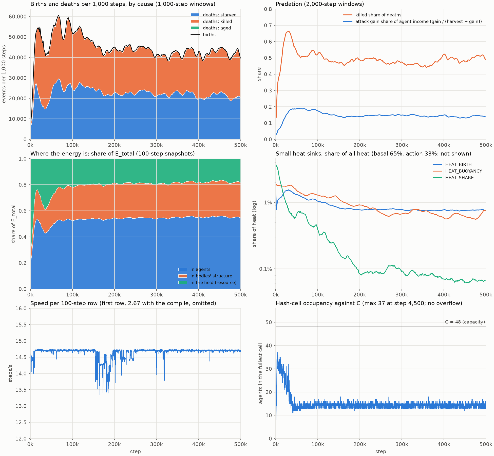

- **Deaths.** Over the run there were 22,495,125 births and 22,471,096 deaths. Of the deaths, 50.16% were
  starvation, 49.47% killing and 0.37% old age. There were no catastrophe deaths and no immigrants.
- **Killed share over time.** The killed share peaks near 0.66 to 0.67 in the 1,000-step windows between about 25,000
  and 33,000 (maximum 0.667, the window ending at 31,000). From step 100,000 it is 0.46 to 0.50 per 50k window. In 2D
  it falls to 0.13 (§7).
- **Predation.** The predation ratio (energy stolen over energy harvested) peaks at 0.32 in 50k–100k, then runs at
  0.23 to 0.26. Attack gain is 14 to 18% of the agents' income (harvest plus attack gain).
- **Turnover.** From step 100,000 the per-agent birth and death rates are 1.048 per 1,000 steps each. By Little's
  law that is a mean lifetime of about 954 steps.

### 3.3 Energy

- **Ledger.** `ledger_error` is 0 on all 5,000 rows. The global `E_total` closure recomputed from the rows has
  residual 0. `diag`, `cell_overflow` and `v_clips` are 0 throughout.
- **Heat.** Over the run, heat splits into:
  - basal 65.1%;
  - action 32.9%;
  - `HEAT_BUOYANCY` 0.90%;
  - birth 0.86%;
  - sharing 0.22%.

  Heat is 0.9999 of `INJECT_REGEN`.
- **`HEAT_BUOYANCY` over time.** Its share of the heat falls from 1.75% in 0–50k to 0.62% in 450k–500k. Per agent
  and step it falls from 3.86 q in the first row to 2.00 q in the last (§4.4).
- **Where the energy is.** `E_total` rises from 1.10e9 to 1.49e9 quanta. In the first row 37.8% is held by agents,
  23.4% by structure and 38.8% by the field. In the last row the shares are 54.5%, 27.0% and 18.4%.
  `INJECT_REGEN` is 6.4 M quanta per step in 0–50k and about 11.1 M from 150k on.
- **Speed.** The median is 14.70 steps/s, from 13.34 to 14.75 without the compile interval. The 150k–200k window
  averages 14.34 (minimum at step 165,600). This dip does not correlate with the population (r = 0.07); its cause was
  not diagnosed.

### 3.4 `K_est`, `K_floor` and the floor-layer share

Exact values at the checkpoints ([`results_3d/capacity_checkpoints.csv`](results_3d/capacity_checkpoints.csv)):

| step | n | `K_est` | `K_floor` | n/`K_est` | n/`K_floor` | floor-layer share (`z` < 4) | share at `z` < 20 |
|---|---|---|---|---|---|---|---|
| 0 | 16,384 | 64,270 | 18,662 | 0.255 | 0.878 | 0.039 | 0.249 |
| 50k | 32,307 | 63,503 | 18,021 | 0.509 | 1.793 | 0.239 | 0.602 |
| 100k | 39,454 | 62,548 | 17,649 | 0.631 | 2.235 | 0.208 | 0.541 |
| 150k | 43,088 | 65,780 | 18,627 | 0.655 | 2.313 | 0.208 | 0.528 |
| 200k | 43,733 | 66,450 | 18,807 | 0.658 | 2.325 | 0.193 | 0.525 |
| 250k | 41,635 | 63,255 | 17,931 | 0.658 | 2.322 | 0.198 | 0.526 |
| 300k | 39,493 | 61,187 | 17,344 | 0.645 | 2.277 | 0.197 | 0.531 |
| 350k | 42,950 | 64,450 | 18,255 | 0.666 | 2.353 | 0.198 | 0.537 |
| 400k | 41,918 | 63,278 | 17,914 | 0.662 | 2.340 | 0.189 | 0.530 |
| 450k | 44,912 | 66,082 | 18,700 | 0.680 | 2.402 | 0.193 | 0.534 |
| 500k | 40,413 | 60,543 | 17,109 | 0.668 | 2.362 | 0.194 | 0.529 |

- **The estimates.** `K_est` stays at 60,500 to 66,500, and `K_floor` varies by ±5% as the patches drift.
  `K_est/K_floor` is 3.52 to 3.54 from step 50,000; the maximum, if every layer counted fully, is 3.80. Seven layers
  have weight 1, and about 23% of the agents live in layers whose weight is below 1. The step-0 `K_est` is 64,270, as
  `DESIGN.md` records; `c_ref` is 191.63.
- **Settled ratios.** From step 100,000, n/`K_est` is 0.631 to 0.680 (mean 0.658) and n/`K_floor` is 2.24 to 2.40
  (mean 2.33). The 2D run is at 0.82 of its `K_est` (32,102 over 400k–500k against 39,310).
- **The sizing's 70% assumption did not hold.** The realised floor-layer share is 0.19 to 0.24, and the bottom
  quarter of the column holds 0.53 to 0.60. The sizing expected a `K_est` of 33,600 at 70% in the floor layer. With
  the column in use, `K_est` is 60,500 to 66,500 instead. That is near the sizing table's row for founders uniform in
  the volume (61,500), not its 70% row. The population is about 0.66 of this larger `K_est`, and so it lands above the
  aim.

Realisation factors against `DESIGN.md` §27.13 (the values between checkpoints use the approximate `K_est`):

| quantity | this run | `DESIGN.md` §27.13 |
|---|---|---|
| n/`K_est` at step 100 | 0.372 (exact, first row) | 0.37 (trial) |
| n/`K_est` at 30,000 | about 0.44 (0.425 against `DESIGN.md`'s inspect value of 68,185) | 0.42 (trial) |
| n/`K_est` at the first peak (12,500–14,000) | 0.647 to 0.652 | 0.63 to 0.65 (trial); 0.78 to 0.79 (`DEV3D` plateau) |
| n/`K_est` from 100k | 0.63 to 0.68 (exact) | trial 0.42 to 0.65; `DEV3D` 0.63 to 0.79 |
| n/`K_floor`, late | 2.24 to 2.40 | `DEV3D` 2.16 to 2.65 |

- **The `DEV3D` plateau.** The `DEV3D` plateau of 0.78 to 0.79 is never reached; the highest row value is 0.71, at
  step 493,800. A `K_est` scaled by 0.65 to 0.75, as cloud-9 suggested, brackets the late level, which sits at its low
  edge.
- **The extinction-risk ratio.**
  - n/`K_floor` is lowest at the founder crash: about 0.62 at step 1,200, 3.1× above `risk_k_frac` (0.2).
  - It re-crosses 1 near step 4,800 (`DEV3D`: 4,600). After step 5,000 it never falls below 1.05, and after step
    20,000 never below 1.38.
  - These row values use the interpolated `K_floor` (±5%; adjacent checkpoints differ by up to 8.5%).
  - So for this run the `K` criterion of the director's risk flag is far from firing. The 30% `fall` criterion is
    another matter (§10, item 3).

## 4. Vertical niches and buoyancy

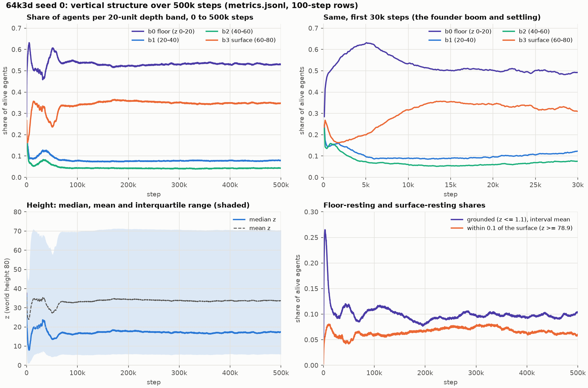

### 4.1 Where the agents live

| step | band fractions, floor to surface (`z` 0–20 / 20–40 / 40–60 / 60–80) | grounded | at the surface | mean `z` |
|---|---|---|---|---|
| 100 | 0.285 / 0.245 / 0.235 / 0.236 | 0.009 | 0.003 | 38.1 |
| 5,000 | 0.630 / 0.097 / 0.074 / 0.199 | 0.248 | 0.067 | 24.2 |
| 50,000 | 0.602 / 0.102 / 0.059 / 0.237 | 0.117 | 0.043 | 27.3 |
| 100,000 | 0.541 / 0.078 / 0.042 / 0.338 | 0.110 | 0.058 | 32.9 |
| last 50k (mean ± sd of rows) | 0.531 / 0.078 / 0.043 / 0.348 (each ±0.002 or less) | 0.097 ± 0.004 | 0.062 ± 0.002 | 33.70 ± 0.13 |

- **The founders and the transient.** The founders start roughly uniform in `z`. They sink: the grounded share peaks
  at 0.265 at step 3,100, and the floor band peaks at 0.632 at step 5,100.
- **Bimodal from about 75,000.** From about step 75,000 the distribution is flat in time. At the end, 88% of the
  agents are in the floor band or the surface band and 12% in the 40 units between. The height quartiles over the
  last 50,000 steps are 5.79, 17.18 and 70.50.
- **Little time on the boundaries.** The grounded share is 0.10. The share resting on the surface peaked at 0.081 at
  step 325,300 and is 0.062 over the last 50,000 steps.

### 4.2 Occupancy follows the food

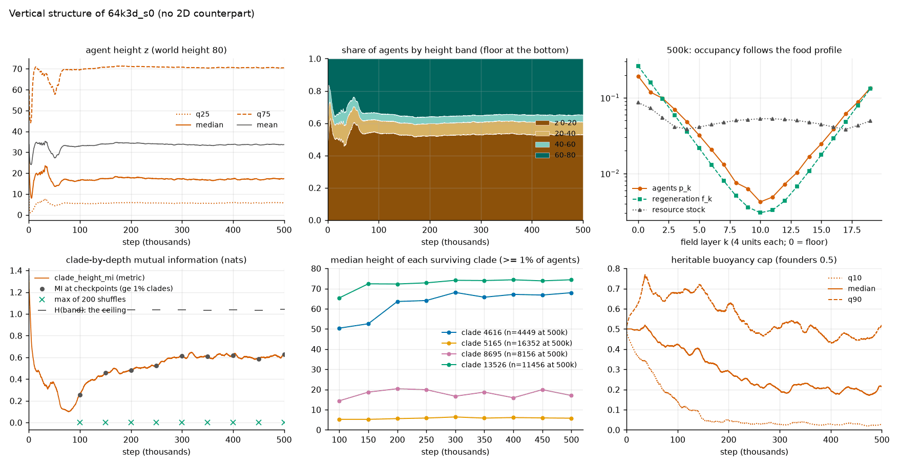

At step 500,000, by 4-unit field layer ([`results_3d/layers_occupancy_food.csv`](results_3d/layers_occupancy_food.csv)):

| layers | share of agents | share of regeneration | share of standing stock | last-step harvest per agent (q) |
|---|---|---|---|---|
| 0 (floor, `z` < 4) | 0.194 | 0.263 | 0.086 | 335 |
| 1–4 | 0.336 | 0.351 | 0.208 | 300 |
| 5–14 (mid-water) | 0.123 | 0.079 | 0.489 | 196 |
| 15–18 | 0.213 | 0.175 | 0.167 | 267 |
| 19 (surface layer) | 0.135 | 0.132 | 0.049 | 312 |

- **The match.** The correlation of log occupancy with log regeneration share over the 20 layers is 0.994 to 0.996
  at every checkpoint from 100k. The total-variation distance between the two profiles is 0.10 to 0.11, against 0.507
  for the uniform founders.
- **Grazing.** The floor and surface layers are grazed down: they hold 0.086 and 0.049 of the stock against 0.263 and
  0.132 of the regeneration. The mid-water layers hold half the standing stock and are harvested least per agent.
- **Not a cause.** This is a correlation. It does not show that food sets the positions.

### 4.3 Four clades in two depth zones

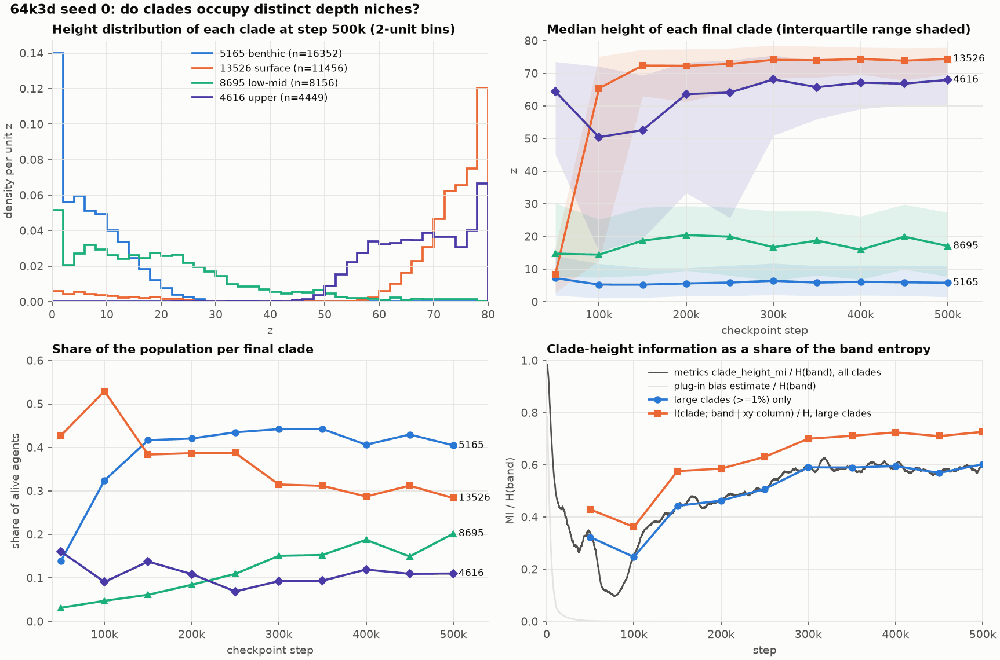

From step 177,100 exactly four founder clades are alive. At step 500,000 they cover the whole population
([`results_3d/clades_checkpoints.csv`](results_3d/clades_checkpoints.csv)):

| clade | share | mean `z` | median `z` | bands, floor to surface | grounded | at the surface | bonded | mean cap | mean pitch (rad) |
|---|---|---|---|---|---|---|---|---|---|
| 5165 (floor) | 0.405 | 7.1 | 5.8 | 0.97 / 0.03 / 0 / 0 | 0.21 | 0 | 0.86 | 0.19 | −0.54 |
| 13526 (surface) | 0.283 | 68.7 | 74.4 | 0.07 / 0.01 / 0.01 / 0.91 | 0.01 | 0.17 | 0.73 | 0.44 | −0.42 |
| 8695 (low water) | 0.202 | 19.6 | 17.0 | 0.58 / 0.32 / 0.08 / 0.02 | 0.08 | 0 | 0.00 | 0.20 | −0.42 |
| 4616 (upper water) | 0.110 | 67.2 | 68.0 | 0 / 0 / 0.23 / 0.77 | 0 | 0.10 | 0.00 | 0.08 | +0.84 |

- **Lifestyles.** The two colonial clades live at the two boundaries: 5165 on the floor and 13526 at the surface. The
  two clades without bonds live in the water.
- **Two depth zones.** The four clades fall into two zones of two clades each.
  - In the floor zone, 5165 has a median `z` of 5.8 (quartiles 1.5 to 10.9) and 8695 has 17.0 (7.7 to 27.3). In the
    top zone, 4616 has 68.0 (60.4 to 74.9) and 13526 has 74.4 (69.7 to 77.9).
  - The overlap of two clades' height histograms (2-unit bins) at 300,000, 400,000 and 500,000 is 0.60, 0.60 and 0.56
    for the floor pair and 0.74, 0.62 and 0.60 for the top pair. Between zones it is 0.002 to 0.11 at 500,000 (up
    to 0.27 at 300,000).
  - The top pair are close in mean height (67.2 and 68.7) and swap rank at 450,000 (66.4 against 64.1) and
    back at 500,000. Four separate depths would overstate this.
- **Depth carries information about the clade.** At step 500,000:
  - The MI of clade and band is 0.627 nats, which is 0.60 of `H(band)` = 1.041. The block-bootstrap 95% interval is
    0.565 to 0.641, and the shuffle baseline is 0.0001.
  - Most of it separates the zones. A zone label (floor: 5165 and 8695; top: 4616 and 13526) carries 0.515 nats, and
    the clades within a zone add 0.111 (the chain rule). Merging only 4616 into 13526 lowers the MI from 0.627 to
    0.594. So the band MI measures floor against top more than four distinct depths.
  - Conditioned on the xy column, the MI is 0.756 nats (0.73 of `H`), against a within-column shuffle baseline of
    0.0104. It is higher than the unconditional value because the clades also differ in xy within a band:
    `I(clade; column | band)` is 0.300 nats against `I(clade; column)` of 0.170.
  - The metric `clade_height_mi` reads 0.606 ± 0.009 over the last 50,000 steps.
- **Horizontal position.**
  - The overlap of two clades' xy occupancy (one minus the total-variation distance over the 10 × 10 columns) is 0.50
    to 0.91 over the six pairs at 500,000, 0.65 on average. The two pairs that share a zone overlap 0.53 (5165 and
    8695) and 0.55 (4616 and 13526; 0.27 at 300,000). The four pairs from different zones overlap 0.91 (5165 and
    13526), 0.85 (4616 and 8695), 0.55 (4616 and 5165) and 0.50 (8695 and 13526). The mean of 0.65 therefore
    summarises neither group.
  - Every column holds at least two of the clades, so clades at the same place mostly sit at different depths.
  - Inside a zone the two clades are partly separated in xy. Among the agents with `z` < 28 the MI of clade (5165 or
    8695) and xy column is 0.225 nats of a clade entropy of 0.589 (shuffle baseline 0.002). Among the agents with
    `z` ≥ 60 (4616 or 13526) it is 0.245 of 0.559 (0.0035). The values at 300,000 and 400,000 are 0.221 and 0.225
    (floor zone) and 0.305 and 0.255 (top zone). At 500,000, 41% of the floor-zone columns and 52% of the top-zone
    columns (those with at least 20 agents of the pair, 100 columns each) have one clade holding at least 90% of the
    pair.
  - This could be territory or kin clustering after birth. The two were not separated.
- **Persistence.** Three clades keep their band profiles from step 150,000. Clade 4616 does not.
  - The total-variation distance of a clade's band profile between consecutive checkpoints from 150,000 is at most
    0.013 for 5165, 0.099 for 13526 and 0.095 for 8695. Between 150,000 and 500,000 it is 0.006, 0.132 and 0.096.
  - For 4616 it reaches 0.162 in a single 50,000-step interval and is 0.423 between 150,000 and 500,000. Its bottom
    band falls from 0.26 to 0.00 and its top band rises from 0.40 to 0.77 (mean `z` 45.2 to 67.2).
  - Averaged over the four clades, the distance between consecutive checkpoints is 0.04 to 0.07, against 0.62 to
    0.72 between clades. The mean hides the drift of 4616.
  - The rank order of the clades' mean heights is identical from 100k to 400k. The Spearman correlation falls to
    +0.80 at 400k to 450k and at 450k to 500k, because 4616 and 13526 swap places.
- **Niche shifts.**
  - Clade 13526 moved from the floor to the surface. At 50k its mean `z` was 14.2, with 81% of it in the floor band;
    it was 48.3 at 100k and 70.8 at 300k.
  - Clade 4616 rose from a mean `z` of 44.0 at 100k to 67.2 at 500k as its cap fell from 0.36 to 0.08. The rise is
    gradual: 45.2 at 150k, 51.8 at 250k, 60.5 at 350k and 66.4 at 450k.
- **The metric over time.**
  - `clade_height_mi` is saturated by near-singleton clades early on: 0.98 of `H` at step 100 and 0.51 at 10,000.
    `DESIGN.md` §27.9 warns about this. The metric can be read from about step 10,000, when its plug-in bias estimate falls
    below 0.1 nats (0.083 at 10,000, 0.023 at 20,000).
  - It drops to 0.097 of `H` at step 77,900. That is just after the top clade's share peaked at 0.68 (step 76,900),
    with one clade spanning the column.
  - It then rises to about 0.59 of `H` by step 300,000.
- **What this cannot show.** With four lineages and one seed, niche adaptation cannot be separated from lineage
  history.

### 4.4 The buoyancy cap

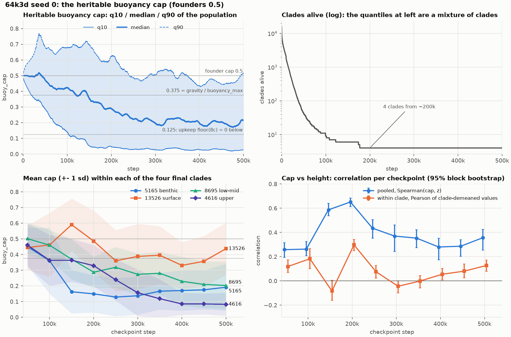

- **The quantiles.**
  - The median is about 0.50 until about step 36,000, then falls: 0.472 at 50k, 0.424 at 100k, 0.354 at 150k, 0.289
    at 200k and 0.222 at 250k. Over the last 50,000 steps it is 0.190 ± 0.014.
  - The q10 falls from 0.485 at step 100 to about 0.02 to 0.04 from 300k (50k-window means 0.032, 0.028, 0.028 and
    0.024; 0.024 over the last 50,000 steps).
  - The q90 first rises, to 0.770 at step 36,400, then falls to 0.465 over the last 50,000 steps.
- **Who can float.** A cap of 0.375 is the level at which buoyancy alone offsets gravity (`gravity/buoyancy_max`).
  The share of agents at or above it falls from 0.74 at 50k to 0.17 to 0.29 from 250k.
- **A free zone below 0.125.** The upkeep is `floor(8·cap)` q per step, so a cap below 0.125 costs nothing. The share
  of agents in that free zone rises from 0.007 at 50k to 0.28 to 0.35 from 250k. The mean upkeep falls from 3.34 to
  1.3 to 1.6 q per step.
- **The pooled quantiles mix four clades.** Their caps differ ([`results_3d/cap_thresholds_drift.txt`](results_3d/cap_thresholds_drift.txt)):

  | clade | mean cap at 50k | at 150k | at 500k | share below 0.125 at 500k |
  |---|---|---|---|---|
  | 5165 (floor) | 0.450 | 0.163 | 0.192 | 0.43 |
  | 13526 (surface) | 0.445 | 0.591 | 0.438 | 0.04 |
  | 8695 (low water) | 0.502 | 0.371 | 0.203 | 0.38 |
  | 4616 (upper water) | 0.460 | 0.364 | 0.083 | 0.76 |

- **The clade without lift.** Clade 4616 lives high (median `z` 68) with the lowest cap. 85% of its agents are
  pitched up by more than 10°, and its mean `|pitch|` is 0.96 rad. It holds its depth by thrust.
- **Cap in the sheets.** The 2,423-agent body at 500k has a mean cap of 0.45, against 0.25 for the population. The
  body is entirely clade 13526, whose mean cap is 0.44, and the other three clades average 0.18. The clade's agents
  outside the body average 0.43. At the same height (`z` ≥ 70) the body's members average 0.46 and the clade's
  non-members 0.48. The high cap belongs to the clade, not to the body.
- **Not neutral drift.** A haploid Wright–Fisher reference was run (σ = 0.02, clipped, 400 replicates). After 100
  generations, the sd of the population mean is 0.119 at N = 100, 0.045 at N = 1,000 and 0.013 at N = 10,000. Clade
  5165's mean cap fell by 0.29 between 50k and 150k, while its mean generation rose only from 154 to 197. The
  effective population size is not known. So the conclusion is only that these shifts far exceed neutral drift unless
  N_e is below about 100. Direct selection on the cap cannot be separated from hitchhiking with brain changes.
- **Cap and height.**
  - The pooled Spearman correlation of cap and height is +0.26 to +0.65 over 50k–500k. It is +0.357 at 500k (95%
    0.254 to 0.426).
  - Within clades (clade-demeaned) it is −0.08 to +0.30, with a sign change, and +0.127 at 500k.
  - The between-clade share of the cap variance is 0.27 to 0.62 from 150k. Most of the pooled correlation is between
    clades.
  - The mean cap by band at 500k is 0.203, 0.209, 0.087 and 0.356, which is not monotone.
- **Against the cloud grid.** The cloud's grid of buoyancy costs found that the median cap stays at 0.50 over 10,000
  steps (`DESIGN.md` §27.13). Here too it holds at 0.50 until step 36,000. Over 500,000 steps it does not.

### 4.5 Sinking corpses ("marine snow")

- **Size.** By construction all corpse energy lands in the floor layer. `FLOW_CORPSE` is 0.040 of `INJECT_REGEN`
  over 100k–500k: 444,000 of 11.04 M quanta per step (2D: 0.043).
- **Effect.** Against the floor layer's 0.263 share of regeneration, that adds about 15% to the floor's input. At
  most 3.2% of all regeneration is carried down from above the floor layer.
- **Not measured.** The event log records no death positions, so the fall distance is not measured. Separating the
  effect needs a run in which corpses stay where they die.

## 5. Bonded bodies

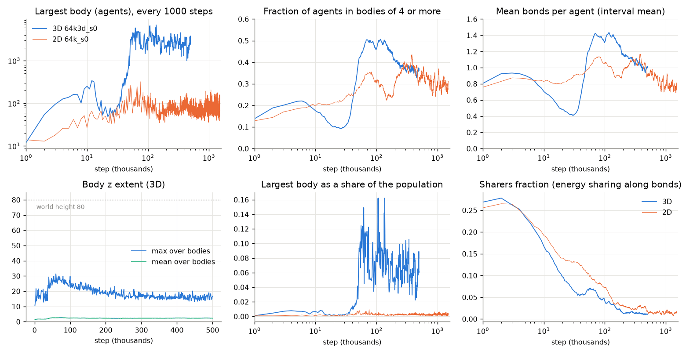

### 5.1 Sizes

| | 3D, steps 250k–500k | 2D, whole run to step 1.504M (1,504 heavy rows) |
|---|---|---|
| largest body, median (q10–q90) | 2,510 (1,720–3,526), maximum 4,535 | 73 (52–115), maximum 323 |
| largest body as a share of the population, median / maximum | 6.1% / 10.6% | 0.22% / 0.94% |
| `frac_in_bodies_ge4`, median | 0.367 | 0.308 |
| mean bonds per agent, median | 1.03 | 0.86 |

- **Onset.** Bodies switch on sharply at about 40,000 to 50,000 steps. Mean bonds per agent rise from about 0.42 near
  step 30,000 to about 1.4 near 70,000. The largest body first reaches 1,000 agents at step 49,000 and 2,000 at
  51,000.
- **Range.**
  - Over steps 100k to 500k, the largest body has at least 1,001 agents on every heavy row (median 2,582, against 74
    in 2D). The maximum, 6,900, comes at step 136,000.
  - Only the tail differs from 2D: the share of agents in bodies of 4 or more is the same, 0.37 in both runs over
    250k–500k.
- **No single giant component.** The top five at step 500,000 have 2,423, 1,391, 688, 486 and 460 agents, and 188
  bodies have 10 or more members. None of the bodies of 10 or more wraps the torus, at any checkpoint.
- **Vertical extent.** The mean vertical extent of a body is about 2.3 units from 100k. The maximum falls from about
  30 (near 60k) to 16 to 17. No body spans the 80-unit column, and no component of 5 or more has its centroid in the
  mid-water bands (`z` 20 to 60) at 250k or 500k.
- **The 2D baseline.** `EVALUATION.md` gives the 2D baseline as "largest body about 90". The 2D metrics give a median
  of 73 and a q90 of 115.

### 5.2 What the large bodies are

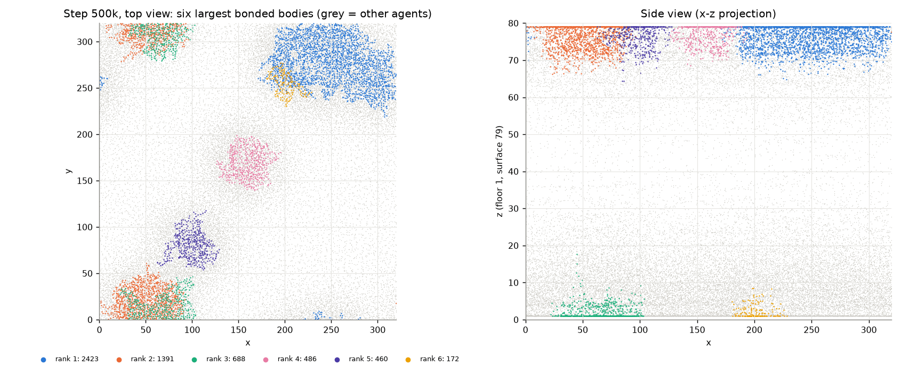

The largest body at step 500,000 ([`results_3d/bodies_top.csv`](results_3d/bodies_top.csv) has the top bodies of
every checkpoint):

- **Shape.**
  - 2,423 agents and 3,223 bonds, over an xy extent of 157 × 110 units. The sd along the principal axes is 37.4, 21.3
    and 3.0: a sheet about 9 units thick (5–95% of `z`: 70.4 to 79.0).
  - 26% of the members are on the surface clamp, and none is grounded.
  - Over the bodies of 10 to 300 at this checkpoint, the radius of gyration grows as n^0.50 (dimension about 2.0;
    2.0 to 2.3 across checkpoints).
- **Mesh, not tree.**
  - The mean degree is 2.66; 12, 27, 42 and 18% of the members have degree 1, 2, 3 and 4.
  - The body has 801 independent cycles, and 79% of the members are in the 2-core.
  - 23% of the bonds are bridges, and the largest 2-edge-connected block holds 50% of the members.
  - The hop diameter is 112.
- **Density.** There are 3.7 members per 4 × 4 cell of floor area (0.23 per unit²). 95% of the agents in the body's
  occupied 4 × 4 × 4 cells are members: the body is the local crowd.
- **Lineage.**
  - It is one clade (13526), and all its bonds are within the clade. 25% are parent–child bonds, and 48% of the
    members have their parent in the body.
  - Members span generations 503 to 720 (median 549; the population median is 542), so the body is not a lineage of
    its own.
  - Same-clade bonding is not kin discrimination. Of the contacts across the body's edge, 99.9% are with the same
    clade. The surface layer (`z` ≥ 75) is 82% clade 13526.
  - The probability of a bond given contact (distance below 3) is 0.75 for same-clade pairs and 0.51 for
    different-clade pairs. Only 79 different-clade pairs exist. The engine's `kin_bond_bias` is 0.06 at the end.
- **Not coordinated.** Velocity coherence `|Σv|/Σ|v|` is 0.04 to 0.10 over the top five bodies. The velocity
  cosine between bonded neighbours is 0.07, against 0.01 for unbonded contacts. Sharers are 1.1% of the population at
  the end; they were 28% at step 2,000.
- **Which layer.** From step 200,000 the largest body is a surface sheet of clade 13526 at six of seven checkpoints.
  The exception is step 350,000, where it is a floor sheet of clade 5165 with 1,893 agents. At 100k and 150k the
  largest are floor sheets (2,971 and 3,973 agents). From 200k every body in the top three of a checkpoint is a single
  clade.
- **Layer census at 500k** (cutoffs `z` ≤ 5 and `z` ≥ 75). Bodies of 100 or more hold 5,620 agents: 55% in the
  surface layer, 31% between and 14% on the floor.

### 5.3 Why they are so large: contact clusters, crowding and bonds

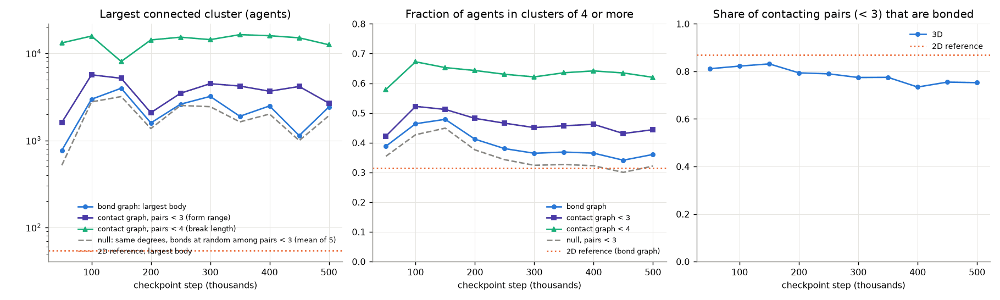

- **Density.** The 3D world holds 40,413 agents on 320² units of floor, 0.395 per unit². The 2D world holds 0.031 to
  0.032 per unit² on 1,024². Per unit of floor area the 3D crowd is 12 to 13 times denser, but that sums over the
  80-unit column and is not the density an agent meets. In the slabs where the sheets sit, at 500,000 steps, it is
  1.7 to 4.7 times the 2D value: 2.5× in the floor layer (`z` < 4, 0.076 per unit²), 4.7× for `z` < 10, 3.3× for
  `z` ≥ 70 and 1.7× for `z` ≥ 76.
- **Contacts.** An agent has 1.25 to 1.59 contacts closer than 3 in 3D (checkpoints 50k to 500k), against 0.81 to
  0.89 in 2D (1.45× at the final states). The share of agents with no such contact is 0.29 to 0.39 in 3D and 0.48
  to 0.51 in 2D.
- **Bonded share of contacts.** The share of contacting pairs (distance below 3) that are bonded is 0.73 to 0.83 in
  3D and 0.87 in 2D. This does not show that bonding is the same in the two worlds. Bonds create many of the
  contacts (below, §5.5), and bonding differs by clade: two of the four 3D clades have a bonded share of 0.00
  (§4.3).
- **The contact graph.**

  | | 2D (step 1,504,009) | 3D (step 500,000) |
  |---|---|---|
  | largest contact cluster, pairs closer than 3 | 94 | 2,681 |
  | mean contacts closer than 3 per agent | 0.89 | 1.29 |
  | share of agents with no contact closer than 3 | 0.48 | 0.39 |

  At pairs closer than 4 (the break length), a single 3D cluster holds 0.19 to 0.41 of the whole population across
  checkpoints (0.31 at 500k). The largest contact cluster at distance 3 is 1.1 to 3.7× the largest body.
- **Null model.** The null keeps the same agents, positions and degree sequence, and places bonds at random or
  nearest-first among close pairs. Its largest body is 0.81 to 0.91 of the observed on average (range 0.51 to 0.98).
  The candidate pairs are only 1.24× the observed bonds, so the null is nearly fixed by the contact graph. It shows
  that the sizes follow from the contact graph and the degrees. It is not independent evidence of organisation, and
  the contact graph itself depends on the bonds (next point). The observed bond graph is slightly more connected than
  the null.
- **Crowding or bonding.** The contact clusters are partly made by the bonds. With every bond erased at each step
  (§5.5), contacts per agent fall from 1.29 to 0.60 in 100 steps, below the 2D level, and the largest contact cluster
  at distance 3 falls from 2,681 to 295 (from 350k: 4,212 to 221), while the population falls by about 15%. So a body
  is a contact cluster held together by its bonds. These data do not separate crowding from bonding as the cause of
  body size. A run at lower density would (§10, item 4).
- **The 2D reference is later in evolution.** No 2D checkpoint between step 0 and step 1.49M survives. The 2D side of
  this section (contacts, contact clusters, bridge shares, top-five sizes) is therefore read at steps 1,490,000,
  1,500,000 and 1,504,009, three times later than the 3D state. The median generation there is 1,041 to 1,054
  against 542 in 3D, and the top clade's share is 0.82 to 0.84 of 4 clades against 0.41 of 4. The size of the largest
  body does not depend on this: the metrics rows give a 2D median of 74 over steps 100k to 500k and 73 over the
  whole run.
- **2D bodies.** 2D bodies are structurally similar but small (top five 38 to 73 agents, at steps 1.49M to 1.504M)
  and also single-clade. They are more tree-like: 0.33 to 0.79 of the bonds of the top five bodies at three
  checkpoints are bridges, against 0.23.

### 5.4 Persistence

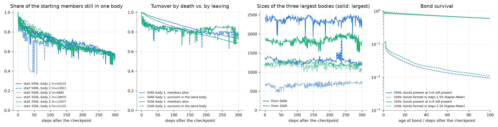

- **Across checkpoints.** No agent survives from one checkpoint to the next (`max_age` is 10,000; the checkpoints are
  50,000 apart). Footprint overlap is 0 to 0.20, against 0.04 to 0.11 by chance, and the patches move 109 units on
  average per 50,000 steps. A body cannot be tracked between checkpoints; only its type persists.
- **Over 300 steps (CPU continuations):**

  | | from 500k (largest body, 2,423) | from 350k (largest body, 1,893) |
  |---|---|---|
  | largest body size over 300 steps | mean 2,365 (sd 96, range 1,826 to 2,516) | mean 1,830 (range 1,522 to 2,031) |
  | starting members alive at t = 100 / 300 | 0.89 / 0.73 | 0.85 / 0.69 |
  | starting members still in the same body at t = 10 / 100 / 300 | 0.86 / 0.74 / 0.57 | 0.90 / 0.72 / 0.54 |
  | Jaccard index with the starting body at t = 100 / 300 | 0.59 / 0.41 | 0.56 / 0.38 |
  | centroid displacement over 300 steps | 0.08 units | 0.06 units |

  The body is a stationary aggregate. Its members turn over by death and by leaving.
- **Bonds flicker (24 steps from 500k).** About 3,700 bonds form and 3,700 break per step, out of about 20,000. This
  is a mixture:
  - 63% of the pairs bonded at t = 0 are present at all 24 steps.
  - 11,634 pairs toggle at least 4 times (mean 14.7 toggles, near period 2).
  - 94% of new bonds re-form a pair seen earlier in the window.

  Bonds present at t = 0 survive to t = 100, 200 and 300 with fractions 0.60, 0.44 and 0.33. So the rate-based
  lifetime proxy (`bonds_total` over the formation rate, about 5 steps late in 3D) is dominated by flicker and
  understates bond life. The 2D proxy may be affected the same way; that was not tested. The cause of the flicker was
  not investigated.

### 5.5 Counterfactuals: cutting the bonds

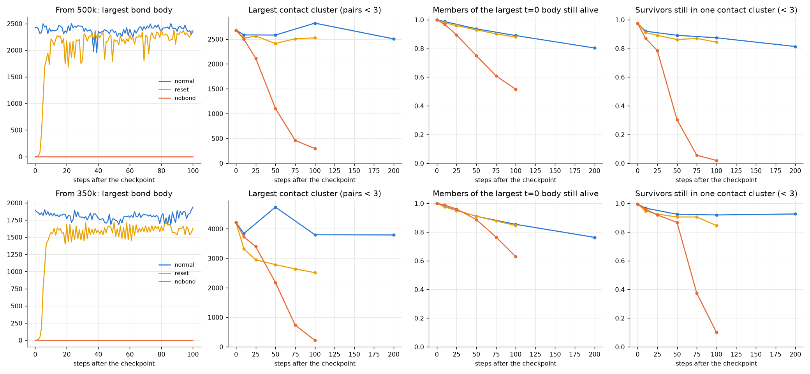

- **All bonds reset once at t = 0, then normal dynamics.**
  - From 500k, 18,732 bonds (93% of 20,124) are back by t = 10. The largest body is 2,212 at t = 10 and 2,361 at
    t = 100.
  - From 350k the largest body returns to 1,500 to 1,700 (normal mean 1,830).
  - So bodies carry no history: they re-form from the contact structure within about 10 steps.
- **Bonds erased after every step.**
  - The contact clusters dissolve over 50 to 100 steps. The largest cluster at distance 3 falls from 2,681 to 295 by
    t = 100 (from 350k: 4,212 to 221). The crowd at distance 4 thins but persists (10,352 and 11,646 at t = 100).
  - The population falls by 14.6% in 100 steps from 500k (40,413 to 34,504) and by 15.4% from 350k (42,950 to
    36,330). With bonds it changes by −0.4% and +0.2%.
  - Over the first 40 steps from 500k, attacks are 451,540 against 90,538 (5.0×). Kill deaths are 2,716 against 748
    (3.6×) and starvation deaths 1,053 against 840.
- **Reading.** Bonded partners cannot be attacked (`combat.attack_bonded = false`). The numbers fit bonds that act
  as a ceasefire and also keep the crowd together. This is consistent with that reading, not proof of it.

## 6. Evolutionary activity

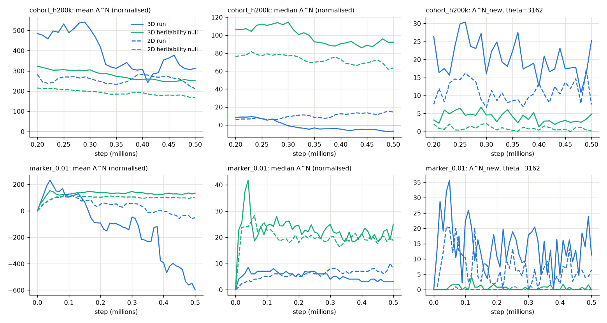

Classification (Channon / Bedau, primary settings; full table in
[`results_3d/activity_classification_3d.txt`](results_3d/activity_classification_3d.txt), statistics in
[`results_3d/activity_compare.md`](results_3d/activity_compare.md)):

| component space | 0–100k | 100k–300k | 300k–500k | 0–500k |
|---|---|---|---|---|
| cohort subtrees, horizon 100k | n/a (pool filling) | bounded / bounded | bounded / bounded | bounded / unbounded |
| cohort subtrees, horizon 200k | n/a (pool filling) | bounded / bounded (valid from 200k) | bounded / bounded | bounded / unbounded |
| cohort subtrees, horizon 500k | n/a | n/a | n/a | n/a (the pool never fills in 500k steps) |
| markers, μ = 0.003 | bounded / unbounded | bounded / unbounded | bounded / unbounded | bounded / unbounded |
| markers, μ = 0.01 | bounded / unbounded | bounded / unbounded | bounded / bounded | bounded / bounded |
| markers, μ = 0.03 | bounded / unbounded | bounded / bounded | bounded / unbounded | bounded / bounded |
| markers, μ = 0.1 | bounded / unbounded | bounded / bounded | bounded / bounded | bounded / bounded |

- **Channon: bounded in all 22 valid cells.** None of the informative sweep settings in any cohort cell is
  unbounded. The same holds for horizons of 50k, 100k and 200k (26 cells), a 5k grid (26 cells), a 20k grid (22) and
  shadow seed 7 (22). The only unbounded settings anywhere are 4 of 18 in one start-up cell: markers μ = 0.1, 0–100k,
  on the 5k grid, all at the smallest ρ0 of 0.003.
- **Bedau's normalisation depends on the window and the component definition** (11 unbounded and 11 bounded), as in
  2D. The whole-run "unbounded" of the cohort pools comes from growth in the number of components `D`: the fitted
  growth across the window is 0.698 for the horizon-100k pool and 0.513 for the horizon-200k pool, against the
  criterion of 0.5.
- **New adaptive activity stays above both nulls.** `A^N_new` is positive in every 50k block. At θ = 3,162 the
  rates per component per 10k steps are (run / neutral shadow / heritability null):

  | space | window | 3D | 2D |
  |---|---|---|---|
  | cohort, horizon 200k | 100k–300k | 22.3 / 7.0 / 5.1 | 12.3 / 6.5 / 1.2 |
  | cohort, horizon 200k | 300k–500k | 19.2 / 6.6 / 3.5 | 10.5 / 5.1 / 0.71 |
  | markers, μ = 0.01 | 100k–300k | 13.4 / 0.70 / 0.70 | 5.95 / 0.30 / 0.14 |
  | markers, μ = 0.01 | 300k–500k | 12.6 / 0.43 / 0.45 | 5.1 / 0.47 / 0.05 |

  The 3D rate is about twice the 2D one. But births per step also differ (3D 42 to 49, 2D 30 to 35), so read each run
  against its own nulls, not across runs.
- **The cohort verdict rests on the median.** `A^N_cum` grows in both cohort windows (ρ_cum +0.28 and +0.05), but the
  median `Ã^N` falls (ρ_med −0.023 and −0.006). The growth of the sum comes from the number of cohort-pool components,
  not from the typical component.
- **Persisting components reproduce less than their share.** In the marker space (μ = 0.01) the mean `A^N` of the
  3D run falls from +104 at 100k to −596 at 500k, a slope of −160 per 100k steps; both nulls stay near +130. 2D has
  the same sign, about 4 times shallower (+127 to −52, −39 per 100k).

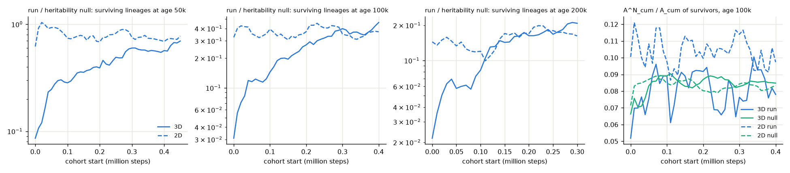

**What differs from 2D.** The table below gives surviving lineages per cohort, as a ratio to the heritability null:

| cohort start | 3D, at age 100k | 2D, at age 100k | 3D, at age 50k | 2D, at age 50k |
|---|---|---|---|---|
| 0–100k | 0.095 | 0.37 | 0.21 | 0.89 |
| 100k–200k | 0.20 | 0.34 | 0.35 | 0.75 |
| 200k–300k | 0.32 | 0.42 | 0.48 | 0.81 |
| 300k–400k | 0.37 | 0.34 | 0.57 | 0.74 |
| 400k–500k | | | 0.63 | 0.73 |

- **Lineage sorting.** In 3D it is much stronger early and weakens over the run, but it has not settled.
  - At cohort age 100k the 3D ratio reaches the 2D level (0.38, the mean of the 2D cohorts started from 200k) for
    cohorts started from about 290k, and the last cohort (400k) is above it, 0.461 against 0.37. At age 200k it
    reaches the 2D level (0.18) from about 240k, and the last cohort is 0.208 against 0.162. At age 50k it has not
    reached it: the last cohorts give 0.63 to 0.70 against 0.72 to 0.78 in 2D.
  - The 3D ratio is still rising at every age. Its slope per million steps of cohort start (cohorts started from
    200k) is +0.89 at age 50k, +0.64 at 100k and +0.50 at 200k, against −0.33, −0.46 and −0.25 in 2D. The last bin
    of each age holds one cohort (ages 100k and 200k) or six (age 50k), and overlapping cohorts are not independent,
    so these slopes are rough.
- **Excess share of births.** The survivors' excess share of births is `A^N_cum/A_cum`, run minus heritability null.
  - In 3D it is +0.006 at age 50k, −0.003 ± 0.002 at 100k and about 0 at 200k.
  - In 2D it is +0.024, +0.021 ± 0.001 and +0.015.
  - The standard errors treat overlapping cohorts as independent, so they are lower bounds.
  - In this measure the 3D survivors show no heritable advantage beyond what the null gives them. The 2D survivors
    do.
- **The null.** The heritability null counts every inherited success as heritable. That includes spatial and
  ecological inheritance, and in 3D possibly membership of a body. These were not separated.
- **Window length.** The windows span 100k to 200k steps. The mean generation is 179 at 100k, 323 at 300k and 462 at
  500k (2D: 104, 289 and 449). "Bounded" means no detectable growth in these windows. Growth below ρ0 = 0.003 cannot
  be excluded.

## 7. Comparison with the 2D run (steps 0 to 500,000)

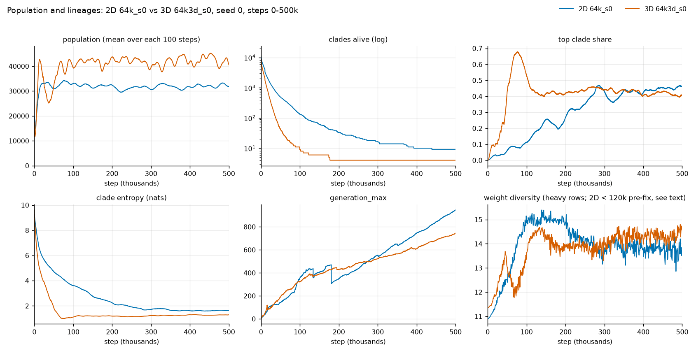

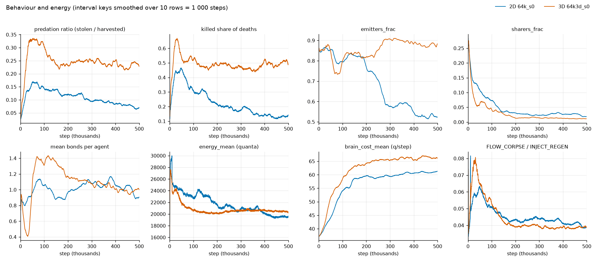

Mean over steps 400k to 500k, with the sd of the rows in brackets
([`results_3d/compare_2d_3d_windows_50k.csv`](results_3d/compare_2d_3d_windows_50k.csv) has every 50k window):

| metric | 2D `64k_s0` | 3D `64k3d_s0` |
|---|---|---|
| population | 32,102 (555) | 42,326 (1,732) |
| clades alive | 9 | 4 |
| top clade share | 0.448 | 0.414 |
| clade entropy (nats) | 1.62 | 1.27 |
| largest body | 89 | 2,435 |
| share of agents in bodies of 4 or more | 0.352 | 0.356 |
| predation ratio | 0.078 | 0.232 |
| kill share of deaths | 0.132 | 0.497 |
| emitters | 0.528 | 0.878 |
| sharers | 0.025 | 0.012 |
| mean bonds per agent | 1.00 | 0.99 |
| bond lifetime proxy (steps) | 10.5 | 5.1 |
| energy per agent (q) | 19,609 | 20,488 |
| brain cost (q per step) | 60.9 | 66.3 |
| weight diversity | 13.75 | 14.34 |
| `FLOW_CORPSE / INJECT_REGEN` | 0.040 | 0.039 |
| max hash-cell occupancy | 8 | 14 |
| steps/s | 62.5 | 14.7 |

- **Population.** 3D holds about 10,000 more agents. The gap is far outside the within-run sd of either run.
- **Lineages.** In 3D they collapse faster. `clades_alive` is at most 10 from step 99,500, against 392,800 in 2D.
  The ratio depends on the threshold: 1.8× for 2,000 clades, 2.1× for 1,000 (15,200 against 31,200 steps), 4.0× for
  10 and 4.4× for 9. The 3D top clade reaches a share of 0.68 at step 76,900. From step 177,100 there are exactly
  four clades, while 2D is still losing clades (9 at 500k).
- **Predation and emission.** In 3D predation stays near its 100k–250k level (predation ratio 0.25, then 0.23 in
  400k–500k), and emitters even rise (0.83 to 0.88). In 2D both fall steadily (0.13 to 0.08, and 0.79 to 0.53).
- **Similar values.** Energy per agent, bonds per agent, weight diversity, the corpse flux and the share of agents in
  bodies of 4 or more are similar. The brain cost is 9% higher in 3D, at a founder cost matched to 2D's.
- **Not a controlled comparison.** The presets differ in more than dimension:

  | | 2D `64k` | 3D `64k3d` |
  |---|---|---|
  | world | 1,024² | 320² × 80, with gravity and a vertical food profile |
  | `regen_max` | 320 | 1,700 |
  | patches | 24 of σ 48 | 8 of σ 24 |
  | `C` | 16 | 48 |

  The code also differs: f09b32a and later, RNG layout 1, for 2D. Every difference above is preset against preset.

## 8. `docs/3D.md` goals checklist

| goal (`docs/3D.md` §1) | status | evidence |
|---|---|---|
| A water column: life near the floor is cheap, climbing costs energy | **yes** | Climbing is paid in `HEAT_BUOYANCY` (0.90% of all heat, 2.0 q per agent-step at the end) and in movement cost. The cap evolves down, and for a third of the agents it reaches the range where the upkeep is free (§4.4) |
| Food by depth, so that vertical niches form | **depth-segregated clades present, one seed; food as the cause untested** | Four clades in two depth zones (floor and top, two clades each), MI 0.63 nats (0.60 of `H`; the zone label alone 0.515), 0.73 of `H` within xy columns. Three clades keep their profiles from 150k and one rises through 450k. Occupancy correlates with food per layer (§4.2, §4.3). No control with uniform food by depth was run |
| Corpses sink ("marine snow") | **present, small, not separately tested** | `FLOW_CORPSE` 4.0% of regeneration, at most 3.2% moved down; no death positions logged (§4.5) |
| Bonded structures take real 3D shapes (the "main scientific payoff") | **no, not as organisms** | Bodies are large (median 2,582 from 100k) but are 2D sheets at the surface or floor (sd in z about 3). They are contact clusters held together by bonds, re-forming within 10 steps, with no coordination and no sharing (§5). `RESEARCH.md` P2 is not met |
| The exact 16-term ledger | **yes** | `ledger_error` 0 on all 5,000 rows; `E_total` closure residual 0 (§3.3) |
| Determinism and replay | **not exercised by this run** | The director was off, and no re-simulation of the GPU trajectory was made. The CPU continuations are not the GPU trajectory |
| The director's safety rules and log in 3D | **not exercised** | The director was off. The `K` criterion's margin is measured (§3.4) |

Tuning risks (`docs/3D.md` §9):

| risk | outcome |
|---|---|
| Gravity concentrates life on the floor | Only partly: 53% are in the bottom quarter, but only 19% are in the floor layer, and 35% are in the top quarter |
| Hash capacity | No overflow at `C` = 48 |
| Speed | 14.65 steps/s in 3D against 61.5 in 2D, each from the run's own metrics rows over steps 100 to 500,000 (`DESIGN.md` §27.13's bench: 14.4 against 59.3) |

## 9. Caveats

- **Single seed, single run.** There is no between-seed estimate of the level (about 42,000), of the timing of the
  early overshoot and trough, or of the 3.8% fluctuations. With an autocorrelation time of about 14,000 steps,
  differences under about 1,100 agents between windows are not resolvable.
- **Four lineages.** From step 177,100 the population is four lineages. Per-clade statements describe four lineages
  with no replication, and clade composition drives the pooled quantiles (the cap, height).
- **500,000 steps.** That is about 460 generations at the mean (2D: 1.5M steps). The activity windows span 100k to
  200k steps, and the 500k cohort pool never fills.
- **`K` between checkpoints.** `K` is exact only at the 11 checkpoints. Row-level `K_est` is approximate (±4% before
  50k, about ±1% from 100k), and row-level `K_floor` is interpolated (±5%). `K_est` is a function of the state (where
  the agents live), not a property of the seed.
- **Checkpoint spacing.** The checkpoints are 50,000 steps apart, and no agent lives that long. Bodies cannot be
  tracked between them. Persistence and the counterfactuals come from 300-step CPU continuations from two states.
  Those follow the same dynamics but not the GPU trajectory.
- **Correlations.** The cap–height and occupancy–food results are correlations. The block bootstrap covers spatial
  dependence, not kin dependence, so its intervals are optimistic.
- **The early metric.** `clade_height_mi` is saturated before about step 10,000.
- **Not verified.** These remain inferences or undiagnosed:
  - the cause of the blocked births at the start;
  - the link between the fall of `HEAT_BUOYANCY` and the falling cap;
  - the steps/s dip in 150k–200k;
  - the cause of the bond flicker.
- **The 2D structural reference.** The 2D bodies' shapes, contact graphs and bridge shares come from steps 1.49M to
  1.504M, about three times later in steps and twice as many generations as the 3D state (§5.3). The §5.1 table sets
  3D steps 250k to 500k against the whole 2D run (metrics rows). The sizes of the largest body over steps 100k to
  500k, and the §7 table, compare the same steps.
- **Crowding and bonding.** The contact clusters depend on the bonds, so crowding and bonding are not separated as
  the cause of body size (§5.3).
- **The 2D reference.** 2D `weight_diversity` before step 120,000 is the known pre-fix value, and the 2D run raised
  `cell_overflow` on two early rows.

## 10. Next steps

1. **A second seed** of `64k3d` (500,000 steps, about 9.5 h of GPU). It would test the level near 42,000, the
   two-zone depth structure, the erosion of the cap and the activity verdict between seeds. Done: `runs/64k3d_s1`
   (`docs/RESULTS_3D_RUNS.md` §3).
2. **`regen_max` and `n_init` (owner).** The population is 1.25× the aim. The founders' boom and crash (to 11,585)
   did not threaten extinction, and no hash cell overflowed (maximum 37 against 48). No result here requires a change. Lowering
   `regen_max` would bring the density toward the 2D-equivalent aim and lower the occupancy, but that is untested.
   The sign-off of `n_init` stays open.
3. **The director in 3D.** Done: `runs/64k3d_s0_dir` (`docs/RESULTS_3D_RUNS.md` §5); the `fall` criterion fired
   during the founder overshoot, as expected below.
   - The `K` criterion of the risk flag is confirmed for this run (§3.4).
   - The `fall` criterion would probably read the founder crash (−55%) and the 41% decline from the first peak to the
     trough at 36,600 as risk. From 100k the 100-step means span at most 17% over the whole run (37,628 to 45,240), so
     it would not fire then. This is an inference from the rows: the director computes `fall` from its own window
     statistics.
   - The rescue's size, `0.1·K_est`, is about 6,100 to 6,600 at the checkpoints, so the menu's cap of 1,024 applies.
   - PR #23 (season-aware extinction risk and the persisted blocked-rule set) changes the rules first: merged as
     aef79c2, rules version 2 in `runs/64k3d_s0_dir`.
4. **Bodies beyond crowding.**
   - A lower-density control (a smaller `regen_max`) would test whether body size follows density. It would also
    separate crowding from bonding as the cause of body size (§5.3). Done: `runs/64k3d_s0_half`
    (`docs/RESULTS_3D_RUNS.md` §4 and §6.3); the control cannot say whether density sets body size (its largest body
    is 1.11× seed 0's, against a 4.8× gap between seeds 0 and 1), and crowding and bonding are still not separated.
   - Any goal-directed bodies experiment (the deferred arm D) needs measures other than size. Candidates are member
     persistence over thousands of steps, velocity coherence and energy sharing.
   - A bond-persistence metric would replace the flicker-dominated lifetime proxy.
5. **Signals.** Emitters stay at 0.88 in 3D, against 0.53 in 2D. The signal-information tools are 2D-only
   (`require_2d`), so a 3D port is the next analysis.
6. **Metrics.** The floor-layer share and `K_floor` per row would avoid the approximations of §2. Logging death
   positions would let the corpses' fall be measured.
7. **Speed.** The fused Metal neighbour kernel (`DESIGN.md` §23.2) matters if longer or more 3D runs are wanted (since built, I48: 75 steps/s at `C` = 48, `DESIGN.md` §27.13). At
   14.6 steps/s, 1M steps take about 19 h, and the search is 79% of the step.

## 11. Files

`docs/results_3d/` holds the figures above and these tables:

| file | content |
|---|---|
| `population_windows_50k.csv` | population, births, deaths, predation, heat shares and speed per 50k window |
| `capacity_checkpoints.csv` | `K_est`, `K_floor`, ratios, layer shares and weights at the 11 checkpoints |
| `vertical_windows_50k.csv` | the 3D-only keys (heights, bands, cap, MI, clamps) per 50k window |
| `clades_checkpoints.csv` | every clade of at least 1% at every checkpoint: share, heights, bands, cap, pitch, energy, generation |
| `layers_occupancy_food.csv` | per layer and checkpoint: agents, regeneration share, stock share, harvest |
| `bodies_top.csv`, `bodies_sizeclass.csv` | the largest bodies per checkpoint (size, bonds, cycle rank, mean height, extents, principal axes, floor share, top-clade share, age, degree) and the bodies by size class |
| `compare_2d_3d_windows_50k.csv` | 2D against 3D, per 50k window |
| `activity_classification_3d.txt`, `activity_compare.md`, `activity_sensitivity.md` | `alife activity`: classes, statistics and the sensitivity runs |
| `cap_thresholds_drift.txt`, `mi_table.txt` | the cap per clade with the neutral-drift reference; clade–band MI with its baselines |

- **Scripts and full outputs.** These are in `analysis_cache/64k3d_s0/results3d/`, git-ignored and local to the Mac.
  `writeup/make_assets.py` builds this directory and the derived numbers (`writeup/derived.json`).
- **Activity outputs.** They are in `analysis_cache/64k3d_s0/activity*/`. To reproduce them:

```bash
uv run alife activity runs/64k3d_s0 --out analysis_cache/64k3d_s0/activity \
    --windows 0:100000,100000:300000,300000:500000
```

Add `--no-plots` where matplotlib is not installed. The stored directory also holds the plots, which a second call
with `--reuse --quiet` drew (`analysis_cache/64k3d_s0/results3d/activity/commands.sh`).
