# Four 64k3d runs: a second seed, half the food and the director in 3D

Four runs of the 3D world (`docs/3D.md`, `DESIGN.md` §27), each 500,000 steps of preset `64k3d`: the first long run
`runs/64k3d_s0` (`docs/RESULTS_3D.md`), a second seed, a run with half the food, and a run with the director live.
Written 2026-10-18. This is analysis only: the engine, the config, the director's rules and the golden digests are
unchanged. `docs/RESULTS_3D.md` stays the reference for the methods and for the seed-0 results; this note says which
of them hold across the four runs, and what the two controls change.

## Answer

- **All four runs are clean.** The energy ledger was exact on every metrics row of every run. No hash cell
  overflowed (maximum occupancy 26 to 39, at most 27 after step 50,000, against `C` = 48), and there were no velocity
  clips or error flags. Each run took 9.4 to 9.7 h at 14.7 to 15.0 steps/s (median row), with a peak of 3.32 GB. The
  half-food run and the director run were each paused once and resumed.
- **Seed 1 reproduces the structure of seed 0, not its details.** Of 105 checks of `RESULTS_3D.md` claims, the claim
  holds in seed 1 in 56, in part in 32 and not in 14 (3 are not applicable). The verdicts were given by hand, row by
  row; in 23 of the 56, a listed value is more than 10% from seed 0's or a listed range does not overlap seed 0's
  (§2), so 33 pass that stricter reading. With two seeds, "holds" means "not distinguishable at n = 2".
  - Reproduced: the founder boom and crash; the population relative to capacity (n/`K_est` 0.60 to 0.72 and
    n/`K_floor` 2.1 to 2.5 at the checkpoints from 100k); a floor-layer share of 19 to 23%, not the sizing's 70%;
    the two-ended depth distribution (88% of agents in the floor and top bands); four founder clades, with one
    colonial clade on the floor and one at the surface (the split into two depth zones of two holds only in part:
    seed 1's clade 9441 spans mid-water to the top, §3.2); the high kill and emitter shares against 2D; thin
    single-clade bodies that never wrap the torus; and bounded evolutionary activity.
  - Not reproduced: stationarity (seed 1 rises by 16.7 agents per 1,000 steps over 100k to 500k, mostly in 100k to 300k,
    and has been level at 44,000 to 46,000 since 250k; over 400k–500k it is 1.35× the sizing aim against 1.26×);
    turnover (1.42 births per agent per 1,000 steps against 1.05); the buoyancy cap's trajectory (median 0.285 over the
    last 50k against 0.190, after a rebound) and which clade keeps a high cap (the floor-zone clades in seed 1, the
    surface clade in seed 0); and body size (median largest body 11,655 against 2,582, a quarter of the population).
- **Halving the food gives 0.63× the population, not 0.5×.** Both capacity estimates halve (`K_est` 0.49×,
  `K_floor` 0.50×), but the population fills more of its capacity (n/`K_est` 0.86 against 0.67). The full-food
  field loses 15% of its nominal regeneration to the resource cap and the half-food field 2%, and an agent costs 9%
  less heat per step at half food, most of it action heat (fewer emitters and fewer attacks explain at most about 9
  of its 20 q per agent-step; the rest was not diagnosed). An exact ledger identity gives
  0.497 × 1.154 × 1.000 × 1.098 = 0.630.
  - Predation thins: 0.034 attacks per agent-step against 0.059, and a predation ratio of 0.165 against 0.231, both
    beyond the seed pair's gaps (0.007 and 0.003). The kill share (0.43 against 0.50) moves less than the seed pair's
    does (0.09). The erosion of the buoyancy cap is delayed (median, 5,000-step running mean, below 0.4 from step
    245,300 against 143,800).
    Energy per agent, the two-ended depth profile and speed are unchanged.
  - Only two clades survive, and both span the floor and the top: the clade–depth mutual information falls to 0.09
    (seed 0: 0.60) while the population stays two-ended. The bimodal depth profile does not need a partition of
    clades by depth.
  - The control cannot show whether density sets body size. At 0.63× seed 0's population the half-food run's
    largest body is 1.11× seed 0's (within-run bootstrap interval 0.79 to 1.78), but seed 1, under the same conditions
    as seed 0 and at 1.07× its population, has 4.8× (3.6 to 7.1). A halving of the largest body would be 0.44 of that
    seed gap on a log scale, so at n = 1 it would be lost in the noise.
- **The director run is identical to seed 0 in every metrics row through step 25,000 and every event record before it, as
  `DESIGN.md` §26.8 requires (director enabled with inert levers is bit-identical to director off), and follows a
  different trajectory after its first intervention.** The check compares rows and events only (the only
  earlier checkpoint is the initial state at step 0), so state equality is inferred.
  - It made 30 interventions at 23 steps and spent exactly its budget of 6 per 100k: 12 LLM immigration pulses, 15
    runaway-damper pulses (regeneration ×0.8 for 10,000 steps) and 3 extinction-rescue entries at steps 28,000 and
    38,000. No season, drift, patch or catastrophe lever was used. The model chose `immigration_pulse` in all 12
    calls in which it acted, although other levers were affordable; its 8 "none" replies all came with the budget
    spent.
  - The damper works as a 25,000-step clock. Its trigger, a largest body above 5% of the population, holds at 75%,
    99% and 94% of the boundaries after step 100k in the three undirected runs, so only its cooldown and the budget
    hold it back. Each pulse cuts the population by 13% within about 1,000 steps and the largest body by about a
    quarter. The population recovers within about 1,000 steps of the pulse's end, the bodies over 10,000 to 15,000.
  - Both rescues fired on the 30% fall criterion during the founder overshoot. The same flag is raised in seed 0
    and seed 1, at 21 and 42 boundaries.
  - Immigration left no lineage: 7,424 immigrants were admitted, and 2 of their descendants are alive at step
    500,000.
  - The end state differs from seed 0: 3 founder clades against 4, a top clade of 0.66 against 0.41 and a
    clade–depth MI of 0.17 against 0.60. But the half-food run reaches a similar clade state without a director, and
    the comparison is unpaired after step 25,000, so these differences cannot be attributed to the director. Of its 9%
    fewer agents, about 2,250 come from the damper's pulses (on in 40% of the last 100k, measured within the run,
    §5.5); the remaining 1,565 are not attributable.
  - The archive's coverage is higher (28 cells against 21 and 20, beyond the seed pair's gap by the rule of §2), but the
    cells that seed 0 never visited number 9 in both the director run and seed 1, the half-food run reaches 26 without a
    director, and `EVALUATION.md` finds that coverage mostly tracks forced population oscillation, which the damper's
    pulses also impose (13% cuts every 25,000 steps; whether they account for the gain was not tested). It is not
    evidence of a benefit. Persistent novelty is below both director-free trajectories (−0.0001 against +0.0008 and
    +0.0012). The cohort-pool activity rate equals seed 0's; the marker-space activity rate is a third lower (suggestive
    at n = 1).
- **Evolutionary activity is bounded in all four runs.** Channon's test gives "bounded" in all 22 valid cells of every
  run. Bedau's class differs between runs in 14 of 22 cells, and the seed pair agrees in 0.68 of the cells, inside the
  0.55 to 0.73 range of all pairs. New adaptive activity is positive in every 50k block and window of every run (cohort
  pools and marker spaces μ = 0.003 to 0.03). It is above both nulls in every window except the director run's markers
  at μ = 0.003 over 100k–300k, which sit at its heritability null, and in all but 4 of 176 blocks (§7). In no run is the
  survivors' excess share of births above the heritability null.
- **Caveats.** There is one run per condition apart from the seed pair, and each run is 500,000 steps long. The seed
  pair itself differs by 1.4× in turnover and 4.5× in body size; differences between the other runs are read against
  that scale (§8).

## 1. Data and coverage

| run | seed | difference from `64k3d_s0` | code | steps | status | interruption | wall time (h) | steps/s, median row |
|---|---|---|---|---|---|---|---|---|
| `runs/64k3d_s0` | 0 | (reference; `docs/RESULTS_3D.md`) | 358de29 | 500,000 | done | none | 9.49 | 14.70 |
| `runs/64k3d_s1` | 1 | `run.seed` = 1 (same config hash `df54434f…`) | 358de29 | 500,000 | done | none | 9.40 | 14.79 |
| `runs/64k3d_s0_half` | 0 | `fields.regen_max` = 850 (half of 1,700) | 358de29 | 500,000 | done | paused at 105,262, resumed | 9.74 | 14.95 |
| `runs/64k3d_s0_dir` | 0 | director live, Trickster, LLM every 25,000 steps on `google/gemma-4-26b-a4b-qat`, rules version 2 | aef79c2 | 500,000 | done | paused at 249,394, resumed | 9.42 | 14.83 |

- **Code.** 358de29 is a pinned worktree whose tree equals `main` 99098f4. aef79c2 is `main` after PR #23, which
  changed only the host-side director (season-aware risk, rules version 2, the persisted blocked-rule set). All four
  ran on the M5 Pro's GPU, one at a time, from the queue in `runs/3d_queue/`.
- **Integrity.**
  - `ledger_error`, `diag`, `cell_overflow` and `v_clips` are 0 on all rows of all four runs (5,000 rows, or 5,001
    for the two paused runs, whose pause adds a short row).
  - The maximum hash-cell occupancy is 37, 39, 26 and 37 (s0, s1, half, dir), and at most 18, 27, 19 and 20 after
    step 50,000.
  - In all four runs the event chunks tile `[0, 500,000)`, births and deaths equal the metrics totals, and the
    checkpoint counts agree with the flow. `alife inspect --check` passed at the end of every run (`runs/3d_queue/queue3d.log` for the half-food and
    director runs, `runs/3d_queue/README.md` for seed 1, and a rerun on seed 0 for this PR).
- **Agents.** Births were 22,495,125 (s0), 29,094,305 (s1), 13,139,465 (half) and 22,121,759 (dir, plus 7,424
  immigrants). At step 500,000 there are 40,413, 46,380, 25,365 and 39,165 agents alive.
- **Speed.** The half-food run's first segment (to step 105,262) was erratic: 12.2 steps/s overall, with 207 of its
  1,052 rows below 14. The cause was not diagnosed. Its second segment ran at 14.95. Speed does not follow the
  population (Pearson correlation of `steps_per_s` and `n_alive` over the rows after the first: at most 0.18 in each
  run; over the rows after step 150,000, at most 0.16).
- **Files.** Each run has 11 or 12 checkpoints (every 50,000 steps, plus the pause checkpoint), complete event logs,
  `metrics.jsonl` every 100 steps (heavy keys every 1,000), and for the director run `director.jsonl`,
  `journal.jsonl` and `director_archive.json`.

## 2. Method

- **Shared methods.** Rows, checkpoints, the approximate `K` between checkpoints, clades and depth, bodies and
  activity are as in `docs/RESULTS_3D.md` §2. All analysis ran on the CPU at aef79c2. The engine is unchanged from
  358de29: `metrics.py` differs only by an added function (`seasonal_capacity_table`, called only by the director's
  rules version 2), `src/alife/analysis` is byte-identical, and the other differences are the director package (PR
  #23), two lines of the live-director resume path in `cli.py` and a comment in `runio.py`. `alife.analysis.evaluation`
  imports the director package; no run here has seasons, and it reproduces all 45 logged vitals of the director run.
- **Same pipeline for every run.** The archived seed-0 scripts (`analysis_cache/64k3d_s0/results3d/`) were copied
  with only their paths changed and run on the new runs. Re-run on seed 0, they reproduce every archived JSON and TXT
  output byte for byte and every CSV cell. The new scripts that generalise them (for example, the depth-zone
  analysis without seed 0's clade ids) reproduce the `RESULTS_3D.md` numbers exactly.
- **Windows.** Time series are compared in 50,000-step windows; end states use 400k–500k and the last 50,000 steps.
  Window values are means over rows, weighted by row length where a pause left short rows.
- **Intervals.** Unless stated otherwise, intervals are 95% moving-block bootstraps with 20,000-step blocks. They
  are within-run intervals: they do not include the variance between trajectories, which the seed pair shows is
  larger. "Beyond the seed spread" means larger than |s1 − s0| in this one pair; it is not a test.
- **Replication verdicts.** The rule: "yes" if the claim holds in seed 1 and the numbers agree within about 10% or
  their ranges overlap; "partly" if it holds only in part of the run or the numbers differ by more; "no" if it fails
  in seed 1. It was applied by hand, row by row, because many claims are qualitative, and not every "yes" meets its
  numeric part: a mechanical check of the 56 "yes" rows finds 23 in which a listed value (not a step number) is more
  than 10% from seed 0's or a listed range does not overlap seed 0's, so 33 meet it
  (`analysis_cache/64k3d_runs/fixes/c1b_verdict_rule_strict.out`). The full table is
  [`results_3d_runs/replication_s0_s1.csv`](results_3d_runs/replication_s0_s1.csv).
- **Depth zones.** A large clade (at least 1% of agents) is in the floor zone if its median height is below 40,
  otherwise in the top zone. The rule was fixed beforehand.
- **Density decomposition.** At the 400k, 450k and 500k checkpoints, with the ledger over the 1,000 steps that end at
  each, the population is written exactly as nominal regeneration × the share of it injected × heat/injection ÷ heat
  per agent-step. The ratio half/s0 then splits into those factors with no residual.
- **The director.** The pairing test compares every metrics row and event record of s0 and s0_dir. The effects of a
  lever are measured three ways: a difference in differences against s0 (post window minus the equal pre window,
  10k and 50k), with a background from arbitrary times; superposed epochs of the 14 damper pulses against the same
  calendar steps of s0 and s1; and a rule-matched placebo (the damper's schedule emulated on s0 and s1). The
  director's vital signs, novelty and coverage are recomputed with `alife.analysis.evaluation`, which reproduces
  all 45 logged vitals exactly.
- **Activity.** `alife activity` on the three new runs with the settings of `RESULTS_3D.md` §2 (grid 10k, 2 neutral
  shadows and 2 heritability nulls, seed 0, windows 0–100k, 100k–300k and 300k–500k); seed 0's stored output was
  reused. Rates are `A^N_new` per component per 10,000 steps at θ = 3,162, the common threshold of
  `RESULTS_3D.md` §6.
- **Scripts.** The scripts and their full outputs are kept, git-ignored and local to the Mac, in
  `analysis_cache/64k3d_runs/writeup/parts/` (one folder per topic: `replicate`, `density`, `director`, `bodies`,
  `activity`), with the scripts that built this note's tables and figures in `analysis_cache/64k3d_runs/writeup/`.
  The heavy checkpoint extracts are in `analysis_cache/64k3d_runs/{replicate,density,bodies}/` and the
  `alife activity` outputs in `analysis_cache/64k3d_runs/activity_{s1,s0_half,s0_dir}/`. The scripts are archived as
  they ran: the 16 under `parts/director/` (including `common.py`), `parts/density/common.py` and
  `parts/activity/run_activity.sh` still name the scratchpad of the session that ran them
  (`/private/tmp/claude-501/…/scratchpad/results4/<part>`) as output directory and import path, and need those lines
  edited to re-run. The numbers behind the review corrections of this note are in `analysis_cache/64k3d_runs/fixes/`.

## 3. Replication: seed 1 against seed 0

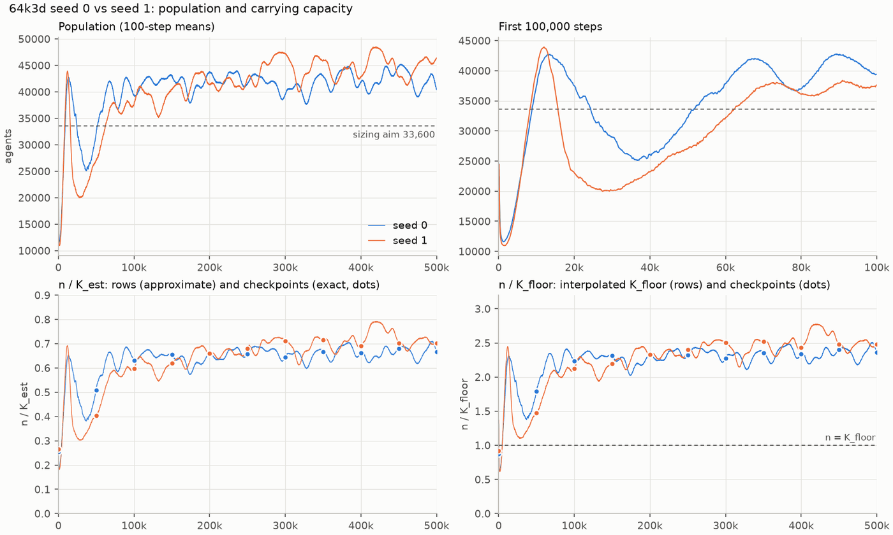

| `RESULTS_3D.md` claim | seed 0 | seed 1 | verdict |
|---|---|---|---|
| founder boom and crash: step 100 / per-step minimum (step) | 25,719 / 11,585 (1,200) | 25,433 / 10,936 (1,700) | yes |
| overshoot and trough: first peak (step) → trough (step) | 42,730 (13,100) → 25,111 (36,600), −41% | 43,953 (12,000) → 19,978 (27,500), −55% | partly |
| mean population, 100k–500k (× the 33,600 aim) | 41,923 (1.25×) | 43,176 (1.28×) | yes |
| no trend over 100k–500k: slope per 1,000 steps (95% interval) | +1.9 (−2.5 to +6.4) | +16.7 (+10.4 to +23.2) | no |
| mean population, 400k–500k (× the aim) | 42,326 (1.26×) | 45,244 (1.35×) | partly |
| n/`K_est` and n/`K_floor` at the checkpoints from 100k | 0.631–0.680; 2.24–2.40 | 0.598–0.716; 2.13–2.52 | yes |
| floor-layer share (`z` < 4) at the checkpoints from 100k | 18.9–20.8% | 21.2–22.6% | yes |
| n/`K_floor` minimum at the founder crash | 0.622 | 0.615 | yes |
| band fractions, floor to surface, last 50k | 0.531 / 0.078 / 0.043 / 0.348 | 0.573 / 0.077 / 0.041 / 0.308 | yes |
| four founder clades, final from step | 177,100 | 322,900 | partly |
| two depth zones of two clades; MI of clade and band at 500k (share of `H`) | 0.627 (0.60) | 0.717 (0.71) | partly / yes |
| median buoyancy cap, last 50k | 0.190 ± 0.014 | 0.285 ± 0.022 | no |
| mean cap of the large clades at 500k (floor, low water, upper water, surface) | 0.19 / 0.20 / 0.08 / 0.44 | 0.37 / 0.49 / 0.18 / 0.12 | no |
| births per agent per 1,000 steps, 100k–500k (Little lifetime, steps) | 1.048 (954) | 1.420 (704) | no |
| killed share of deaths, 400k–500k (2D: 0.13) | 0.496 | 0.583 | partly |
| emitters, 400k–500k (2D: 0.53) | 0.878 | 0.856 | yes |
| largest body, median over 100k–500k / share of the population | 2,582 / 6.3% | 11,655 / 26.6% | partly / no |
| no body of 10 or more wraps the torus (checkpoints 50k–500k) | none wraps | none wraps | yes |
| Channon's activity class (22 valid cells) | bounded in all | bounded in all | yes |

### 3.1 Population and capacity

- **The start.** Both runs boom and crash from the same founder design and overshoot to about 43,000 by step 13,000.
  Seed 1's trough is deeper and earlier (19,978 at step 27,500), and its last row below the sizing aim is at step
  62,200 (seed 0: 51,500).
- **The level.** The two runs agree over 100k–300k (means 41,843 and 41,657). Seed 1 then ends higher: over 300k–500k
  its mean is 44,694 against 42,002, a difference of +2,692 (interval +1,165 to +3,802). Its rise is concentrated in
  100k–300k (50k-window means from 38,754 at 100k–150k to 44,913 at 250k–300k); over 300k–500k its slope is +5.9 per
  1,000 steps (interval −10.4 to +21.3) and its 50k-window means stay between 43,876 and 46,119.
- **Settling.** The 10k-window mean stays within 10% of the final-100k mean from step 60,000 in seed 0 and from step
  170,000 in seed 1 (the first window that stays within ends at 70,000 and 180,000). The integrated autocorrelation time
  over 100k–500k is 14,300 steps in seed 0 and 73,800 in seed 1, because seed 1's series carries the rise.
  `RESULTS_3D.md`'s "stationary from about 70,000 to 100,000 steps" is a seed-0 result. The level at n = 2 is 42,000 to
  45,000 over 400k–500k, 1.26 to 1.35× the aim.
- **Capacity.** `K_est` spans 60,500 to 66,500 in both runs and `K_floor` 17,100 to 18,800. The occupancy of the 20
  layers follows their share of regeneration with log correlation 0.991 to 0.997 in both.
- **`DESIGN.md` §27.13's 30,000-step trial is a seed-0 trajectory.** The population at step 30,000 is 29,010 in
  seed 0 and 20,122 in seed 1.

### 3.2 Depth and clades

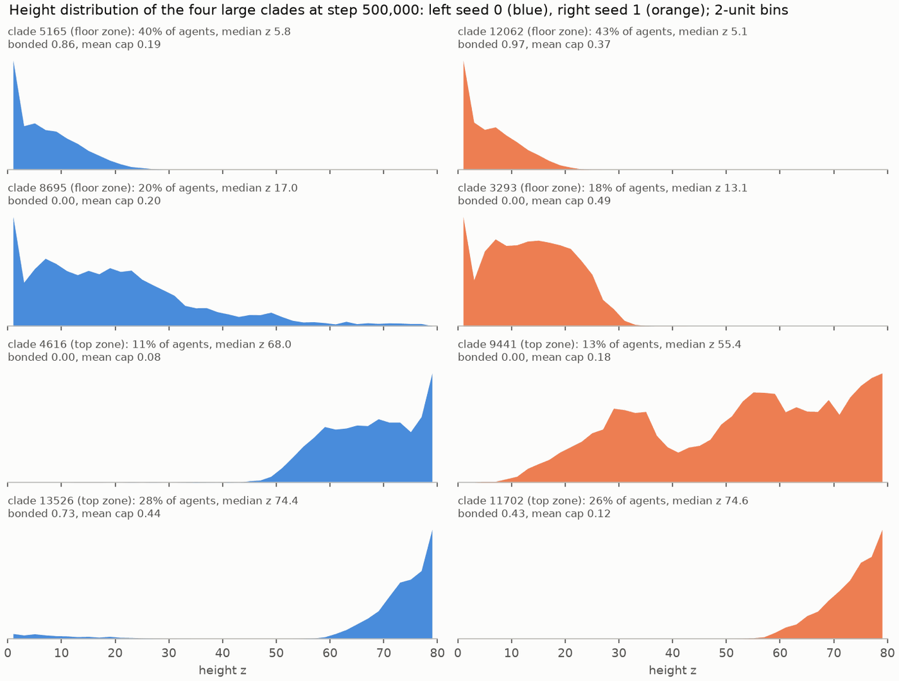

| seed | zone | clade | share | median `z` (quartiles) | bands, floor to surface | bonded | mean cap |
|---|---|---|---|---|---|---|---|
| 0 | floor | 5165 | 0.405 | 5.8 (1.5–10.9) | 0.97 / 0.03 / 0 / 0 | 0.86 | 0.19 |
| 0 | floor | 8695 | 0.202 | 17.0 (7.7–27.3) | 0.58 / 0.32 / 0.08 / 0.02 | 0.00 | 0.20 |
| 0 | top | 4616 | 0.110 | 68.0 (60.4–74.9) | 0 / 0 / 0.23 / 0.77 | 0.00 | 0.08 |
| 0 | top | 13526 | 0.283 | 74.4 (69.7–77.9) | 0.07 / 0.01 / 0.01 / 0.91 | 0.73 | 0.44 |
| 1 | floor | 12062 | 0.431 | 5.1 (1.3–9.5) | 0.99 / 0.01 / 0 / 0 | 0.97 | 0.37 |
| 1 | floor | 3293 | 0.179 | 13.1 (6.8–19.5) | 0.77 / 0.23 / 0 / 0 | 0.00 | 0.49 |
| 1 | top | 9441 | 0.126 | 55.4 (34.9–68.4) | 0.05 / 0.26 / 0.30 / 0.40 | 0.00 | 0.18 |
| 1 | top | 11702 | 0.264 | 74.6 (70.0–77.5) | 0 / 0 / 0.02 / 0.98 | 0.43 | 0.12 |

- **The same lifestyles.** In both seeds a bonded clade lives on the floor and another at the surface, and the two
  unbonded clades live in the water. The floor and top bands hold 0.879 and 0.881 of the agents over the last 50k,
  and no band share moves by more than 0.014 between 50k windows after step 100k.
- **Two zones, with a caveat.** The two zones are separate in height in both seeds (overlap 0.002 to 0.113 between
  zones at 500k in seed 0, 0.000 to 0.156 in seed 1), and most of the clade–band MI separates them (zone label alone
  0.515 and 0.582 nats). But seed 1's clade 9441 is a broad mid-to-upper clade (quartiles 34.9 to 68.4), not an
  upper-water clade like seed 0's 4616 (60.4 to 74.9), so "two zones of two" partly reflects the zone rule (§2).
- **What differs.** Seed 0's clade 4616 drifts upward from 150k (band-profile distance 0.423 between 150k and 500k)
  and its clade 13526 moved from the floor to the surface by 100k; no seed-1 clade drifts (at most 0.139) or changes
  zone. Seed 0 has a dominant episode (top clade 0.679 at step 76,900), seed 1 does not (at most 0.548). Seed 1
  reaches its final four clades at step 322,900, 1.8× later; the collapse to 10 clades takes the same time
  (99,500 and 98,300).

### 3.3 Buoyancy cap

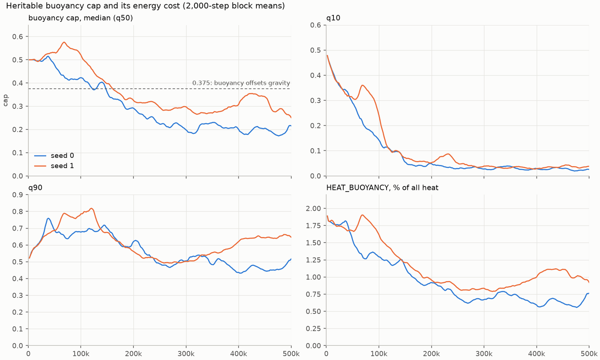

- **The direction replicates, the trajectory does not.** The median starts at 0.50 and falls in both seeds. Seed
  1's stays above 0.5 until step 103,700 (seed 0: 42,000), falls to 0.273 (50k window 300k–350k), rises to 0.344
  (400k–450k) and ends at 0.285 ± 0.022 over the last 50k. Seed 0 falls slowly to the end (slope over 200k–500k
  −0.021 per 100k, interval −0.029 to −0.013); seed 1's slope is flat (+0.002, interval −0.013 to +0.016).
- **The tails.** The q10 reaches about 0.02 to 0.04 in both, so a fifth to a third of the agents end in the zone where
  the cap costs nothing (cap below 0.125). The q90 falls to 0.50 by 250k in seed 1 and then rises to 0.65 (seed 0:
  0.465).
- **`HEAT_BUOYANCY`.** Its share of heat is 1.75% and 1.74% in the first 50k. Seed 0's falls to 0.62% at the end;
  seed 1's falls to 0.82% (250k–300k) and rises to 1.01%.
- **Which clade keeps a high cap is lineage-specific.** In seed 0 the surface clade keeps 0.44 and the upper-water
  clade has 0.08. In seed 1 the surface clade 11702 has 0.12 (it fell from 0.50 at 100k to 0.12 at 150k) and the
  floor-zone clades 0.37 and 0.49. The pooled Spearman correlation of cap and height at 500k flips sign, +0.357
  against −0.461; within clades it stays small and positive (+0.127 and +0.033). `RESULTS_3D.md`'s reading that the
  surface clade floats and the water clade climbs by thrust does not generalise. How the low-cap surface clade 11702
  holds its height was not examined.

### 3.4 Turnover and predation

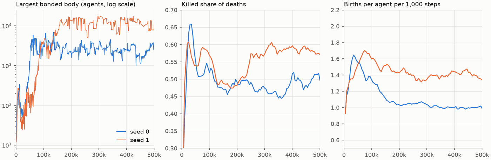

- **Turnover.** Seed 1 had 29,094,305 births against 22,495,125. From step 100k its per-agent birth rate is 1.420
  per 1,000 steps against 1.048, a Little lifetime of 704 steps against 954.
- **Generations do not follow.** The mean generation gains about 70 per 100k steps in both runs (462 and 444 at step
  500,000), although seed 1's agents reproduce 36% faster.
- **By clade.** Over 100k–500k the bonded clades of the three undirected runs turn over at 1.09 to 1.93 births per
  agent per 1,000 steps and the unbonded ones at 0.29 to 0.59. Seed 1's bonded clades are the fastest (12062: 1.93,
  11702: 1.53; seed 0's 5165: 1.34, 13526: 1.09), so its higher turnover is not only a matter of which clades
  dominate.
- **Predation.** The killed share rises in seed 1 from 0.48 (150k–200k) to 0.59 after 300k; over 400k–500k it is
  0.583 against 0.496. The predation ratio converges to 0.23 in both over the last 100k (2D: 0.078). `FLOW_CORPSE` is
  5.7% of regeneration against 4.0%.
- **Speed.** Seed 0's dip to 14.34 steps/s in 150k–200k is absent in seed 1 (14.80); its cause stays undiagnosed.
- **Not diagnosed.** The causes of seed 1's higher turnover, of its cap's rebound and of its population rise.

## 4. Density control: half the food

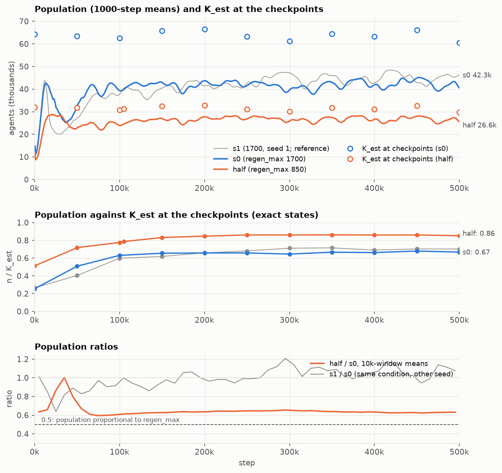

`runs/64k3d_s0_half` differs from seed 0 only in `fields.regen_max` (850 against 1,700). The founder state is
bit-identical, and the food patches are at identical positions at all 11 checkpoints; the two runs' event logs
diverge at step 17 (deaths: 2 against 3) and step 20 (births: the same 1,024 births, from different parents; the
birth counts differ from step 29). Seed 1 is shown as the seed-spread reference.

Mean over steps 400k–500k ([`results_3d_runs/endstate_four_runs.csv`](results_3d_runs/endstate_four_runs.csv),
[`results_3d_runs/windows_50k_four_runs.csv`](results_3d_runs/windows_50k_four_runs.csv)):

| metric | s0 (1,700) | half (850) | half/s0 | s1 (1,700) |
|---|---|---|---|---|
| population | 42,326 | 26,575 | 0.628 | 45,244 |
| `K_est`, mean of the 400k, 450k and 500k checkpoints | 63,301 | 31,130 | 0.492 | 62,956 |
| n/`K_est` | 0.670 | 0.858 | 1.28 | 0.699 |
| floor-layer share | 0.192 | 0.235 | 1.22 | 0.217 |
| births per 1,000 steps | 42,262 | 21,665 | 0.513 | 63,835 |
| killed share of deaths | 0.496 | 0.432 | | 0.583 |
| attacks per agent-step | 0.059 | 0.034 | 0.58 | 0.052 |
| predation ratio (stolen / harvested) | 0.231 | 0.165 | | 0.235 |
| harvest per agent-step (q) | 291.8 | 259.6 | 0.89 | 286.6 |
| heat per agent-step (q) | 261.4 | 238.4 | 0.91 | 252.1 |
| of which action heat (q) | 86.3 | 66.2 | 0.77 | 78.9 |
| energy per agent (q) | 20,488 | 20,521 | 1.00 | 21,452 |
| emitters | 0.878 | 0.511 | | 0.856 |
| sharers | 0.0115 | 0.0031 | | 0.0077 |
| clades alive at 500k | 4 | 2 | | 4 |
| `clade_height_mi` | 0.603 | 0.090 | | 0.687 |
| largest body, median of rows | 2,396 | 2,660 | 1.11 | 11,570 |
| `frac_in_bodies_ge4` | 0.356 | 0.330 | | 0.427 |
| steps/s, mean of rows | 14.70 | 14.96 | | 14.76 |

### 4.1 Why 0.63× and not 0.5×

- **The ratio is stable.** half/s0 is 0.635 over 100k–500k (interval 0.625 to 0.647) and 0.628 over 400k–500k
  (0.607 to 0.649). The 10k-window ratio stays between 0.595 and 0.656 from step 70,000. The half-food run has no
  trend over 100k–500k (+1.2 per 1,000 steps, interval −1.6 to +3.9).
- **Capacity halves.** `K_est` falls to 0.492× and `K_floor` to 0.4995×. The occupancy weighting is not the reason:
  `K_est`/`K_plain` is 0.931 against 0.921, and seven layers have weight 1 in both runs.
- **The population fills more of it.** The exact decomposition over the three late checkpoints
  ([`results_3d_runs/density_decomposition.csv`](results_3d_runs/density_decomposition.csv)):

  | factor | s0 | half | half/s0 |
  |---|---|---|---|
  | nominal regeneration (M q per step) | 13.03 | 6.48 | 0.497 |
  | share of it injected (`INJECT_REGEN` / nominal) | 0.850 | 0.981 | 1.154 |
  | heat / `INJECT_REGEN` | 1.0005 | 1.0002 | 1.000 |
  | heat per agent-step (q), inverted | 261.1 | 237.7 | 1.098 |
  | population | 42,416 | 26,733 | 0.630 |

  - The resource cap clips the full-food field. The share of nominal regeneration lost to it, from the ledger over
    the 1,000 steps that end at the 400k, 450k and 500k checkpoints, is 0.165, 0.136 and 0.151 at full food and
    0.030, 0.016 and 0.012 at half food (the pooled 0.150 and 0.019 are 1 minus the injected shares above). A snapshot
    of the field gives 0.23 to 0.28 and 0.02 to 0.04, but that is the share the next regeneration would lose if nothing
    were harvested first, an upper bound: harvest (S10) comes before regeneration (S17).
  - The cost per agent falls mostly in action heat (86.3 against 66.2 q per agent-step over 400k–500k, 20.1 of the
    22.9 q gap), with fewer emitters (0.878 against 0.511) and fewer attacks. The emission cost accounts for at most
    about 7.3 of the 20 q (upper bound, if every emitter pays every step) and the attack cost for about 1.2, so at
    least 11.5 q of the action-heat gap are not explained; this is arithmetic, not a ledger term.
- **Local density falls less than the total only on the floor.** Per field layer, the half-food run has 0.77× seed
  0's agents in the floor layer (the total is 0.63×), but 0.50× in mid-water (layers 5 to 14) and 0.57× in the top
  quarter. Its population is 1.58× the sizing
  aim scaled to half food (16,800), against 1.25× for seed 0.
- **The response to regeneration.** The elasticity of the population to `regen_max` is 0.67 (interval 0.60 to 0.74)
  from the half-food run, and 0.65 (0.55 to 0.75) from the director's damper pulses (§5.4).

### 4.2 Demography

- **The founder phase is harsher.** The crash reaches 8,684 at step 1,600 (seed 0: 11,585 at 1,200); the first peak
  is 28,900 at step 21,400.
- **Predation thins with density but stays a main cause of death.** The kill share is 0.432 over 400k–500k (seed 0
  0.496), and attacks per agent fall roughly in proportion to density (0.58×). The shift in kill share is smaller
  than the seed pair's gap in the other direction (s1 0.583).
- **The rates drift late.** Births fall from 26,034 per 1,000 steps in 300k–350k to 20,391 in 450k–500k while the
  population stays flat; sharers fall to 0.17% and emitters to 0.49 over the last 50k. The newborns' mean
  generation advances by 125 per 100k steps over 100k–500k but by 9.6 in the last 100k; this stall was not
  diagnosed.

### 4.3 Clades and depth

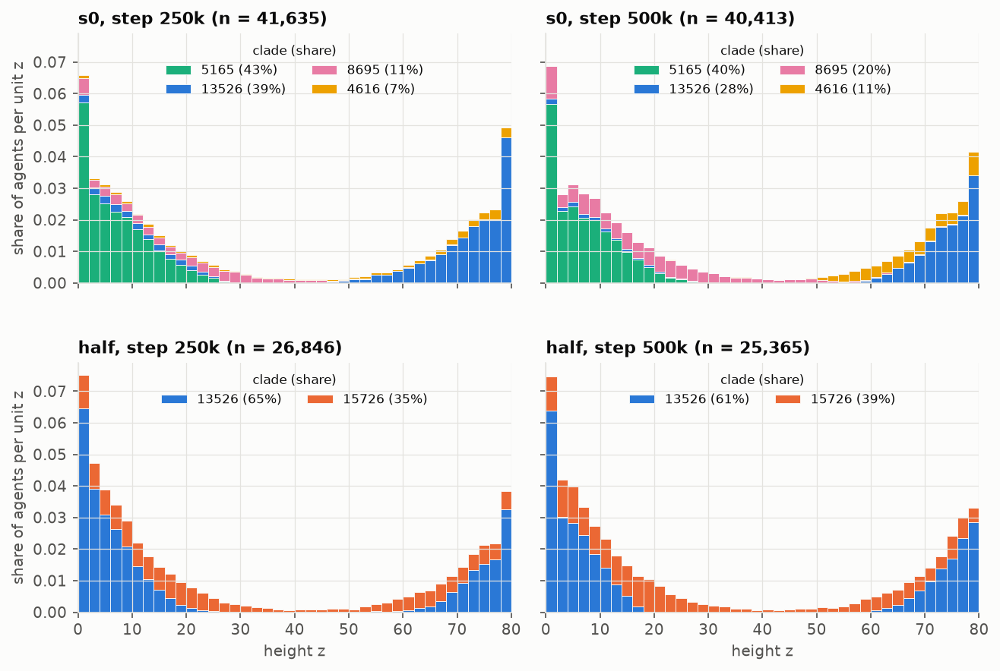

- **Two survivors.** The half-food run reaches 4 clades at step 189,100 and 2 at step 243,000 (clade 4616 died at
  189,050, 6441 at 240,701 and 8699 at 242,933). At 500k clade 13526 holds 0.607 and 15726 0.393. Clade 13526
  survives in both runs; seed 0's largest clade, 5165, never reached 1% at half food.
- **Founders matter early and wash out.** The 20 largest clades at step 2,000 overlap in 12 of 20 between s0 and
  half (0.02 expected by chance; s0 and s1: 0); by step 50,000 the overlap is 6.
- **Both clades span both zones.** At 500k clade 13526 has band fractions 0.64 / 0 / 0 / 0.36 (floor to surface)
  and 15726 0.51 / 0.16 / 0.08 / 0.26. The clade–band MI is 0.091 nats at 500k (seed 0: 0.627), and
  `clade_height_mi` averages 0.090 over 400k–500k.
- **The population is still two-ended.** The floor band holds 0.590 and the top band 0.315 (seed 0: 0.531 and 0.348).
  So the two-ended profile follows the food profile and gravity; it does not need clades partitioned by depth.
- **A niche taken over, not tested.** The half-food run's surface clade 8699 (0.99 or more in the top band) declined
  to extinction; over the same period clade 13526's top-band share rose from 0.11 (150k) to 0.26 (200k) and 0.36
  (500k). This is coincident in time; the cause was not tested.

### 4.4 Buoyancy cap

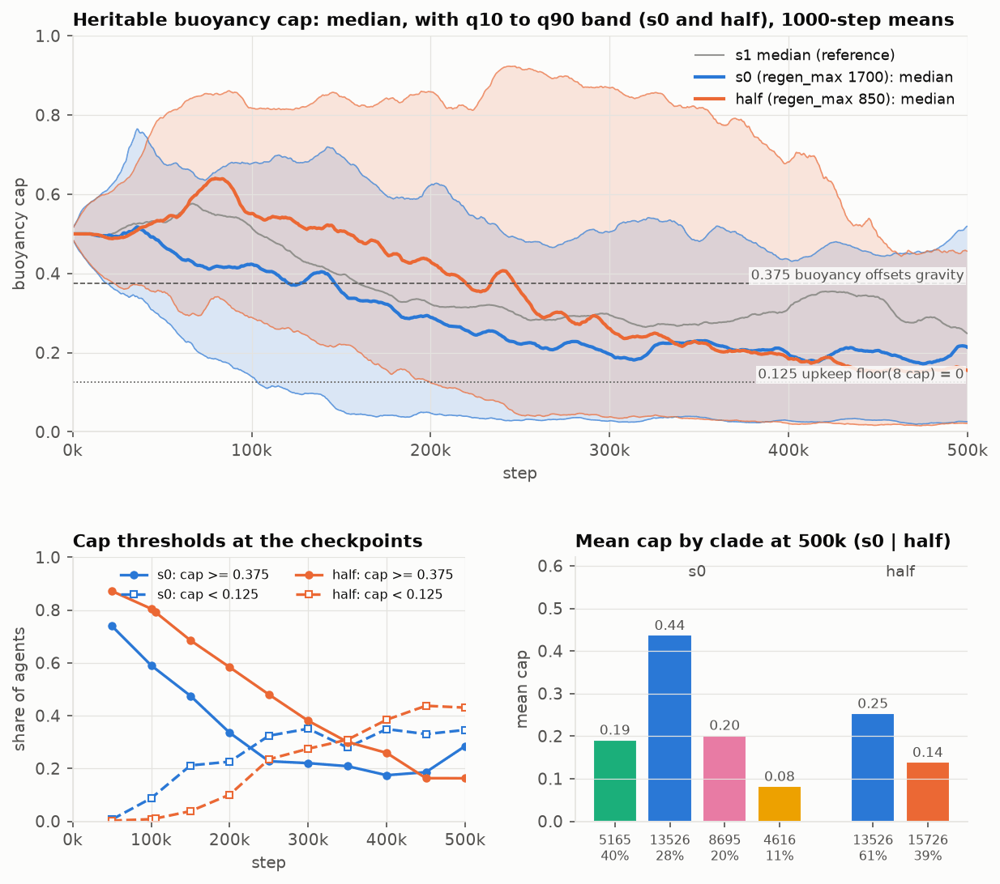

- **Erosion is delayed, not prevented.** The median cap (5,000-step running mean) is permanently below 0.4 from step
  245,300 at half food, against 143,800 (s0) and 149,400 (s1); on the per-row median, from 243,200, 142,200 and
  147,000. Over the last 50k it is 0.156 (s0 0.190, s1 0.285).
- **At step 500,000** the share of agents with a cap below 0.125 is 0.43 (s0 0.35), and the share at or above 0.375
  is 0.16 (s0 0.28). The mean cap is 0.25 in clade 13526 and 0.14 in 15726.

## 5. The director in 3D

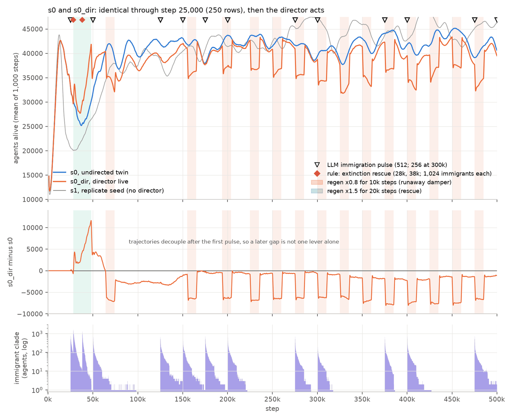

### 5.1 Pairing

- **Identical through step 25,000.** The metrics rows of s0 and s0_dir at steps 100 to 25,000 (250 rows) are equal
  in every key except the wall-clock ones (`wall_s`, `steps_per_s`, `peak_mem_gb`) and `env`, which only the director
  run logs and which is inert through 25,000. The 1,027,897 births and 1,012,072 deaths before step 25,000 match
  record for record.
- **Divergence.** The first differing row is 25,100: 61 of its 74 compared keys differ, including `immigrants` (512),
  the LLM's first pulse at the 25,000 boundary. No later row is identical. The gap in `n_alive` is +704 at 25,100,
  between −137 and +213 over 25,500 to 26,000, and −934 at 28,000.
- **So** director-enabled-with-inert-levers equals director-off in 3D in every metrics row and event record, as
  `DESIGN.md` §26.8 specifies (it states bit-identical; the state itself is not compared, because the only checkpoint
  before 50,000 is the initial state), and after step 25,000 s0_dir is a different realisation of the same seed. Every
  comparison after 25,000 below is unpaired.

### 5.2 What it did

| source | rule or lever | entries | steps | parameters |
|---|---|---|---|---|
| LLM | `immigration_pulse` | 12 | 25k, 50k, 125k, 150k, 175k, 200k, 275k, 300k, 375k, 400k, 475k, 500k | 512 immigrants (256 at 300k) |
| rule | `runaway_damper` → `regen_pulse` | 15 | 64k, 155k, 194k, then every 25k from 225k to 500k | ×0.8 for 10,000 steps |
| rule | `extinction_rescue` | 3 | 28k (two entries), 38k | 28k: regen ×1.5 for 20,000 steps and 1,024 immigrants (override); 38k: 1,024 immigrants (regen cooling down) |
| revert | `regen_pulse` | 15 | the end of each regeneration pulse | ×1.0 |

The full list is [`results_3d_runs/director_entries.csv`](results_3d_runs/director_entries.csv).

- **Budget.** The 30 forward entries cost 30 units, 6.0 per 100k, which is the Trickster's budget: 15 for the damper,
  12 for the LLM and 3 for the rescues. The budget was full at 67.8% of the 1,000-step boundaries.
- **Regeneration.** It was ×0.8 for 28% of all steps and 40% of the steps from 250k; ×1.5 for 4%.
- **Immigrants.** 7,936 were requested and 7,424 admitted; the pulse at step 500,000 was still pending at the end.
  That is 0.034% of the run's births.
- **Unused levers.** No season, drift, patch-gain, patch-off or catastrophe lever was ever applied: `env.season_amp`
  is 0 on all 5,001 rows.
- **The LLM** ([`results_3d_runs/director_llm_calls.csv`](results_3d_runs/director_llm_calls.csv)):
  - 20 calls, at every multiple of 25,000, all on `google/gemma-4-26b-a4b-qat`. Outcomes: 12 ok and 8 none; no
    failed, invalid or rejected reply, no fallback and no clamp. Latency: median 2.80 s, p90 3.12 s, maximum
    3.56 s. Prompt: median 2,535 tokens.
  - All 8 "none" replies came with the budget spent (6 of 6). In all 12 "ok" calls other levers were affordable
    (`set_seasons`, `fertility_shift`, `drift_change`, and sometimes more), and the model chose `immigration_pulse`
    every time. In 11 of them it asked for two identical pulses, and the duplicate was dropped.
  - Of the 17 numbers in its journal text, 16 are in the prompt it saw. One is wrong: "374 clades at step 25,000"
    (the prompt says 334). At step 325,000 it attributes a decline to "the current regen_pulse", a pulse applied
    at that same boundary, after the decline.
- **The pause at 249,394.** The rows around the pause (94 and 6 steps) have ledger error 0, and row-to-row changes
  across it are at most 2.6 sd of normal changes (deaths per step in the 6-step row; the other keys below 1.4 sd).
  There were no entries between 249,000 and 250,000; the 250,000 boundary after the resume made one damper entry
  and one LLM call. There are no duplicate entries, no second header, and the vital signs recomputed from the rows
  equal the logged ones for all 45 entries. No decision was lost or repeated. Bit-equality with an uninterrupted run
  cannot be tested.

### 5.3 The rules in 3D

- **The season-aware path (rules version 2) never ran.** No season was set, no entry carries `fall_seasonal`, and
  the journal has no `seasonal_exemption` note.
- **The rescues read the founder overshoot.** Both fired on the fall criterion, not the `K` criterion: fall 0.322
  with n/`K_floor` 1.54 at step 28,000, and fall 0.315 with 1.11 at 38,000. The same flag (fall > 0.3) is raised at
  21 consecutive boundaries in s0 (28,000 to 48,000) and 42 in s1 (17,000 to 58,000), and never in the half-food
  run. `RESULTS_3D.md` §10 predicted this.
- **The damper fires on the body condition.** All 15 firings came from "largest body above 5% of the population"
  (5.8% to 12.2% at the firings); the population was 0.581 to 0.673 of `N_CAP`, far from the crowding branch's 0.95.
  The 5% threshold sits near or below the median of every 64k3d run: the condition holds at 75% (s0), 99% (s1) and
  94% (half) of the boundaries after step 100k.
- **So the damper is a clock.** From step 194,000 the condition held at 275 of 307 boundaries. An emulation of the
  cooldown and budget reproduces all 15 firings exactly: from 194,000, 13 fired, 256 were blocked by the 15,000-step
  cooldown and 6 by the budget (219,000 to 224,000). The damper took half the budget. A pulse lowers the trigger
  statistic by only about 0.01, so it stays above 5%.

### 5.4 Effects of the levers

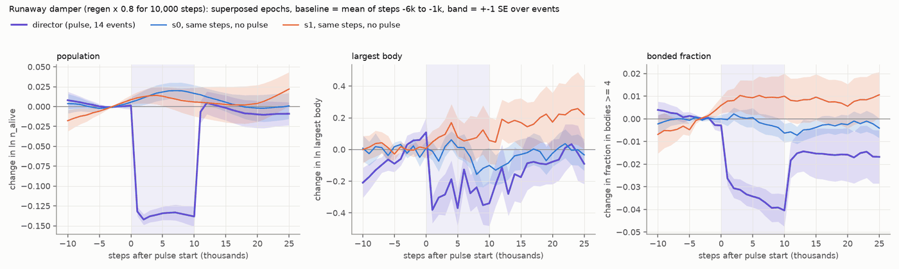

- **The damper, population.** In the 14 pulses with 20,000 steps of data after them, ln `n_alive` changes by −0.136
  (interval −0.150 to −0.124) over the first 5,000 steps, negative in 14 of 14 (s0 at the same steps: 5 of 14; s1:
  6 of 14). The step is complete within about 1,000 steps and reverses within about 1,000 steps of the pulse's end.
  For the 13 pulses from step 155,000 the mean shift over the 10,000-step window is −5,595 agents (sd 340 across
  pulses), 13.4% of about 41,800. Nothing remains over 50,000-step windows (−1,213, p = 0.31).
- **The damper, bodies.** ln of the largest body changes by −0.305 (−0.498 to −0.128) in the first 5,000 steps, and
  by −0.318 (−0.540 to −0.127) against the rule-matched placebo; it regrows over 10,000 to 15,000 steps.
  `frac_in_bodies_ge4` changes by −0.031 (−0.040 to −0.024), negative in 14 of 14.
- **The damper, predation.** Over the 10,000-step window of the 9 pulses without an immigration pulse at the same
  step, the kill share changes by −0.031 and the predation ratio by −0.029.
- **The response to regeneration.** The pulse cuts the nominal regeneration to 0.8× but the injected regeneration
  only to 0.850× (the resource cap clips less). The population's elasticity to the nominal multiplier is 0.65 (0.55
  to 0.75), the same as from the half-food run, 0.67 (0.60 to 0.74).
- **Immigration.**
  - All immigrants share clade id 16384. It peaked at 1,641 agents at step 28,100 (after the rescue's 1,024). Within
    10,000 steps of a pulse 3 to 25 of its agents remain; it died out between pulses six times; 2 agents remain at
    step 500,000, of 39,165.
  - 5,610 of the 7,424 immigrants had at least one child, but the clade's 8,107 births did not replace it.
  - The only detectable effect is on `clades_alive`, +1.0 over 10,000 steps (p = 0.02, 5 events) and +0.13 over
    50,000 steps (p = 0.9): the transient immigrant clade. Population, top-clade share, emitters, predation and body
    size show nothing (p > 0.3).
- **The rescue.** Over steps 28,000 to 48,000 the population averages 32,578 against s0's 27,243 (+19.6%). The trough
  is 27,569 at step 35,400 (s0: 25,111 at 36,600). The gap reaches +11,819 at step 48,000 (42,370 against
  30,551) and is gone by about 64,000. The largest body first reaches 1,000 agents at step 40,000 (s0: 49,000),
  inside the range of the other runs (35,000 to 82,000).

### 5.5 Outcome

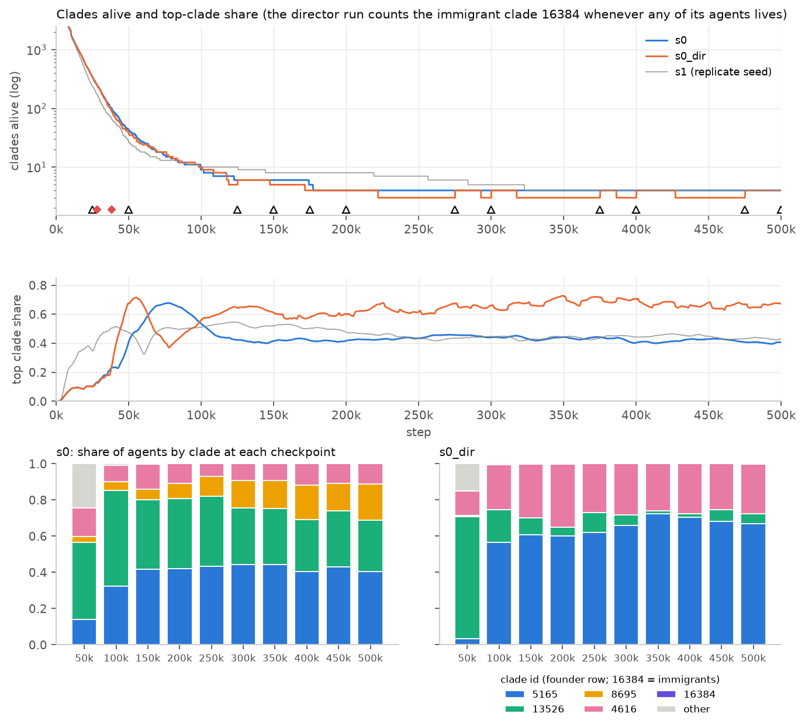

Mean over steps 400k–500k:

| metric | s0 | s0_dir | s1 | half |
|---|---|---|---|---|
| population | 42,326 | 38,511 | 45,244 | 26,575 |
| injected regeneration (M q per step) | 11.06 | 10.37 | 11.41 | 6.34 |
| founder clades alive | 4 | 3 | 4 | 2 |
| top clade share | 0.414 | 0.662 | 0.443 | 0.621 |
| clade entropy (nats) | 1.27 | 0.79 | 1.27 | 0.66 |
| `clade_height_mi` | 0.603 | 0.167 | 0.687 | 0.090 |
| largest body, mean of rows | 2,435 | 3,153 | 11,588 | 2,957 |
| `frac_in_bodies_ge4` | 0.356 | 0.284 | 0.427 | 0.330 |
| mean bonds per agent | 0.99 | 0.87 | 1.26 | 0.92 |
| killed share of deaths | 0.50 | 0.52 | 0.58 | 0.43 |
| predation ratio | 0.23 | 0.22 | 0.23 | 0.17 |
| emitters | 0.878 | 0.879 | 0.856 | 0.511 |
| median buoyancy cap | 0.193 | 0.197 | 0.315 | 0.164 |
| mean generation | 434 | 360 | 412 | 477 |

- **Population.** The gap of −3,815 against s0 splits into the damper's on-off effect, −2,250 (it is on in 40% of
  the rows), and an offset of −1,565 while regeneration is ×1. Per unit of injected regeneration the director run
  holds 0.971 of s0's population.
- **Viability.** The lowest 100-step mean after step 100k is 31,668 (0.755 of s0's 100k–500k mean), inside a damper
  window; s0's is 37,628. There was no collapse and no extinction; the energy ledger was exact throughout.
- **Clades.** The director run ends with three founder clades, 5165 (0.67 of the agents at 500k; 0.66 over 400k–500k),
  4616 and 13526 (0.06; 0.28 in s0), plus 2 immigrant-clade agents. Clade 8695, which holds 0.20 of s0 at 500k, went
  extinct at about step 118,900. The loss of the clade-by-depth structure (`clade_height_mi` 0.17) follows from the loss
  of clades.
- **Attribution.** The 3 founder clades and the top share of 0.66 lie outside the seed pair (4 and 4; 0.41 and
  0.44). But the half-food run, without a director, also ends with 2 clades and a top share of 0.62, and after
  step 25,000 the director run is an unpaired realisation. With one trajectory per arm, the director's levers cannot
  be separated from chaotic divergence. The director run's gaps from seed 0 in the largest body (+718 against the
  seed pair's +9,153) and in bonds per agent (−0.12 against +0.27) are inside the seed pair's. Its gap in
  `frac_in_bodies_ge4` (−0.072) equals the seed pair's (+0.071), so it is not attributable at n = 1.
- **Novelty and coverage** (the director's own archive, recomputed for every run):

  | run | coverage at 500k | cells not visited by s0 | mean novelty | persistent novelty against s0 (17 anchors, share above 0) |
  |---|---|---|---|---|
  | s0 | 21 | 0 | 0.0265 | 0 (by construction) |
  | s0_dir | 28 | 9 | 0.0272 | −0.0001 (59%) |
  | s1 | 20 | 9 | 0.0276 | +0.0008 (71%) |
  | half | 26 | 22 | 0.0257 | +0.0012 (82%) |

  The anchors are the director run's intervention steps up to 350,000 (the after-window must end by 500,000); the
  director-free runs are evaluated at the same steps. On the 17 anchors the director run's persistent novelty
  (−0.0001) is below both director-free trajectories (s1 +0.0008, half +0.0012) and slightly below 0: no gain. Over
  the 8 LLM-only anchors it is −0.0008.
- **Activity.** The director run's cohort-pool rate equals s0's (mean paired difference of the 50k-block rates from
  100k: −0.02 ± 1.08 at horizon 200k, against s1 − s0 = +5.7 ± 1.3). Its marker-space rate is lower: at μ = 0.01 it
  averages 8.8 against 13.0 (s0) and 14.8 (s1), −4.2 ± 1.3 against s0 with 1 of 8 blocks above; at μ = 0.003, 11.8
  against 18.5 and 18.1. Over 100k–300k at μ = 0.003 it sits at its own heritability null (10.6 against 10.9) and is
  below that null in 3 of the 4 50k blocks. These ± are naive standard errors of overlapping blocks, so lower bounds.
  The cause was not identified: the director run also has a different clade state from 100k (top clade 0.62 to 0.70),
  though the half-food run, with a similar clade state, shows no drop at μ = 0.01.

### 5.6 Against the 2D evaluation (`docs/EVALUATION.md`)

- **Different behaviour.** In 2D, arm C (the same persona and LLM tier) set permanent seasons first and alternated
  levers; its rescues fired at every seasonal trough (34 and 38) and it answered "none" in 36 and 37 of 56 calls. Here
  the model used one lever, the rescue fired only during the founder overshoot (2 steps), and "none" came only with
  an empty budget (8 of 20).
- **No novelty gain here.** In 2D arm C had coverage 87 and 69 (control 23 and 32) and persistent novelty +0.015 and
  +0.0065, driven by the seasons it set; its cohort-pool activity rate was 2.4 to 4 times the control's. None of this
  appears in the 3D run, which set no seasons. The setups differ (fork at 120k against a run from step 0, preset,
  model build, budget use), so this is a contrast, not a like-for-like comparison.
- **The same in both.** Immigrants do not establish (2 of 39,165 agents at the end here; 1 of 26,349 in 2D arm C,
  seed 0), and the replies were valid JSON every time (median latency 2.8 s on the QAT model here, 3.6 to 4.4 s on
  the 8-bit model in 2D).

## 6. Bodies across the four runs

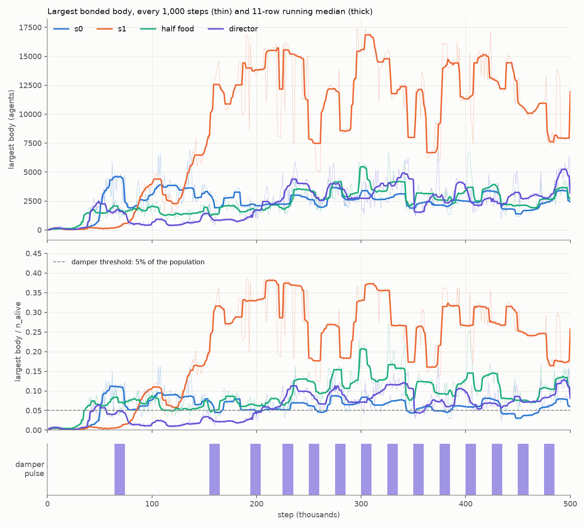

### 6.1 Sizes

Steps 400k–500k ([`results_3d_runs/bodies_endstate.csv`](results_3d_runs/bodies_endstate.csv),
[`results_3d_runs/bodies_windows_50k.csv`](results_3d_runs/bodies_windows_50k.csv)):

| run | population | largest body, median (q10–q90) | largest / population | `frac_in_bodies_ge4` | bonds per agent | first step with a body of 1,000 |
|---|---|---|---|---|---|---|
| s0 | 42,326 | 2,396 (1,574–3,443) | 5.9% | 0.356 | 0.99 | 49,000 |
| s1 | 45,244 | 11,570 (7,790–15,020) | 26% | 0.427 | 1.26 | 82,000 |
| half | 26,575 | 2,660 (1,942–4,092) | 10.5% | 0.330 | 0.92 | 35,000 |
| dir | 38,511 | 2,882 (2,067–5,004) | 7.3% | 0.284 | 0.87 | 40,000 |

- **Onset does not follow early density.** The mean population over steps 0 to 50,000 is 30,000 (s0), 24,900 (s1),
  23,600 (half) and 32,300 (dir), against onsets at 49,000, 82,000, 35,000 and 40,000.
- **Where the largest body sits** (checkpoints 100k to 500k): a surface sheet of clade 13526 at 6 of 9 in s0 (a floor
  sheet of 5165 at the other 3); a floor sheet of clade 12062 at 9 of 9 in s1; a floor sheet of clade 13526 at 9 of
  9 at half food; a floor sheet of 5165 at 8 of 9 in the director run. Clade 13526 makes surface sheets in s0 and
  floor sheets at half food.

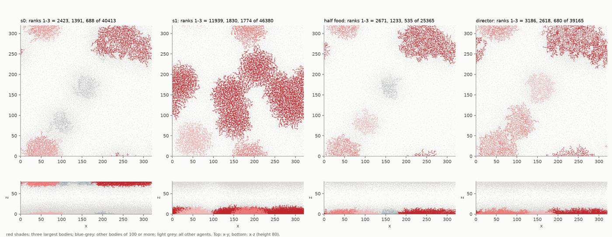

### 6.2 Seed 1's giant body

- **Size and make-up.** At step 500,000 the largest body has 11,939 agents (25.7% of 46,380) and 16,669 bonds. It is
  one clade, 12062, with all bonds inside the clade; 60% of that clade's 19,996 agents are in it. Its members'
  median generation, 495, equals the population's.
- **A floor sheet, thicker than seed 0's.** Its height is 1.0, 4.9 and 14.2 at the 5th, 50th and 95th percentiles; 22% of the members
  are grounded and none is at the surface. The sd along its principal axes is 77.4, 44.7 and 4.5. It is a denser
  mesh than seed 0's largest body: mean degree 2.79 (2.66), 0.89 of the members in the 2-core (0.79), 13% of the
  bonds bridges (23%), hop diameter 214 (112).
- **Almost box-spanning, but not wrapping.** Its footprint covers 94% of the x columns and 75% of the y columns. At
  no checkpoint from 100k to 500k does it close a loop around the torus (no winding on its non-tree edges, no
  unbonded seam pair closer than 4); the r < 4 contact cluster wraps at 4 of 9 checkpoints (s0 2, dir 2, half 0).
  It is an open sheet.
- **Not one stable object.** From 200k the mass in bodies of 1,000 or more is steady at 14,900 to 17,400 agents, and
  the largest body holds 49% to 89% of it as patches merge and split (at 250k there are two floor bodies of 7,826 and
  7,632). Over the rows from 200k to 500k the largest body is 10,000 or more in 74% of rows. Its velocity coherence
  is 0.04 to 0.09: members do not move together.

### 6.3 Body size and density

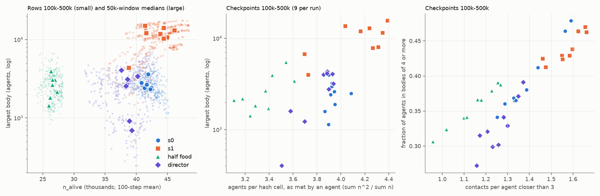

- **The half-food control cannot show whether density sets body size.** half/s0 over 400k–500k (ratios of means; of
  medians for the largest body; a difference for `frac_in_bodies_ge4`): population 0.628 (within-run bootstrap interval
  0.599 to 0.658 on the 1,000-step heavy rows with the body series; §4.1's 0.607 to 0.649 uses the 100-step rows), largest body 1.11 (0.79 to 1.78), `frac_in_bodies_ge4` −0.025 (−0.041 to −0.012). s1/s0, under the
  same conditions: population 1.07 (1.01 to 1.12), largest body 4.8 (3.6 to 7.1), `frac_in_bodies_ge4` +0.071. (The
  bootstrap medians of these ratios are 1.13 and 4.9.) The seed gap in the largest body (ln 4.83 = 1.58) is 2.3 times a
  halving (ln 2 = 0.69), and the intervals leave out the variance between trajectories (§2), so one half-food run cannot
  detect a density effect of that size.
- **Local density falls less than the population** (mean of the 400k, 450k and 500k checkpoints;
  [`results_3d_runs/bodies_density_endstate.csv`](results_3d_runs/bodies_density_endstate.csv)):

  | run | agents per unit of floor area | agents per hash cell, as met by an agent | contacts closer than 3, per agent | agents with `z` ≤ 5 |
  |---|---|---|---|---|
  | s0 | 0.414 | 3.97 | 1.29 | 9,601 |
  | s1 | 0.430 | 4.25 | 1.56 | 10,912 |
  | half | 0.261 | 3.41 | 1.08 | 7,508 |
  | dir | 0.398 | 3.92 | 1.22 | 9,820 |

  Half food cuts the population by 37% but the occupancy an agent meets by 14% and its contacts by 16%, because the
  population concentrates in the floor layer. (The last column counts `z` ≤ 5; §4.1 counts the field's layer 0,
  `z` < 4, where half food has 0.77× seed 0's agents.)
- **Correlations.** Over 36 checkpoints (4 runs × 9, 100k–500k) the Spearman correlation of the largest body with
  the population is 0.35 (0.21 within runs), with the occupancy an agent meets 0.59 (0.53), and with contacts per
  agent 0.65 (0.45). `frac_in_bodies_ge4` correlates with contacts at 0.86 (0.93 within runs). The contacts are
  partly made by the bonds (`RESULTS_3D.md` §5.5), and the permutation p-values ignore autocorrelation, so these do
  not separate crowding from bonding.
- **The contact graph sets the size, as in seed 0.** A null model with the same agents, positions and degrees, bonds
  placed nearest-first among pairs closer than 3, gives a largest body of 0.87 (s0), 0.96 (s1), 0.81 (half) and 0.75
  (dir) of the observed (medians over 9 checkpoints). The probability of a bond given a contact closer than 3 is 0.71
  to 0.87 over the checkpoints from 100k (0.72 to 0.82 as each run's mean of the 400k, 450k and 500k checkpoints,
  `bodies_density_endstate.csv`).
- **A sudden cut shrinks the bodies.** Within the director run, a 13% fall in population during a damper pulse
  comes with a fall of about a quarter in the largest body (ratio of the mean log changes over the first 5,000 steps,
  each net of the same calendar steps of s0 and s1: 2.35, interval 1.08 to 3.78; 2.24 from the raw changes of §5.4). The pulse cannot separate a density effect from a direct food effect, such as the
  starvation of bonded agents.
- **Reading.** At a permanent 0.63× population the half-food run's largest body is 1.11× seed 0's, inside the 4.8×
  gap between the seeds: the control neither shows nor excludes a shrinking. A sudden 0.87× cut shrank the bodies
  within one run, for 10,000 to 15,000 steps. Crowding against bonding as the cause of body size is still open.

### 6.4 Common structure

- **Across all 40 checkpoints** (4 runs × 50k to 500k) the recomputed bodies equal the metrics rows' `bodies_*` keys,
  no body of 10 or more wraps the torus, and the three largest bodies at 250k, 400k and 500k are single-clade (one
  of them, seed 1's largest at 250k, has one member of a second clade), with every bond inside the clade except one
  (seed 1, 250k).
- **No coordination.** The velocity coherence of the largest body is 0.01 to 0.19 across runs and checkpoints, and
  the velocity cosine between bonded neighbours is 0.01 to 0.08 (unbonded contacts −0.01 to 0.04).
- **Sheets.** Over bodies of 10 to 300 agents the radius of gyration scales with a dimension of about 2 in every run
  (1.75 to 2.50 over all runs and checkpoints; 1.99 to 2.29 in seed 0).

## 7. Evolutionary activity

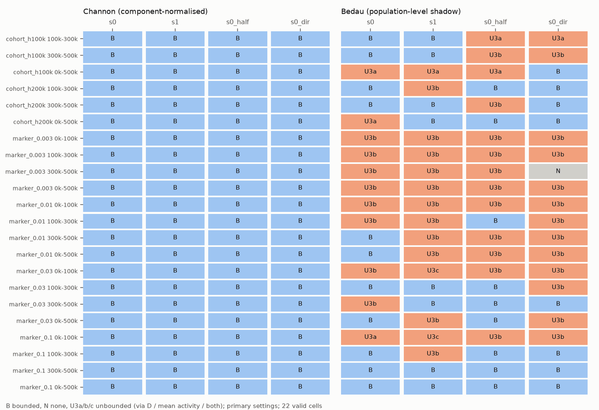

- **Channon: bounded in all 22 valid cells in all four runs** (primary settings;
  [`results_3d_runs/activity_classification.md`](results_3d_runs/activity_classification.md)). Over the informative
  sweep, only seed 1 has unbounded settings: 10 of 30 in cohort horizon 200k, 100k–300k (all at the strictest ρ0 of
  0.003; ρ_cum +0.232, ρ_med +0.003), and 5 of 18 in markers μ = 0.1, 0–100k. Its primary class is bounded in both.
- **Bedau's class is not stable between runs.** The primary tallies (bounded / none / unbounded over 22 cells) are
  11/0/11 (s0), 8/0/14 (s1), 9/0/13 (half) and 8/1/13 (dir). The four runs disagree in 14 of 22 cells. The seed pair
  agrees in 0.68 of the cells; the other pairs agree in 0.55 to 0.73.
- **New adaptive activity is positive everywhere and mostly above both nulls.** `A^N_new` is positive in every 50k
  block (176) of every window (72) of every run, in the cohort pools and in the marker spaces μ = 0.003, 0.01 and 0.03.
  It is above both nulls in every window but one and in all blocks but four. The exceptions are the director run's
  markers at μ = 0.003 over 100k–300k (10.6 against a heritability null of 10.9; below that null in 3 of its 4 50k
  blocks, and below the neutral shadow too in 2) and seed 1's cohort pool with horizon 200k in 450k–500k (22.7 against
  a neutral shadow of 23.9). At θ = 3,162 (run / neutral shadow / heritability null;
  [`results_3d_runs/activity_rates.md`](results_3d_runs/activity_rates.md)):

  | space | window | s0 | s1 | half | dir |
  |---|---|---|---|---|---|
  | cohort, horizon 200k | 100k–300k (valid from 200k) | 22.3 / 7.0 / 5.1 | 27.4 / 21.7 / 13.3 | 15.8 / 5.5 / 2.9 | 20.1 / 9.4 / 5.3 |
  | cohort, horizon 200k | 300k–500k | 19.2 / 6.6 / 3.5 | 25.3 / 23.3 / 15.0 | 13.0 / 3.3 / 1.95 | 20.3 / 8.3 / 3.6 |
  | markers, μ = 0.01 | 100k–300k | 13.4 / 0.70 / 0.70 | 13.5 / 1.9 / 2.8 | 12.3 / 0.40 / 0.23 | 9.2 / 0.83 / 1.5 |
  | markers, μ = 0.01 | 300k–500k | 12.6 / 0.43 / 0.45 | 16.1 / 1.8 / 3.3 | 12.8 / 0.07 / 0.07 | 8.5 / 0.50 / 1.0 |

  Seed 1's nulls in the cohort pool are 3 to 4 times seed 0's, for reasons not traced, so each run is read against
  its own nulls: run over heritability null is 4.4 and 5.6 (s0), 2.1 and 1.7 (s1), 5.4 and 6.7 (half), 3.8 and 5.6
  (dir) in the two cohort windows.
- **Half food** lowers the cohort-pool rate to about 0.7× seed 0's and leaves the marker rate at μ = 0.01 unchanged.
- **The other `RESULTS_3D.md` §6 claims:**
  - *Cumulative `A^N` grows in the cohort pool.* In 100k–300k for s0 (ρ_cum +0.28) and s1 (+0.23), not for the
    director (−0.15) or half-food run (−0.04). In 300k–500k s0's growth (+0.05) is not replicated (−0.03, −0.04,
    −0.03). The median `Ã^N` does not grow in any run (ρ_med below 0.01), hence "bounded" everywhere.
  - *Persisting marker components reproduce less than their share.* The sign replicates in all four runs; the size
    varies about fivefold. The slope of the mean `A^N` at μ = 0.01 is −160 (s0), −64 (s1), −323 (half) and −243
    (dir) per 100k steps; seed 1 ends at +43 where the others end at −596 to −1,137.
  - *Lineage sorting weakens over the run.* The run-to-null ratio of surviving lineages rises with the cohort's start
    in all four runs. Seed 0 is the strongest sorter: at age 100k, for cohorts started in 300k–400k, the ratio is
    0.374 (s0), 0.586 (s1), 0.603 (half) and 0.451 (dir).
  - *No heritable advantage beyond the null.* The survivors' excess share of births at age 100k (cohorts from 100k)
    is −0.004 (s0), −0.007 (s1), −0.016 (half) and −0.009 (dir).

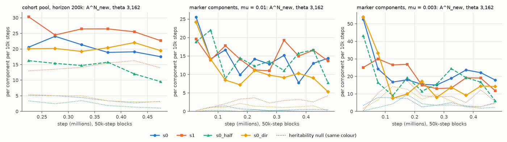

## 8. Caveats

- **One run per condition.** Only s0 and s1 share a condition, and that pair is a single difference, not a variance.
  It already differs by 1.4× in turnover, by 4.5× in the median largest body (4.8× over 400k–500k) and by 0.07 in
  `frac_in_bodies_ge4`, so smaller differences between other runs are not attributable. For an exchangeable third
  replicate, the director run would lie outside [s0, s1] two thirds of the time.
- **500,000 steps.** The mean generation at the end is 444 to 501 in the undirected runs (375 over the director
  run's last 50k). Seed 1 rose between 100k and 300k (50k-window means 38,754 to 44,913) and has been level at 44,000
  to 46,000 since 250k; its autocorrelation time, 73,800 steps, is about 5 times seed 0's because its series carries
  that rise, and the
  half-food run's rates (not its population) drift after 350k.
- **The pauses.** The director run was paused at step 249,394 and resumed: no decision was lost or repeated (§5.2),
  but equality with an uninterrupted run cannot be tested. The half-food run was paused at step 105,262; no
  discontinuity is visible, and the determinism of that resume was not re-tested.
- **The director comparison.** Pairing is exact only to step 25,000. After that the per-event effects compare two
  realisations; the events (25,000 steps apart) overlap and are mildly dependent; the per-event p-values compare
  with random times in the same pair of runs, whose background includes the damper's offsets. No checkpoint was
  taken during a pulse. The LLM is the QAT build on a 3D prompt; the 2D evaluation used the 8-bit build.
- **Zones and correlations.** The two-zone count rests on a fixed rule (median height 40). The cap–height and
  occupancy–food results are correlations. The density correlations use contacts that the bonds partly create.
- **Not repeated.** The CPU continuations of `RESULTS_3D.md` §5.4 and §5.5 (bond reset and erase, 300-step
  persistence) were not rerun for the new runs, so crowding against bonding stays open.
- **Activity.** It is births-based, so it under-rewards long-lived lineages, and the heritability null counts spatial
  inheritance as heritable. The persistent-novelty anchors are 25,000 steps apart against a 100,000-step lag, so the
  17 anchors are not independent.
- **Not diagnosed.** Seed 1's higher turnover, population rise and cap rebound; the half-food run's late slowdown of
  births and generations; the action-heat gap beyond emission; the speed of the half-food run's first segment; the
  cause of the director run's lower marker-space activity rate.

## 9. Next steps

1. **More seeds before per-clade claims.** Turnover, the cap's trajectory, which clade keeps lift, the steps to the
   final clade count and body size all differed between two seeds by 1.4× or more. A third seed of `64k3d` (director
   off, about 9.5 h) is the cheapest way to tell which of the two is typical. The two seeds already agree on the
   capacity ratios, the depth structure and the activity class.
2. **The director's rules in 3D (owner decision).** The damper's 5% body threshold sits below the median
   largest-body share of every 64k3d run (0.063 in s0, 0.27 in s1), so it acts as a 25,000-step clock and takes half
   the budget; it needs a per-preset value or a different trigger. The rescue's 30% fall criterion reads the founder
   overshoot (steps 17,000 to 58,000 in the undirected runs) as risk; a warm-up exemption or the `K` criterion alone
   would avoid that. The season-aware path of rules version 2 is still unexercised in 3D.
3. **The LLM tier in 3D.** The model picked `immigration_pulse` in 12 of 12 actions with other levers affordable,
   while immigrants never establish. Whether that is the prompt, the menu or the model build is untested; an
   archive-immigrant lever (`DIRECTOR.md` §5) would at least make the pulse meaningful.
4. **A director evaluation in 3D, if wanted,** would follow `DIRECTOR.md` §9: forks from a common late checkpoint so
   the arms stay paired, two or more seeds, and the damper recalibrated first. This run shows only what the director
   does in 3D, not whether it helps.
5. **Bodies.** The density control cannot say whether density sets body size (its largest body is 1.11× seed 0's against
   a seed gap of 4.8×), and the bodies are still contact clusters held by bonds. The next tests are the bond reset and
   erase continuations on s1 (the giant floor sheet) and the half-food run, and an arm with
   `combat.attack_bonded = true` to test the ceasefire reading directly. A bodies goal still needs measures other than
   size.
6. **`regen_max` and `n_init` (owner).** Full food gives 1.25 to 1.35× the sizing aim at n = 2; the population's
   elasticity to regeneration is about 0.65 (half-food run and damper pulses alike). No result here requires a change.
7. **Unchanged from `RESULTS_3D.md` §10:** the signal-information tools need a 3D port (emitters 0.86 to 0.88 at full
   food, 0.51 at half food); the fused Metal neighbour kernel matters for longer or more runs (since built, I48); per-row floor-layer
   share, `K_floor` and death positions would remove approximations.

## 10. Files

`docs/results_3d_runs/` holds the figures above and these tables:

| file | content |
|---|---|
| `runs.csv` | the four runs: seed, config difference, code, steps, status, pause, wall time, speed, integrity counters, births, immigrants, alive at the end |
| `replication_s0_s1.csv` | the 105 replication checks with values, verdicts and notes (§3) |
| `capacity_s0_s1.csv`, `capacity_half.csv` | `K_est`, `K_floor`, ratios and layer shares at the checkpoints |
| `density_decomposition.csv` | the factors of §4.1 per checkpoint and window |
| `windows_50k_four_runs.csv`, `endstate_four_runs.csv` | 23 metrics per 50k window, and end-state means (100k–500k, 400k–500k, 450k–500k) with within-run errors, for the four runs |
| `director_entries.csv`, `director_llm_calls.csv`, `director_event_effects.csv` | the director's 45 log entries with their vital signs; the 20 LLM calls (outcome, accepted actions, latency, tokens; no prompt or reply text); the per-intervention difference-in-differences against s0 |
| `bodies_endstate.csv`, `bodies_windows_50k.csv`, `bodies_density_endstate.csv`, `bodies_top_checkpoints.csv` | body statistics per run and window, local density and contacts, and the top bodies at 250k, 400k and 500k |
| `activity_classification.md`, `activity_rates.md`, `activity_rates_excess.md`, `activity_blocks_50k.csv`, `activity_persistent_novelty.md` | classes, rates, 50k-block series and the director's persistent novelty for the four runs |

To reproduce the activity outputs of a run (as for seed 0 in `RESULTS_3D.md` §11):

```bash
uv run alife activity runs/64k3d_s1 --out analysis_cache/64k3d_runs/activity_s1 \
    --windows 0:100000,100000:300000,300000:500000
```
