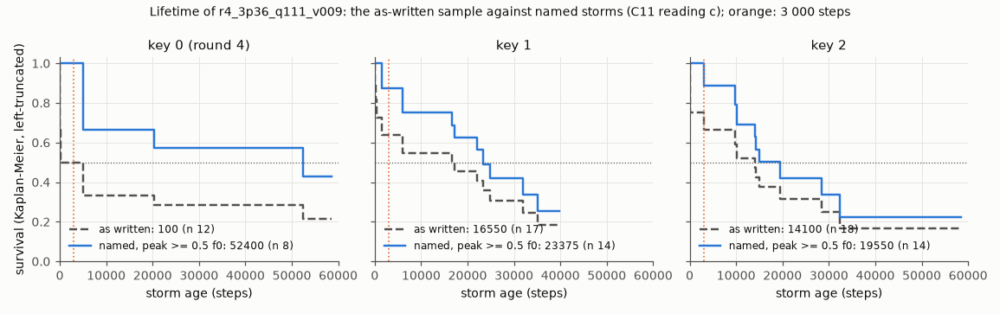
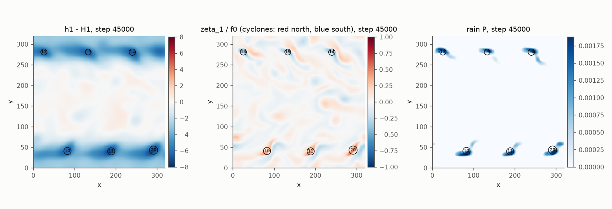
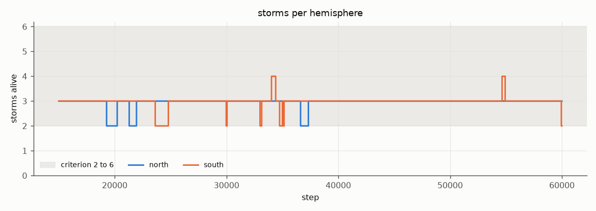
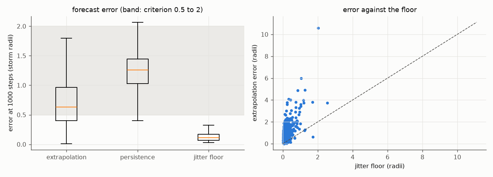
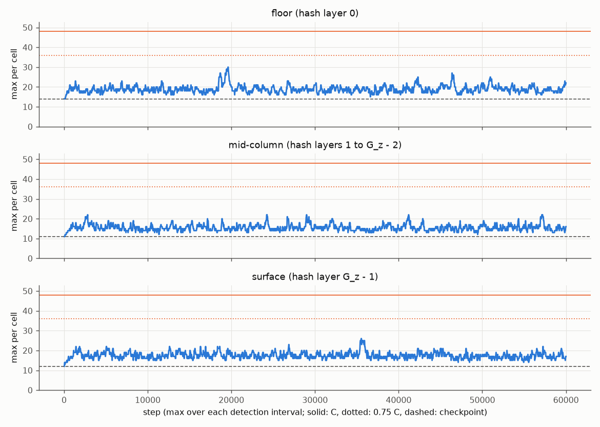
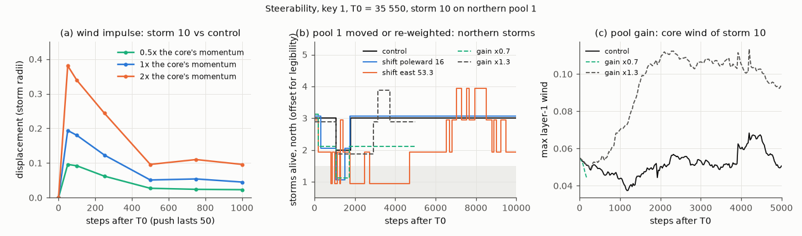

# W0 results: the model-B storm prototype

The offline weather prototype of `docs/STORMS.md` §8 step 1 (W0), tuned on the GPU and judged against the six exit
criteria the owner accepted as written on 2026-10-19. Written 2026-10-19. The model and its study driver are
`src/alife/weather.py` and `python -m alife.analysis.w0` (DESIGN Review-log row I46, built in the three commits
before this one). All runs used that code unchanged; this commit adds this note, its figures, the I46 status, the
STORMS §8 status line, and makes the confirmed set the `WeatherParams` defaults. **No engine change**: the step,
the config, the presets, the goldens and the digests are untouched. An adversarial review of these results
(2026-10-19) is applied in the next commit: the cost is quoted with the pool drift (§1, §3), a forecaster that
knows the drift is reported (§2.2), the lifetime and count are also read with storms named in real time (§2.1), and
the study driver's start-set comparisons are fixed (§10).

Every study ran 60,000 steps (spin-up 15,000, window 45,000) on the 160 × 160 grid, with the 44,912 agents of
`runs/64k3d_s0` at step 450,000 as passive tracers on exactly the agents' wind. The GPU is an Apple M5 Pro (MLX
0.32.3). The study outputs live in the session scratchpad (paths in §11), not in the repository.

## 1. Verdict

- **W0 does not pass as written: the cost criterion fails.** The confirmed set drifts its warm pools (D8), so its
  cost is the drift-on cost. The weather step plus the per-agent wind sampler costs (B) + (C) = **1.163 ms** per
  step against ≤ 1.0 ms ((B) 0.807 with `T_s = warm_pools(p, t)` in the graph + (C) 0.356), 16% over; in one
  compiled graph it is **1.131 ms**, 13% over. Each drift-on figure is a single run, not a median of 3. The CLI's
  `--bench` times a static pool map: **1.116 ms** (median of 3 benches, range 1.104 to 1.126 ms), 12% over; it is the
  secondary number (§3). All three fail.
- **Every other criterion passes on both confirmation keys** for the chosen set `r4_3p36_q111_v009`, with a clean
  health gate: 2 to 4 storms per hemisphere at every time, a named-storm median lifetime of 23,375 and 19,550 steps,
  a 1,000-step forecast error of 0.63 storm radii (jitter floor 0.11) with skill +0.50 and +0.48 over persistence,
  and tracer peaks of at most 30 against C = 48. Storm latitudes are reported. The forecast pass belongs to the
  extrapolation method of the spec, not to how hard the storms are to forecast (§2.2).
- **The lifetime is read under a coordinator ruling (C11, §2.1)**: on named storms, those whose peak vorticity
  reaches 0.5 f0 over the whole track (a reading made with hindsight). On keys 1 and 2 the chosen set also passes
  the lifetime as written (16,550 and 14,100), but it failed it on the tuning key 0 (100, from 3 short fragments),
  and on key 1 the southern hemisphere alone gives 1,575, so the as-written reading is not robust. **Named in real
  time instead, the lifetime still passes (22,125 and 14,175) but the count of named storms falls below 2 at 1.4% /
  7.9% (key 1, N / S) and 11.9% (key 2, N) of times (§2.1).**
- **The fallback to model A is not triggered.** Under the W0 spec §3.4 a cost-only failure is an engineering issue
  (fewer, fused kernels; the step is dispatch-bound, §3), not a reason to change the model. The early stop never
  fired (§7). Model B stands.
- **The storms are anchored to warm pools and move with them (D8, §2.2).** The pools drift west at 0.009 units per
  step; the storms follow at the pool speed. Their 1,000-step forecastability comes from that imposed drift, and it
  is easy: a forecaster that knows the drift errs by 0.33 radii at 1,000 steps, below the criterion's 0.5 lower
  bound. Once players learn the drift, forecasting is easier than the bound intends, so W3 and W4 must add
  uncertainty to storm motion (§2.2, §10). A storm is steered by moving or re-weighting its pool; a wind push of up
  to twice the core's momentum (a velocity increment of 0.017, against a core wind of 0.055) barely moves it (§5).
- **The decision left is the cost path**: fuse the step for W1 and re-measure, or a ruling that only the weather step
  (B) counts (0.76 ms; 0.81 ms with the pool drift in the graph), or a relaxed budget.

## 2. The exit criteria (STORMS §8)

The chosen set on its tuning key (0) and the two confirmation keys. Count = storms per hemisphere at every one of the
1,801 detection times of the window (D5), on all qualifying tracks (named or not). Forecast = median extrapolation
error at a 1,000-step lead in storm radii, read with D9 (in 0.5–2, above the jitter floor, positive skill over
persistence). Occupancy = window peak per hash cell, floor / mid-column / surface bands (hash layers 0, 1–11, 12).

| criterion (threshold) | key 0 (round 4) | key 1 | key 2 |
|---|---|---|---|
| 1. storms per hemisphere (2–6 at every time) | N 2–3, S 2–4, 100% | **pass**: N 2–3 (mean 2.95), S 2–4 (2.97), 100% | **pass**: N 2–3 (2.92), S 2–3 (2.99), 100% |
| 2. median lifetime, named storms (≥ 3,000; C11) | 52,400 (n 8, thin) | **pass**: 23,375 (n 14, readable) | **pass**: 19,550 (n 14, readable) |
| 3. forecast at 1,000 steps (0.5–2 radii, D9) | 0.590, floor 0.102, skill +0.52 | **pass**: 0.630, floor 0.110, skill +0.50 | **pass**: 0.626, floor 0.113, skill +0.48 |
| 4. tracer peak per hash cell (< 48 in each band) | 25 / 21 / 25 | **pass**: 30 / 22 / 26 | **pass**: 24 / 21 / 23 |
| 5. cost, (B) + (C) (≤ 1.0 ms) | — | **fail**: **1.163 ms** with the pool drift (0.807 + 0.356; 1.131 ms in one graph; single runs); 1.116 ms with a static pool map (CLI `--bench`, median of 3). Key independent | — |
| 6. storm latitudes (reported) | median pole distance 41.1 | 40.9; 0.24% within 16 of a pole | 41.1; none within 16 |
| health gate | clean | clean | clean |

Criterion 3 passes with the least-squares extrapolation of W0 spec §6. A forecaster that knows the pool drift errs by
only 0.33 radii at the same lead, below the 0.5 lower bound (§2.2), so the pass says little about how hard the storms
are to forecast.

The other finalist, `r4_4p36s26_q1115_v010` (4 pools per hemisphere, 26 × 16, `q_pool` 1.115, `vx` −0.01), also
passes every non-cost criterion under the ruling on both keys (count N 3–5, S 3–6; named-storm median 36,800 and
37,150; forecast 0.975 and 1.005, skill +0.22), but fails the as-written lifetime on every key (150, 300, 250). The
ruling's choice rule took the 3-pool set first because it passes.

### 2.1 The lifetime criterion: coordinator ruling C11

**The ruling.** The coordinator ruled on build finding 1 as C11, under the owner's delegation of 2026-10-19, **to be
revisited with the owner**. The criterion "median storm lifetime of at least 3,000 steps" is read on **named storms**
(reading (c)): qualifying tracks whose peak lower-layer vorticity reaches 0.5 f0. This is the analogue of naming a
tropical system once it reaches storm strength, and it is what the game will name and track. The median is the
study's left-truncated Kaplan–Meier median over those tracks. Reading (a) is the companion, and the as-written median
is reported beside both. The peak is taken over the whole track, so a storm is named with hindsight; the count
criterion (D5) is read on all qualifying tracks. The two criteria therefore use two storm definitions, and the owner
should see what naming in real time does (below).

**Why the as-written median is not used.** It counts every track of 3 or more detections as a storm. Most storms born
in the spin-up enter the left-truncated curve at ages of 13,000 or more (13 of the 18 qualifying ones over the three
keys; the other 5 enter at 2,100, 2,725, 3,350, 10,275 and 10,525), so at young ages mostly window births are at
risk, and two kinds of short track decide the median:
- shed polar fragments: split off the storms' trailing rain bands, peak 0.29–0.47 f0, living 50–525 steps;
- failed geneses: weak spin-ups at a vacant pool, peak 0.35–0.50 f0, ending within 1,000 steps.

A handful of these moves the median by two orders of magnitude: the chosen set gives 100 on key 0 (3 fragments among
6 window births, survival just before 3,000 exactly 0.5) and 16,550 and 14,100 on keys 1 and 2. In round 0 the start
set's median moved from 100 to 26,925 with the rain threshold alone (`p_th` 5e-4 against 1e-3). No detection
threshold that the ζ and rain histograms support removes the fragments without breaking real storms.

The pooled as-written median also hides a failing hemisphere on key 1: the southern median alone is 1,575 (n 11,
survival just before 3,000 0.500, readable with 5 at risk; the northern one is 35,100, thin). The criterion is
pooled, so the pass stands, but this supports the "not robust" reading.

| reading | key 0 | key 1 | key 2 |
|---|---|---|---|
| (c) named storms, peak ζ ≥ 0.5 f0 (**the criterion**) | 52,400 (n 8, thin) | 23,375 (n 14; S(3,000⁻) 0.875) | 19,550 (n 14; 1.000) |
| (a) share of window detections in storms living ≥ 3,000 (companion; pass > 1/2) | 99.6% | 99.1% | 99.9% |
| (b) `min_dets` 12 (reported) | 52,400 (thin) | 22,100 | 19,550 |
| as written, `min_dets` 3 (reported, not used) | 100 (not readable) | 16,550 (n 17; 0.636) | 14,100 (n 18; 0.750) |

- Reading (c) passes on all three keys at every naming cut from 0.40 to 0.60 f0 (keys 1 and 2 also at 0, which is
  the as-written sample). The 4-pool set needs a cut of at least 0.45 f0: two of its failed geneses peak at 0.496.
- One named storm in the chosen set's sample died young: track 15 (south, key 1), 1,575 steps, peak 0.504 f0.
- In wall-clock terms the named-storm medians are 27.1 and 22.6 min at 14.4 steps/s (13.0 and 10.9 min at 30).

**Naming in real time (for the owner's revisit of C11).** A game cannot name a storm by its future peak. Name it from
its first detection with ζ ≥ 0.5 f0 instead, with its age counted from then (same tracks, same window times;
recomputed from `tracks.csv` and `storms.csv`):

| reading | key 1 | key 2 |
|---|---|---|
| median lifetime, named with hindsight (C11) | 23,375 | 19,550 |
| median lifetime, named in real time | 22,125 (n 14) | 14,175 (n 14) |
| named storms per hemisphere below 2 (of 1,801 times), with hindsight | 0 | 0 |
| named storms per hemisphere below 2, in real time | N 1.4% (26 times), S 7.9% (142) | N 11.9% (214), S 0% |

- The lifetime still passes, but the count of named storms drops below 2: before a young storm reaches 0.5 f0 it
  is not yet a named storm. The count criterion as written (all qualifying tracks) is unaffected (minimum 2). If
  the game's storm list is the named one, the chosen set fails a count of 2 at up to 11.9% of times.
- The 4-pool finalist passes under every one of these readings (named storms per hemisphere never below 3; real-time
  lifetime 35,925 and 42,325, the second thin with 3 at risk). It fails the lifetime as written.

### 2.2 Storms are anchored to warm pools and move with them (D8)

Pool drift (D8, the spec's last-resort mobility lever) is accepted by the coordinator as the mobility lever. Stated
plainly: **the storms do not translate on their own. Each sits on a warm pool and moves with it.**
- In 13 parameter sets without drift (rounds 0–1) no set produced steady motion: forecast skill was negative in the
  12 that had forecast origins (the best is −0.115; `q_pool` 1.05 had none). Anchored storms wobble and
  reverse on 750–1,500 steps; mobile ones (closed supersaturated bands) fragment and merge.
- With drift the storms move at the pool speed: −0.0090 and −0.0091 units per step on keys 1 and 2, against `vx`
  −0.009. 99–100% of detections are within 16 units of their pool centre, 5.5 units east of it (trailing) and 3
  poleward.
- The drift per 1,000 steps (1.20–1.26 radii) and the positive skill (+0.48 to +0.50) both come from the pools'
  steady motion. A storm's track is its pool's track plus a smaller displacement: over 1,000 steps the median
  storm-minus-pool displacement is 0.33 radii. The 0.63 radii of the forecast criterion is not that displacement but
  the error of the least-squares extrapolation (below).
- The pools circle the planet once in 35,556 steps (41 min at 14.4 steps/s).
- **A forecaster that knows the drift beats the criterion's lower bound.** Predict x(t0) + (−9, 0) over 1,000 steps
  (persistence plus the pool velocity −0.009 × 1,000) on the same origins as the criterion (1,002 on key 1, 1,008 on
  key 2): the median error is **0.325 radii (key 1) and 0.329 (key 2)**, below the 0.5 lower bound, with skill +0.74
  and +0.73 over persistence (recomputed from `tracks.csv`). The 0.63 and 0.626 of the criterion belong to the
  least-squares line of W0 spec §6 through the last 250 steps, whose fitted velocity departs from the pool's and is
  carried over a lead four times the fit span. A longer fit window helps little (key 1: 0.63, 0.63, 0.62 and 0.54 at
  windows of 250, 500, 1,000 and 2,000 steps). The D9 reading passes as specified (floor 0.110 and 0.113, skill +0.50
  and +0.48), but the floor cannot see this: it assumes white centroid noise and reads low for an anchored storm
  (the `forecast_stats` docstring). **Consequence:** once players learn the drift, forecasting is easier than the 0.5
  lower bound intends. W3 and W4 must add uncertainty to storm motion (for example meandering or a variable pool
  drift); see §10.
- When a storm dies it dies on its pool (peak ζ about 0.36 f0 at the end, still attached), and the pool grows a
  replacement after 100–1,025 steps: 8 such deaths on key 1, 9 on key 2. This life cycle is what makes the
  as-written lifetime pass on keys 1 and 2.

*Key 1 at step 45,000: layer-1 thickness anomaly, vorticity and rain, with storm ids. Three storms per hemisphere,
one per pool, each with a trailing rain band.*

### 2.3 Margins

- **The count has no margin at its lower bound.** The minimum is 2 per hemisphere on both keys; 2 storms occur at
  5.1% (N) and 4.0% (S) of times on key 1, 8.3% and 0.6% on key 2, during re-genesis gaps. The neighbouring set
  `r3_3p36_q111_v010` (`vx` −0.01) failed the count on key 0 at 3 of 1,801 times. The 4-pool set has a margin of 1 at
  both bounds.
- **The forecast is 0.13 radii above its lower bound** on both keys; leads 250 and 500 give 0.143 and 0.298 radii.
  A forecaster that knows the pool drift is 0.17 radii below the bound (0.33; §2.2).
- **Occupancy is not limiting**: peaks 21–30 against 48, near the 19 / 16.5 / 19 that the tracer turnover alone
  produces without wind (median of 20 draws); on key 1 no cell passed 0.75 C at any step.
- **Intensity is bounded and modest**: core wind p50 / p90 / max 0.052 / 0.061 / 0.081 (key 1), below the 0.1–0.2 of
  STORMS §4, which is not an exit criterion. The `m` limiter never engaged (`eps_local` max 0.915).

## 3. Cost

The settings are W0 spec §7's: compiled, `debug=False`, 200 warm-up steps, 2,000 steps per timing, M = 65,536
positions. Times in ms per step. **The criterion value of the confirmed set is the drift-on cost**, because the set
drifts its pools (D8) and round 4 decided that the bench runs on the final set with drift on. The CLI's `--bench`
times a static pool map (`default_forcing(p)`), so its figure is the secondary number.

| measurement | (B) | (C) | **(B) + (C)** | over 1.0 ms |
|---|---|---|---|---|
| **with the pool drift, timed apart** (`bench_supp.json`, `bench_supp2.json`; single runs) | 0.807 | 0.356 | **1.163** (1.1636 from the unrounded timings) | 16% |
| **with the pool drift, one compiled graph** (the W1 shape; single run) | — | — | **1.131** | 13% |
| static pool map, the CLI `--bench`, GPU, median of 3 benches (secondary) | 0.752–0.768 | 0.352–0.358 | 1.104 / 1.116 / 1.126 (median **1.116**) | 12% |

Each drift-on figure is a single run, not a median of 3; three drift-on benches would pin them down. The verdict
does not depend on it: every measurement of every form is above 1.0 ms.

The CLI bench in full (static pool map):

| measurement | (B) step, chained | (C) sampler, chained | **(B) + (C)** | (A) step, synced (median) |
|---|---|---|---|---|
| GPU, 3 benches | 0.752–0.768 | 0.352–0.358 | **1.104 / 1.116 / 1.126** (median 1.116) | 0.86–0.88 |
| CPU (`--device cpu`) | 5.01 | 7.16 | 12.18 | 4.94 |

(A) and (B) evaluate the state and every diagnostic; (C) is `wind_fields`, `sample_wind`, `alpha`, the clips and the
tracer position update. Peak memory 0.16–0.21 GB on the GPU.

- **No other alife process ran; "idle GPU" is not established.** The check recorded was
  `pgrep -fl "alife|python -m alife"`, empty before each bench, so no other alife process ran; an LM Studio model
  was loaded but idle. The bench logs hold no other evidence (no GPU-use reading). The three benches agree within 2%
  and the later in-process static references (0.754 and 0.757 ms) agree with (B), so contention is unlikely to
  explain the miss; bench 3's synced (A) p90 of 1.096 ms against a median of 0.860 does show outliers.
- **(C) is timed on a fixed weather state** (the end of (B)), not on a state that advances outside the timed region
  as W0 spec §7 writes it (build deviation 15). The cost is state independent, and (C) builds `wind_fields` at
  every call, which W1 would do once per step, so (C) is conservative.

Supplementary GPU timings (same method, same process; scratch tools `bench_supp.py`, `bench_supp2.py`):

| timing | ms per step |
|---|---|
| (B) with the drifting `T_s = warm_pools(p, t)` inside the compiled graph (the W1 form) | 0.807 (static map 0.754) |
| step + diagnostics fold + sampler in **one** compiled graph, M = 65,536 (the W1 shape) | 1.095 with a static map, **1.131** with drift |
| the same at M = 8,192 | 1.073, with drift 1.123 |
| (B) at n = 80 / 160 / 320 (dx 2, pools scaled) | 0.763 / 0.754 / 1.191 |
| (C) at M = 8,192 / 65,536 | 0.307 / 0.356 |
| (C) with the wind fields built outside the timed graph; `wind_fields` alone | 0.326; 0.030 |

- **The layer is dispatch-bound, not size-bound.** Halving the grid does not lower (B); an eighth of the agents
  saves 14% of (C). The lever is fewer and fused kernels (the halo, stacking the layer fields), not a smaller grid.
- **The CLI's `--bench` times a static warm-pool map.** With drift on, the W1-relevant figure is 1.131 ms in one
  graph, or 0.807 + 0.356 = 1.163 ms timed apart (see the table above).
- If the sampler is ruled outside the 1 ms (W0 spec §7 allows the coordinator that ruling), (B) passes at 0.76 ms
  (0.81 with drift).

## 4. Deliverables (STORMS §8)

**Parameters.** The confirmed set is §9's table; it is now `WeatherParams()` (hash `7832e060`).

**Storm drift per 250 steps** (key 1, 10,469 pairs): magnitude median 2.43 units (0.322 radii), p90 3.67 units
(0.51 radii); zonal median −2.24 (east +), poleward median +0.05. North and south agree (2.41 and 2.46 units). The
zonal part is the pool drift (−0.009 × 250 = −2.25).

**Movies** (key 1, last 10,000 steps, 100 frames at 8 fps, not in the repository): `h1.gif` (2.9 MB), `vort.gif`
(3.4 MB), `rain.gif` (0.9 MB), `tracers_hz0.gif`, `tracers_hz1_11.gif` and `tracers_hz12.gif` (1.4–1.6 MB), in
`final_study_k1/` (§11), with the four snapshot frames in `final_study_k1/frames/`.

**Cost**: §3.

**Wave speeds and cores** (key 1, 10,644 qualifying detections):

| quantity | value |
|---|---|
| `c_ext`, `c_bc`, `c_moist` | 0.900, 0.300, 0.177 |
| deformation radius `L_d` (pole / pools); moist `L_d,moist` | 12.0 / 18.5; 7.1 / 10.9 units (3.5 / 5.4 cells) |
| inertial period (pole / pools); potential intensity | 251 / 387 steps; 0.154 |
| Froude number `u/c_bc` in cores, p50 / p90 / max | 0.172 / 0.202 / 0.27 |
| `Δh₁/H₁` in cores, p50 / p90 / max | 0.041 / 0.056 / 0.117 |
| core wind p50 / p90 / max | 0.052 / 0.061 / 0.081 |
| max `(u₁ − u₂)²/(g′(h₁ + h₂))` (bound 1, gate 0.8) | 0.036; the exact 4 × 4 eigenvalue test found 0 complex of 38,400 |
| background wind outside storms, layer 1 / layer 2, p50 (p90) | 0.010 (0.021) / 0.007 (0.034) |
| jets: largest absolute time-mean zonal-mean wind ū, layer 1 / layer 2 | 0.015 at the equator / **0.050 at y 23** (key 2: 0.051 at y 297; 13 units equatorward of the pool rows); zonal-to-eddy KE 0.29 / **7.5** (key 2: 8.4). **The layer-2 jet is 5 times the background wind of about 0.01 in STORMS §4** (§9, §10) |

The 0.1–0.2 core winds of STORMS §4 are not reached (core p90 0.061). `c_bc` = 0.30 is inside the 0.2–0.4 that
those winds would need, so the shortfall is intensity, not wave speed.

**Wall-clock** (at 14.4 / 30 steps/s): the 60,000-step run is 69.4 / 33.3 min (spin-up 17.4 / 8.3, window 52.1 /
25.0). The named-storm median is 27.1 / 13.0 min (as written 19.2 / 9.2). Forecast leads 250 / 500 / 1,000 are 17 /
35 / 69 s at 14.4 steps/s. A 250-step drift interval is 17 / 8 s. `report.md` of each study has the full table.

**Storm-to-organism lifetime ratio.** The organism median age at death in `runs/64k3d_s0` over steps 450,000–500,000
is 492 steps (mean 996; 2,123,221 deaths, read from `deaths_0000450000_0000500000.npz`). STORMS §2's 700–950 is not
this median.

| storm lifetime (key 1) | over the organism median (492) | over the organism mean (996) |
|---|---|---|
| named-storm median 23,375 (C11) | 47.5 | 23.5 |
| as-written median 16,550 | 33.6 | 16.6 |

Key 2: 39.7 (named) and 28.7 (as written) over the median. A named storm lives 40 to 48 median organism lifetimes.

**Steerability**: §5.

## 5. Steerability (W0 spec §9a)

One key-1 study and 8 forks from its state at T0 = 35,550 (1 shared control, 3 impulses, 2 pool shifts, 2 gains; the
§9a budget). The control fork reproduces the study bitwise. Every experiment acts on storm 10, the storm of northern
pool 1: at T0 it is at (162.9, 39.9), `r_eq` 7.57, ζ_max 0.43 f0, wind 0.055, alive since step 20,225. T0 is a step
at which every drifting pool sits within 0.05 units of its step-0 centre, which the CLI's pool-shift readings assume
(§10).
Times are also given in seconds at 14.4 / 30 steps/s.

**Wind impulses** (a Gaussian disc of radius `r_eq` for 50 steps on both layers, pushing poleward, with 0.5×, 1×
and 2× the storm core's momentum, `|U|` 0.0043 / 0.0086 / 0.0171). The momentum is normalised as the scalar
Σ h|u|Δx² over the footprint, so 2× is a velocity increment of 0.017, about 30% of the storm's core wind of 0.055.
Displacement against the control, in radii:

| push | +50 | +250 (17 s) | +500 (35 s) | +1,000 (69 s) | survived | neighbours at +1,000 |
|---|---|---|---|---|---|---|
| 0.5× | 0.096 | 0.062 | 0.027 | 0.023 | yes | 0.002, 0.003 radii |
| 1× | 0.194 | 0.123 | 0.051 | 0.045 | yes | 0.004, 0.005 radii |
| 2× | 0.381 | 0.244 | 0.096 | 0.096 | yes | 0.008, 0.011 radii |

- The response is linear in the push and small, and mostly not in the push direction: at +50 the centroid moves west
  and equatorward, because the added velocity disc carries vorticity that shifts the vorticity-weighted centroid.
- The displacement falls from 0.096–0.381 radii at +50 to 0.027–0.096 at +500 and then stays at that level: it does
  not keep returning to the pool position. At 2× it is 0.096 / 0.110 / 0.096 radii at +500 / +750 / +1,000, east and
  poleward in about equal parts at +1,000. The two control neighbours (95 and 97 units away) do not move.

**Warm-pool shifts** (pool 1 moved at T0; the drift-aware re-reading agrees with the CLI on every number but one,
the poleward displacement lag: 175 steps in the CLI and in the drifting frame, 200 relative to the control):

| shift | displacement lag of storm 10 | storm 10 lost | genesis lag: first new track on the moved pool | northern storms below 2 |
|---|---|---|---|---|
| 16 units poleward (1 σy) | 175–200 steps (12–14 s / 6–7 s), up to 0.77 of the shift | +275 (19 s) | 1,500 steps (104 s / 50 s); grows to 0.85 f0 | 4.2% of times (17 times, 425 steps = 30 s / 14 s; +1,075 to +1,475) |
| 53.3 units east (half the pool spacing) | never within 10,000 (at most 0.05 of the shift) | +175 (12 s) | 1,275 steps (89 s / 43 s), merged into storm 11 after 125 | 29% of times (117 times, 2,925 steps = 203 s / 98 s; first at +800, last at +4,675) |

- The genesis lag is the first new track on the moved pool (build deviation 11: the first detection of a storm born
  after T0 inside the shifted pool's supersaturated footprint). W0 spec §9a words it as the first detection of any
  storm there, which is 25 steps for the poleward shift (storm 10 itself; also 25 in the control) and 1,275 for the
  east shift.
- Poleward: storm 10 follows the pool for 250 steps, then drops out of detection; a new storm forms on the moved pool
  and is alive at +10,000.
- East: storm 10 loses its supply and dies in place. The new storm merges into pool 2's storm, which grows to
  0.93 f0 and wind 0.132 (fork maxima 1.10 f0, 0.140) and sits between the two pools; pool 0's replacement storm is
  delayed from +1,775 (control) to +4,700.

**Warm-pool gains** (pool 1's amplitude at T0):

| gain | storms, all (north), at +2,000 / +5,000, against the control | storm 10 |
|---|---|---|
| ×0.7 | 5 vs 6 (−1) / 5 vs 6 (−1) | gone within 175 steps (12 s); nothing replaces it within 5,000: the peak `T_s` 0.70 is below the supersaturation threshold 0.732 |
| ×1.3 | 5 vs 6 (−1) / 6 vs 6 | intensifies: at +2,000 wind 0.108 vs 0.050, ζ 0.74 vs 0.45 f0, `r_eq` 14.8 vs 7.8; still 0.094 vs 0.051 at +5,000 |

The −1 at +2,000 under ×1.3 is pool 0's replacement born 1,150 steps later than in the control, not pool 1. Gain ×0.7
also leaves the northern hemisphere with one storm at 13% of the comparison times (26 times; +1,075 to +1,700,
45 s / 22 s), until pool 0's replacement arrives. No storm in any fork is limiter-bound (minimum `h₁` ≥ 20.7).

**For the game**: the wind impulse is not a steering lever at these magnitudes. The pool levers act within
175–1,500 steps (12–104 s at 14.4 steps/s): a pool gain ×1.3 doubles a storm's wind within 2,000 steps, a gain ×0.7
kills it, and a shift relocates genesis. Moving a pool too far can leave a hemisphere with one storm for minutes (the
east shift: 203 s at 14.4 steps/s), and removing a pool's supply (gain ×0.7) for 45 s.

## 6. Health

The gate (W0 spec §3.4) was clean on every confirmation run. Key 1: no safety clips, clamps, or flux-, condensation-,
relaxation- or evaporation-limited cells; hyperbolicity max 0.036 (gate 0.8), and the exact eigenvalue test, run on
the 16 most hyperbolic cells of each of the 2,400 snapshots (38,400 cells), found none complex; `eps_local` max 0.915
(< 1); mass drift 6.5e-7 (< 1e-5); moisture-budget residual −2.9e-8 of the total; 0%
limiter-bound detections (≤ 5%); Courant max 0.040 and speed max 0.082; grid-noise index 0.0065 (window median);
stationary over the last three 5,000-step blocks (spreads 0.027 / 0.039 / 0.012 in kinetic energy, rain and count).
Key 2 is equally clean (hyperbolicity 0.040, mass drift 7.3e-7, grid noise 0.0064). No agent-wind clip fired
(`u_max` and `w_edge` shares 0).

## 7. Tuning history

The budget was round 0 (5 runs), 4 rounds of 8, and the confirmation (4): **41 distinct studies of the 39–47
allowed**. Not counted against it: the five round-0 `r0_*_cal` re-reads, which were full 60,000-step GPU re-runs that
reproduce the round-0 trajectories exactly (the runs are deterministic) and only apply the calibrated detection
threshold, so 46 study runs were made in tuning. After it came the §9a study with its 8 forks and the deliverables
study (a repeat of the key-1 confirmation run with movies). No numerics round was run. Each round's table and
reasoning are in `rounds/round_k.md` (§11).

| round | what was tried | what it showed |
|---|---|---|
| 0 (5) | the start set; `q_pool` 1.05 and 1.15; the probe's broad-pool M set, bilinear and cubic | 1.05 forms almost no storm (0.03 per hemisphere on average); 1.10 anchors 2 permanent storms per hemisphere; broad pools make rain strips, not storms. **Numerics fixed at bilinear** (the spec's rule takes cubic only with a longer forced median and clean grid noise and stationarity: the cubic M median was 425 against 625 at the as-run threshold and 525 against 400 at the calibrated one, with 4.6× the grid noise and a non-stationary count); `ν` stays 0. **`zeta_th` lowered to 0.25 f0** (the lowest cut where the ζ mask is storm-dominated). Found that the as-written median is decided by shed fragments (build finding 1). |
| 1 (8) | ε 0.675 (`gamma` 21.6); gapped and banded broad pools; 3 pools at latitude 44; pools at latitude 36 | No steady translation anywhere (negative skill in all 12 sets of rounds 0–1 that had forecast origins; the best is −0.115). Latitude 36 gives compact, clean storms (`r1_e675_lat36_q110`: as-written median 5,575) but they are immobile and leave gaps in the count. Closed bands give roaming, short-lived storms. |
| 2 (8) | pool drift (D8) at 0.005–0.01; 3 pools per hemisphere at latitude 36 | Storms follow the pools exactly; skill positive in all 5 drifting runs (+0.12 to +0.61). The early stop did not fire (`r2_lat36_q110_v005` meets it). 3 pools at latitude 36 static: median 14,825, 0 splits. |
| 3 (8) | a supply × drift box on the 3-pool layout; 4 pools; start pools with drift | `q_pool` 1.11 is the ceiling for fragment-free storms: at 1.12 the `m` limiter engages and the storms split 21–26 times. `r3_3p36_q111_v010` failed only the count, at 3 of 1,801 times. |
| 4 (8) | 4-pool layouts with the 1.11 supply per pool; `vx` 0.009; `sy` 18; weaker seeds | All 8 pass the count. 4 pools give the widest margins but fail the as-written lifetime (75–275) on fragments. `r4_3p36_q111_v009` passes under every reading of finding 1 but as written (100, not readable). Weaker seeds steady the tracks but drop the forecast below 0.5. |
| confirmation (4) | the two finalists on keys 1 and 2 | Both pass under C11; the 3-pool set is chosen (§2). |

## 8. Deviations

- **D3, `q_pool` > 1** (STORMS §3.2 has `Q_e ≤ Q_s`): the chosen set has 1.11, so `Q_e > Q_s` where `T_s > 0.732`,
  an ellipse of about 1,099 units² per pool. With `Q_e ≤ Q_s` no storm formed in 7 probe runs: a steady core with
  ε < 1 needs evaporation inside the saturated core (W0 spec §3.2). In round 0, 1.05 formed almost none (0.03
  storms per hemisphere on average).
- **D7, the moist-thickness limiter** (`m = h₁ − γQ ≥ m_min = 1`, not in STORMS §3.2): on, as a MUST, against the
  grid-scale moist runaway the probe found. In the chosen set it **never engaged** on any key. Where it engaged (the
  4-pool sets and `q_pool` ≥ 1.12) it bounded the cores (0% limiter-bound) and went with fragment shedding: over rounds
  1–3, the 10 runs without it had 0–2 splits and 13 of the 14 with it had 13–279.
- **D8, pool drift** (a last resort): `vx` −0.009 on every pool. It is the source of the mobility (§2.2).
- **Detection**: `zeta_th` 0.25 f0 (0.00625) from round 0, unchanged after it. The naming cut 0.5 f0 is a host-side
  reading of the tracks (C11), not a model or detection parameter.
- **Numerics**: bilinear semi-lagrangian advection (no `sl_order` 3), `κ_d` 0.04, `ν` 0, as in the spec's start set.

## 9. What W1 inherits

**The parameter set** (`r4_3p36_q111_v009`, now the `WeatherParams` defaults; bold: changed from the spec's start
set, which stays available as `weather.START_SET`):

| group | values |
|---|---|
| grid, layers | `n` 160, `dx` 2, `dt` 1, `height` 80; `H1` 32, `H2` 48, `g_top` 9.18256e-3, `g_prime` 5.16862e-3, `h_min` 2 |
| rotation | `f0` 0.025 |
| moisture | `Qs` 1, **`gamma` 21.6** (ε 0.675), `tau_c` 8, `k_E` 0.1, `u_gust` 0.02, `q_bg` 0.70, **`q_pool` 1.11**, `m_min` 1 |
| relaxation, damping | `tau_rad` 2000, `r1` 2e-4, `c_d` 2e-3, `r2` 1e-4, `c_half` 1e-3 |
| numerics | `nu` 0, `kappa_d` 0.04, `sl_order` 1, `u_safe` 0.3 |
| **pools** | **3 per hemisphere, 32 × 16, amplitude 1, drift (−0.009, 0): north at y 36, x 53.333333 / 160 / 266.666667; south at y 284, x 0 / 106.666667 / 213.333333** |
| seeds | `seed_rate` 0.02, `seed_v` 0.02, `seed_sigma` 12, `seed_jitter` 0.5, `seed_q` 0, `seed_qsigma` 6, `seed_w2` 0 |
| agent wind | `alpha0` 0.25, `alpha1` 0.75, `u_max` 0.3, `w_edge` 0.03, `z_sl` 4 |
| detection | `detect_every` 25, **`zeta_th` 0.00625**, `p_th` 1e-4, `a_min` 25, `r_min` 4, `miss_grace` 2, `min_dets` 3; named storms: peak ζ ≥ 0.5 f0 |

The pool drift means `T_s` changes every step: W1 must build `warm_pools(p, t)` inside its compiled step from an
int32 step array (as the study does), not once.

**The costs** (§3): with the pool drift, 0.81 ms for the step and 0.36 ms for the sampler at 65,536 agents, 1.163 ms
timed apart or 1.131 ms in one graph (1.0 ms is the budget); with a static pool map 0.76 ms, 0.36 ms and 1.10–1.12 ms.
The layer is dispatch-bound. The CPU takes 12.2 ms. W1 should build the wind fields (`J`) once per step and pass them
to the sampler (`fields=`), and keep the rule that no array's roll is built twice in one compiled graph (MLX 0.32.3
duplicate-roll compile bug, strict xfail in `tests/test_weather.py`).

**The load-rule values** (STORMS §3.3; W0 spec §2.5 rule 16, with the 64k3d physics: gravity 0.015, buoyancy max
0.04, thrust max 0.1, drag 1, `r` 1, `k_repel` 0.08, `v_max` 0.5):

| value | rule | margin |
|---|---|---|
| α = 0.25 + 0.75·buoy_cap (α_max 1) | `α0 ≥ 0`, `α0 + α1 ≤ 1` | at the bound |
| `w_edge` 0.03 | `thrust_max + max(g, b_max − g) + α_max·drag·w_edge < 2r·k_repel`: 0.1 + 0.025 + 0.03 = 0.155 < 0.16 | 0.005 |
| `u_max` 0.3 | `(thrust_max + α_max·drag·u_max)/drag ≤ v_max`: 0.4 ≤ 0.5 | 0.1 |
| `z_sl` 4 | `0 < z_sl ≤ field_cell` (the floor field layer) | — |

**The layer-2 jet.** The time-mean zonal wind of layer 2 reaches −0.050 at y 23 (key 1; −0.051 at y 297 on key 2), 13
units equatorward of the pool rows, with a zonal-to-eddy kinetic energy of 7.5 and 8.4 (the start set had −0.041 and
3.5). That is 5 times the background wind of about 0.01 that STORMS §4's calibration row assumes outside storms, and
comparable to the organisms' own speeds (0.024–0.034) and to the storm core wind p50 (0.052). Agents above the layer
interface (`z_i` about 32 of 80) feel layer 2 directly (`_wind_formula`: `u_h` = layer 2's wind there, with no
near-ground profile). W1 and W2 should measure what the jet does to agents against the still-air and tracer controls,
and decide there whether it needs damping.

Measured on key 1 (181 snapshots and every tracer step): no `u_max` and no `w_edge` clip; `|u_h|` p99 0.054; mid-
column `|w|` max 0.061 (not clipped, as the spec writes it); no sample with `‖(u_h, w)‖ > u_max`. So the 3D norm
question of W0 spec §4 does not bind at these winds, and the floor and surface edges never needed the clip.

## 10. Open

- **C11 with the owner.** The named-storm reading is the coordinator's choice under the delegation, to be revisited.
  The as-written lifetime passes on the confirmation keys but not robustly (key 0 failed it; the southern hemisphere
  of key 1 alone gives 1,575). **Look at the real-time naming result of §2.1 when revisiting it**: C11 names storms
  by hindsight (the peak over the whole track); named in real time, the lifetime passes (22,125 and 14,175) but the
  count of named storms per hemisphere falls below 2 at 1.4% to 11.9% of times, and the count criterion itself is
  read on all qualifying tracks, a different storm definition.
- **The cost.** 1.163 ms with the pool drift (1.131 ms in one graph), against 1.0 ms; 1.116 ms with the static map of
  the CLI bench. Kernel fusion for W1, or a ruling on the sampler or the budget. The drift-on figures are single
  runs; take 3 drift-on benches when the cost is next measured.
- **Mobility is imposed.** Storms cannot leave their pools; their motion and their forecastability are the pools'.
  If the game needs storms that roam on their own, that is open: in 13 sets without drift none did without
  fragmenting.
- **Storm motion needs uncertainty (W3, W4).** A forecaster that knows the pool drift predicts a storm's position at
  1,000 steps to 0.33 radii (§2.2), below the 0.5 lower bound that the criterion sets so that forecasting is not
  trivial. The criterion passes only through its least-squares method. Once players learn the drift, forecasting is
  easier than intended, so W3 and W4 must add uncertainty to storm motion, for example meandering or a variable pool
  drift, and re-check the forecast reading against a drift-aware forecaster.
- **The layer-2 jet** (−0.05, 5 times STORMS §4's background wind; §9) is carried to W1 and W2 to measure against the
  controls.
- **The count's lower bound** is held with no margin (2 storms at up to 8.3% of times). A 4-pool layout buys margin
  at the cost of fragments and a weaker forecast skill (+0.22).
- **Core winds** of 0.05–0.08 are below STORMS §4's 0.1–0.2; W1's wind force and the storm hazard should be sized on
  the measured winds.
- **Study-driver follow-ups** (`analysis/w0.py`):
  - fixed with the review of these results: the report's "detection thresholds changed" line compares with
    `weather.START_SET` (it compared with `WeatherParams()`, which listed nothing for a confirmed-set study and
    `zeta_th` 0.0075 for a start-set one); a `--params` file is a sparse override of `START_SET` (the tuning rounds'
    files were written against it: all 43 resolve to their runs' recorded sets, where only 33 would against the new
    defaults), and without `--params` the base is the defaults; the `--params` help says so; tests cover both;
  - not patched: the pool-shift readings use the pools' step-0 centres; with drift they need the centres at t, and the
    displacement taken against the control track (this run is unaffected, see §5);
  - not patched: `--bench` times a static warm-pool map; with drift (B) is 0.05 ms more.
- **Spec text to carry over** (build notes): the tracker's tie rule for splits, the `miss_grace` reading (two misses
  tolerated), test 6b's beta-plane bound (the 160 × 160 table gives 2,025 steps with the default numerics), and the
  `analysis/__init__.py` docstring.
- **Not measured in W0**: the floor-held tracer arm, and agent (not tracer) occupancy, which W1 and W2 measure. (W1 built
  the measurement, the `weather` block's `occ_hz*` keys and `max_occupancy`, with a pre-registered go/no-go for
  `cell_capacity`; the long GPU run that reads it is the coordinator's, DESIGN §30.8.)
- **The movies are not in the repository** and the scratchpad is temporary; they should be copied somewhere durable.
- ~~HANDOVER next steps and a CLAUDE.md line for W0 (W0 spec §1) are not in this commit.~~ Carried by the W1 change
  (stage 5): `CLAUDE.md` names W0 and W1, and `HANDOVER.md` has the storm-world state and next steps.

## 11. Files

Figures in `docs/w0/`: `lifetime_readings.png`, `frame_k1_45000.png`, `counts_k1.png`, `forecast_k1.png`,
`occupancy_k1.png`, `steerability_k1.png`.

Study outputs (session scratchpad, `scratchpad/w0/tuning/`; each study holds `report.md`, `metrics.json`,
`params.json`, `tracks.csv`, `storms.csv`, `timeseries.csv`, its figures and `frames/`):
- `final.md` (cost, steerability, the deliverables study) and `rounds/round_0.md` … `round_4.md`,
  `rounds/confirmation.md`;
- the deliverables study with movies: `final_study_k1/`;
- the benches: `final_bench_gpu_{1,2,3}/`, `final_bench_cpu/`, `final_bench_supp/`, `final_bench_supp2/`;
- the adversarial review of these results and what was done with each finding: `review.md`, `review_disposition.md`;
- steerability: `final_steer_k1/` (the CLI's readings in its `report.md`) and `final_steer_k1_forks/` (`forks.json`,
  `steer_drift.json`);
- confirmation: `cf_r4_3p36_q111_v009_k{1,2}/`, `cf_r4_4p36s26_q1115_v010_k{1,2}/`; tuning: `r0_*` … `r4_*`;
- parameter files `params/`, readout tools `tools/`, logs `logs/`.
